# Web 应用测试执行报告

- 生成时间：2026-10-29T18:29:36+08:00
- 运行 ID：`RUN-20261029-02`
- 目标：https://demo.playwright.dev/todomvc
- 状态：**通过**
- 阶段：executed
- 执行窗口：2026-10-29T17:22:08+08:00 → 2026-10-29T17:22:18+08:00

## 1. 测试目标

验证 `https://demo.playwright.dev/todomvc` 的核心交互、输入边界、状态过滤与失败取证链路。本报告只陈述本机实际执行且能在证据清单中追溯的结果。

## 2. 测试环境

| 项目 | 值 |
|---|---|
| python | 3.13.9 |
| platform | Windows-11-10.0.26340-SP0 |
| pytest | pytest |
| target | https://demo.playwright.dev/todomvc |
| 证据清单 | `evidence/manifest.json` |

### 运行备注

- 2026-10-29T17:22:08+08:00：pytest started
- 2026-10-29T17:22:18+08:00：pytest exit=0; total=8; failed=False; xfailed=True
- 2026-10-29T17:22:18+08:00：pytest exit=0; tests=8; failures=0; errors=0; xfailed=1; elapsed=10.62s
- 2026-10-29T17:28:39+08:00：TC-TODO-099 为受控预期失败，仅验证失败截图/源码/日志链路，不是产品缺陷；TC-TODO-008/009/010/012 未执行，按用例设计文档标注为缺口。
- 2026-10-29T17:28:44+08:00：浏览器/MCP 证据采集于 17:15-17:18，Selenium 运行于 17:22；为统一验收登记到本运行，原始路径保留采集运行 RUN-20261029-01，未复制/覆盖原图。
- 2026-10-29T17:29:27+08:00：用例计数口径：manifest 通过 9 = pytest 通过 7 + 浏览器/视觉验收登记 2（TC-BROWSER-001、TC-VISUAL-001，非 pytest 用例）；pytest 结果以 JUnit 为准 tests=8, failures=0, errors=0, xfailed=1（JUnit 记为 skipped），xfail 不计入通过率。
- 2026-10-29T17:32:34+08:00：计数口径更新（覆盖 17:29 的旧口径）：manifest 登记 11 条 = 通过 10 + 受控预期失败 1；其中 JUnit 支撑 8 条（7 passed + 1 xfailed），非 JUnit 验收登记 3 条（TC-BROWSER-001、TC-VISUAL-001、TC-VISION-001）。xfail 不计入通过率。

## 3. 测试范围与策略

- 浏览器探索优先使用 DOM/无障碍快照，截图只用于视觉证据。
- 功能用例使用 Selenium + pytest + 显式等待，断言直接绑定可观察状态。
- 失败与受控预期失败自动保存视口/整页截图、页面源码和浏览器日志。
- 视觉差异只作为复核信号，不单独据此判定产品缺陷。

## 4. 测试用例与执行结果

计数口径：manifest 登记用例 11 条（通过 10、受控预期失败 1、失败 0）；其中 8 条由 JUnit 支撑（tests=8、passed=7、failed=0、xfailed=1），3 条为浏览器/视觉验收登记（TC-BROWSER-001, TC-VISION-001, TC-VISUAL-001），不计入 pytest 通过率。

| 用例 ID | 标题 | 状态 | 证据数 | 日志 |
|---|---|---|---:|---|
| TC-BROWSER-001 | 浏览器探索、交互与截图能力验收 | 通过 | 9 | `evidence/logs/RUN-20261029-02/TC-BROWSER-001.log` |
| TC-TODO-001 | 新增一条待办 | 通过 | 3 | `evidence/logs/RUN-20261029-02/TC-TODO-001.log` |
| TC-TODO-002 | 完成待办并按状态过滤 | 通过 | 2 | `evidence/logs/RUN-20261029-02/TC-TODO-002.log` |
| TC-TODO-003 | 编辑待办标题 | 通过 | 1 | `evidence/logs/RUN-20261029-02/TC-TODO-003.log` |
| TC-TODO-004 | 删除待办 | 通过 | 2 | `evidence/logs/RUN-20261029-02/TC-TODO-004.log` |
| TC-TODO-005 | 空与纯空白输入被拒绝 | 通过 | 1 | `evidence/logs/RUN-20261029-02/TC-TODO-005.log` |
| TC-TODO-006 | 输入长度边界 | 通过 | 1 | `evidence/logs/RUN-20261029-02/TC-TODO-006.log` |
| TC-TODO-007 | HTML/脚本文本被转义 | 通过 | 1 | `evidence/logs/RUN-20261029-02/TC-TODO-007.log` |
| TC-TODO-099 | 受控失败断言 | 受控预期失败 | 4 | `evidence/logs/RUN-20261029-02/TC-TODO-099.log` |
| TC-VISION-001 | 模型图像输入与视觉理解能力验收 | 通过 | 1 | `evidence/logs/RUN-20261029-02/vision-check-utf8.log` |
| TC-VISUAL-001 | 截图差异检测、区域定位、裁剪与标注 | 通过 | 8 | `evidence/logs/RUN-20261029-02/TC-VISUAL-001.log` |

## 5. 用例明细

### TC-BROWSER-001 浏览器探索、交互与截图能力验收

- 状态：**通过**
- 预期：打开 TodoMVC，获取无障碍快照，输入 Acceptance todo，列表出现该文本；视口/整页/元素截图与 MCP 截图均可读取。
- 实际：页面标题 React • TodoMVC；输入后列表出现 Acceptance todo；CLI 与 MCP 截图均为有效 PNG；Playwright MCP 工具列表 25 个。
- 执行日志：`evidence/logs/RUN-20261029-02/TC-BROWSER-001.log`

**步骤**
1. playwright-cli 打开 https://demo.playwright.dev/todomvc
2. 获取页面无障碍快照并确认输入框 ref
3. 输入 Acceptance todo 并回车
4. 再次获取快照，确认列表出现该文本
5. 保存视口、整页、待办项元素、状态栏元素截图
6. 独立启动 Playwright MCP，调用 browser_navigate、browser_snapshot、browser_take_screenshot

**证据**

- [snapshot] `evidence/raw/RUN-20261029-01/exploration/snapshot.yml`  
- [snapshot] `evidence/raw/RUN-20261029-01/exploration/after-add.yml`  
- [screenshot] 1280x720 `evidence/raw/RUN-20261029-01/browser/viewport.png`  
  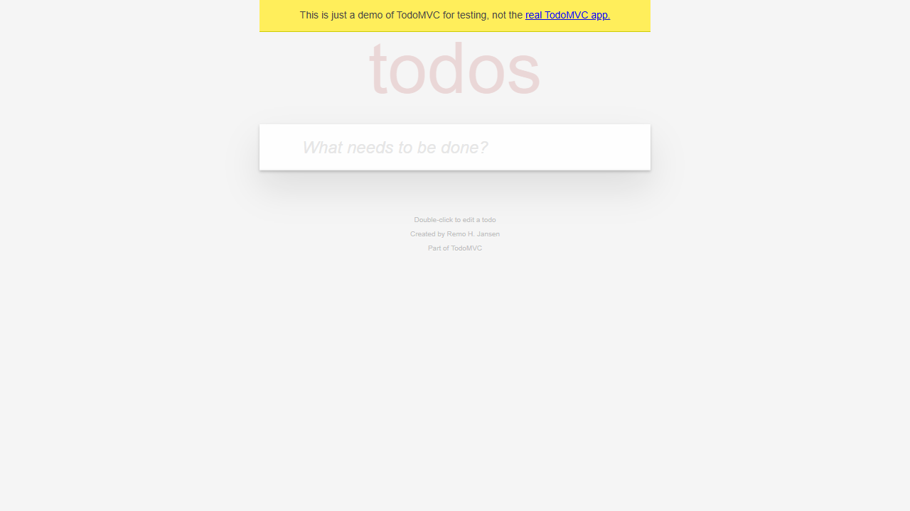
- [fullpage-screenshot] 1280x720 `evidence/raw/RUN-20261029-01/browser/fullpage.png`  
  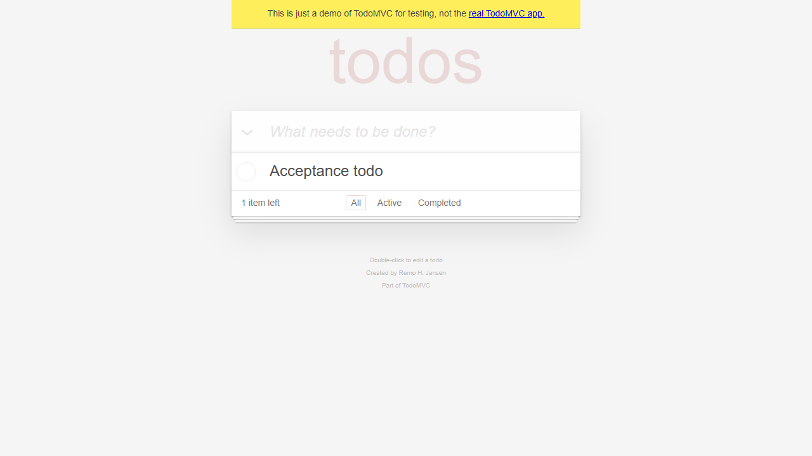
- [element-screenshot] 550x59 `evidence/raw/RUN-20261029-01/browser/element-todo-item.png`  
  
- [element-screenshot] 550x42 `evidence/raw/RUN-20261029-01/browser/element-footer.png`  
  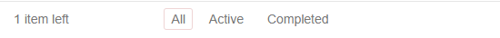
- [screenshot] 1280x720 `evidence/raw/RUN-20261029-01/mcp/mcp-screenshot.png`  
  
- [snapshot] `evidence/raw/RUN-20261029-01/mcp/mcp-snapshot.yml`  
- [log] `evidence/raw/RUN-20261029-01/mcp/mcp-smoke.json`  

### TC-TODO-001 新增一条待办

- 状态：**通过**
- 耗时：1925 ms
- 预期：True
- 实际：断言通过
- 执行日志：`evidence/logs/RUN-20261029-02/TC-TODO-001.log`

**步骤**
1. 打开 TodoMVC 演示页
2. 在新增输入框中输入 Buy milk 并回车

**断言**

| # | 断言 | 预期 | 实际 | 结果 |
|---:|---|---|---|---|
| 1 | 待办列表包含新增项 | ['Buy milk'] | ['Buy milk'] | 通过 |
| 2 | 剩余计数为 1 | 1 item left | 1 item left | 通过 |
| 3 | 底部状态栏可见 | True | True | 通过 |

**证据**

- [element-screenshot] 550x59 `evidence/raw/RUN-20261029-02/TC-TODO-001/TC-TODO-001__case__element__20261029T092211-112.png`  
  
- [fullpage-screenshot] 1262x748 `evidence/raw/RUN-20261029-02/TC-TODO-001/TC-TODO-001__case__fullpage__20261029T092211-218.png`  
  
- [screenshot] 1262x748 `evidence/raw/RUN-20261029-02/TC-TODO-001/TC-TODO-001__final__viewport__20261029T092211-289.png`  
  

### TC-TODO-002 完成待办并按状态过滤

- 状态：**通过**
- 耗时：681 ms
- 预期：['Task B']
- 实际：断言通过
- 执行日志：`evidence/logs/RUN-20261029-02/TC-TODO-002.log`

**步骤**
1. 新增 Task A 与 Task B
2. 勾选第一条待办
3. 切换到 Completed 过滤器
4. 切换到 Active 过滤器

**断言**

| # | 断言 | 预期 | 实际 | 结果 |
|---:|---|---|---|---|
| 1 | 完成后剩余计数为 1 | 1 item left | 1 item left | 通过 |
| 2 | Completed 仅显示已完成项 | ['Task A'] | ['Task A'] | 通过 |
| 3 | Active 仅显示未完成项 | ['Task B'] | ['Task B'] | 通过 |

**证据**

- [fullpage-screenshot] 1262x748 `evidence/raw/RUN-20261029-02/TC-TODO-002/TC-TODO-002__Active__fullpage__20261029T092212-060.png`  
  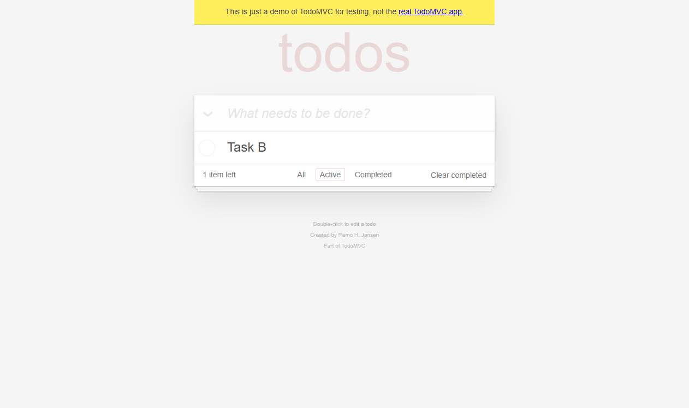
- [screenshot] 1262x748 `evidence/raw/RUN-20261029-02/TC-TODO-002/TC-TODO-002__final__viewport__20261029T092212-127.png`  
  

### TC-TODO-003 编辑待办标题

- 状态：**通过**
- 耗时：775 ms
- 预期：['New title']
- 实际：断言通过
- 执行日志：`evidence/logs/RUN-20261029-02/TC-TODO-003.log`

**步骤**
1. 新增 Old title
2. 双击标题并改为 New title

**断言**

| # | 断言 | 预期 | 实际 | 结果 |
|---:|---|---|---|---|
| 1 | 标题被更新 | ['New title'] | ['New title'] | 通过 |

**证据**

- [screenshot] 1262x748 `evidence/raw/RUN-20261029-02/TC-TODO-003/TC-TODO-003__final__viewport__20261029T092213-010.png`  
  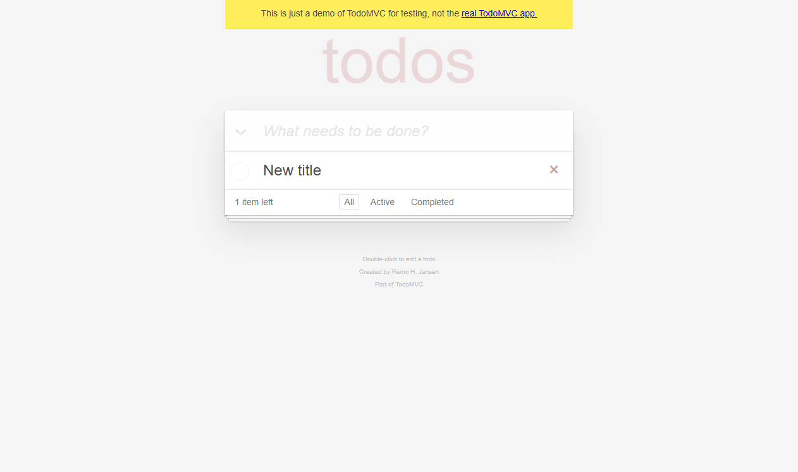

### TC-TODO-004 删除待办

- 状态：**通过**
- 耗时：764 ms
- 预期：False
- 实际：断言通过
- 执行日志：`evidence/logs/RUN-20261029-02/TC-TODO-004.log`

**步骤**
1. 新增 Delete me
2. 悬停并点击删除按钮

**断言**

| # | 断言 | 预期 | 实际 | 结果 |
|---:|---|---|---|---|
| 1 | 列表被清空 | [] | [] | 通过 |
| 2 | 无待办时底部状态栏隐藏 | False | False | 通过 |

**证据**

- [fullpage-screenshot] 1262x748 `evidence/raw/RUN-20261029-02/TC-TODO-004/TC-TODO-004__case__fullpage__20261029T092213-817.png`  
  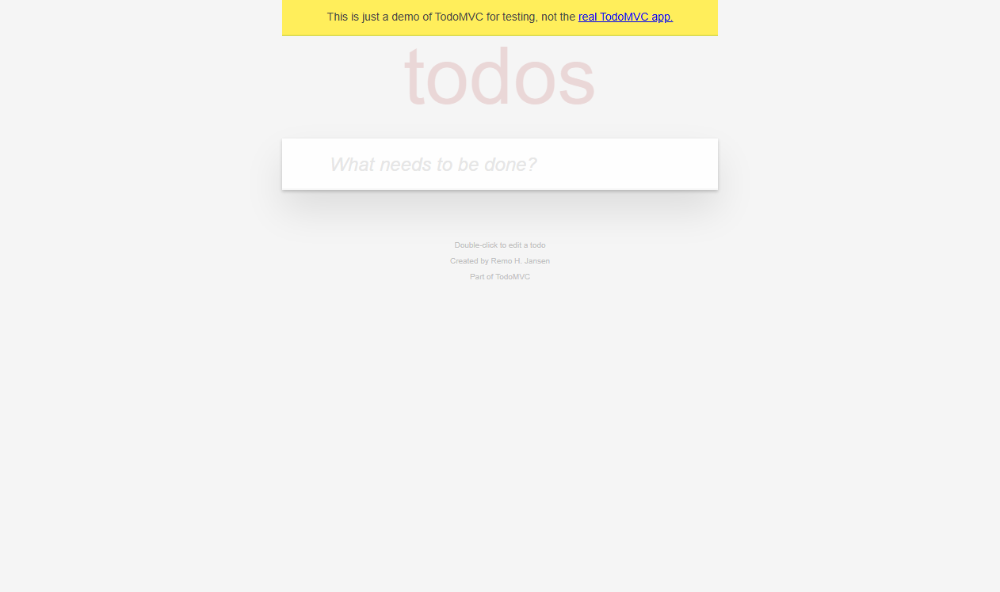
- [screenshot] 1262x748 `evidence/raw/RUN-20261029-02/TC-TODO-004/TC-TODO-004__final__viewport__20261029T092213-889.png`  
  

### TC-TODO-005 空与纯空白输入被拒绝

- 状态：**通过**
- 耗时：348 ms
- 预期：[]
- 实际：断言通过
- 执行日志：`evidence/logs/RUN-20261029-02/TC-TODO-005.log`

**步骤**
1. 直接回车，不输入内容
2. 输入三个空格并回车

**断言**

| # | 断言 | 预期 | 实际 | 结果 |
|---:|---|---|---|---|
| 1 | 空输入不新增待办 | [] | [] | 通过 |
| 2 | 纯空白输入不新增待办 | [] | [] | 通过 |

**证据**

- [screenshot] 1262x748 `evidence/raw/RUN-20261029-02/TC-TODO-005/TC-TODO-005__final__viewport__20261029T092214-340.png`  
  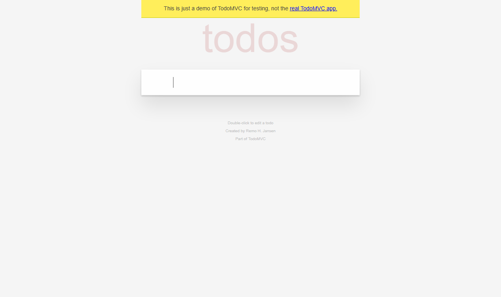

### TC-TODO-006 输入长度边界

- 状态：**通过**
- 耗时：491 ms
- 预期：['A', 'BBBBBBBBBBBBBBBBBBBBBBBBBBBBBBBBBBBBBBBBBBBBBBBBBBBBBBBBBBBBBBBBBBBBBBBBBBBBBBBBBBBBBBBBBBBBBBBBBBBBBBBBBBBBBBBBBBBBBBBBBBBBBBBBBBBBBBBBBBBBBBBBBBBBBBBBBBBBBBBBBBBBBBBBBBBBBBBBBBBBBBBBBBBBBBBBBBBBBBBB']
- 实际：断言通过
- 执行日志：`evidence/logs/RUN-20261029-02/TC-TODO-006.log`

**步骤**
1. 输入 1 个字符 A
2. 再输入 200 个字符

**断言**

| # | 断言 | 预期 | 实际 | 结果 |
|---:|---|---|---|---|
| 1 | 1 字符边界被接受 | ['A'] | ['A'] | 通过 |
| 2 | 200 字符输入被完整保存 | ['A', 'BBBBBBBBBBBBBBBBBBBBBBBBBBBBBBBBBBBBBBBBBBBBBBBBBBBBBBBBBBBBBBBBBBBBBBBBBBBBBBBBBBBBBBBBBBBBBBBBBBBBBBBBBBBBBBBBBBBBBBBBBBBBBBBBBBBBBBBBBBBBBBBBBBBBBBBBBBBBBBBBBBBBBBBBBBBBBBBBBBBBBBBBBBBBBBBBBBBBBBBB'] | ['A', 'BBBBBBBBBBBBBBBBBBBBBBBBBBBBBBBBBBBBBBBBBBBBBBBBBBBBBBBBBBBBBBBBBBBBBBBBBBBBBBBBBBBBBBBBBBBBBBBBBBBBBBBBBBBBBBBBBBBBBBBBBBBBBBBBBBBBBBBBBBBBBBBBBBBBBBBBBBBBBBBBBBBBBBBBBBBBBBBBBBBBBBBBBBBBBBBBBBBBBBBB'] | 通过 |

**证据**

- [screenshot] 1262x748 `evidence/raw/RUN-20261029-02/TC-TODO-006/TC-TODO-006__final__viewport__20261029T092214-922.png`  
  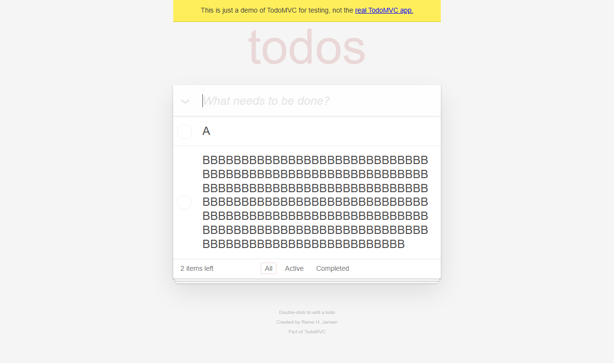

### TC-TODO-007 HTML/脚本文本被转义

- 状态：**通过**
- 耗时：536 ms
- 预期：None
- 实际：断言通过
- 执行日志：`evidence/logs/RUN-20261029-02/TC-TODO-007.log`

**步骤**
1. 输入包含 HTML 事件属性的文本

**断言**

| # | 断言 | 预期 | 实际 | 结果 |
|---:|---|---|---|---|
| 1 | HTML 文本按纯文本展示 | [''] | [''] | 通过 |
| 2 | 未执行注入脚本 | None | None | 通过 |

**证据**

- [screenshot] 1262x748 `evidence/raw/RUN-20261029-02/TC-TODO-007/TC-TODO-007__final__viewport__20261029T092215-539.png`  
  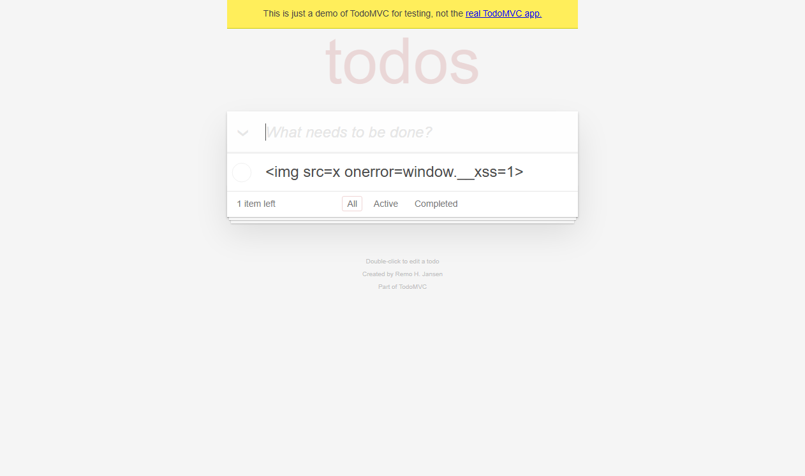

### TC-TODO-099 受控失败断言

- 状态：**受控预期失败**
- 耗时：504 ms
- 预期：2 items left
- 实际：tests\test_todomvc_expected_failure.py:22: in test_expected_failure_captures_evidence
    case_ctx.check(page.count_text().startswith("2"), "受控失败断言", "2 items left", page.count_text())
tests\conftest.py:307: in check
    raise AssertionError(f"{name}: expected={expected!r} actual={actual!r}")
E   AssertionError: 受控失败断言: expected='2 items left' actual='1 item left'
- 执行日志：`evidence/logs/RUN-20261029-02/TC-TODO-099.log`

**步骤**
1. 新增 Only one
2. 故意断言剩余计数为 2（实际为 1）

**断言**

| # | 断言 | 预期 | 实际 | 结果 |
|---:|---|---|---|---|
| 1 | 受控失败断言 | 2 items left | 1 item left | 失败 |

**证据**

- [screenshot] 1262x748 `evidence/raw/RUN-20261029-02/TC-TODO-099/TC-TODO-099__failure__viewport__20261029T092216-142.png`  
  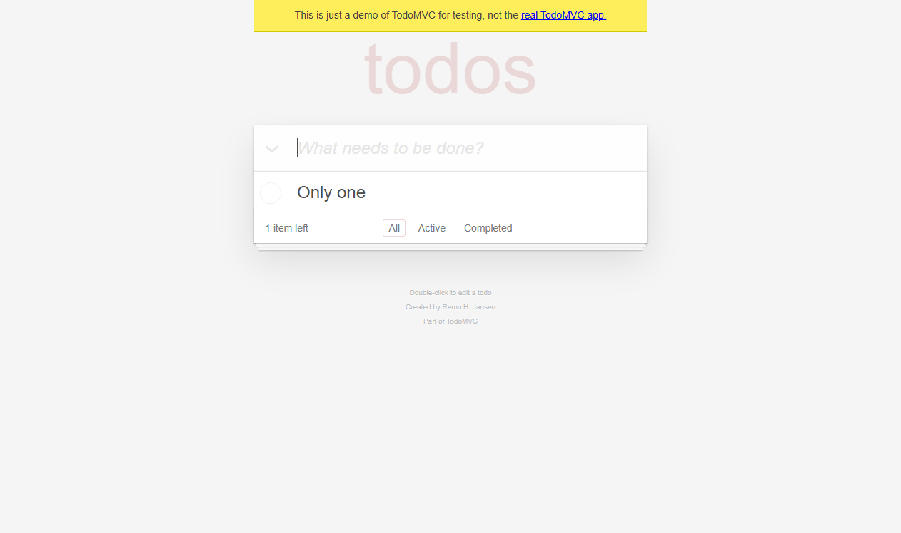
- [fullpage-screenshot] 1262x748 `evidence/raw/RUN-20261029-02/TC-TODO-099/TC-TODO-099__failure__fullpage__20261029T092216-142.png`  
  
- [page-source] `evidence/raw/RUN-20261029-02/TC-TODO-099/TC-TODO-099__failure__page-source__20261029T092216-142.html`  
- [log] `evidence/logs/RUN-20261029-02/TC-TODO-099__browser__20261029T092216-142.log`  

### TC-VISION-001 模型图像输入与视觉理解能力验收

- 状态：**通过**
- 预期：模型能识别截图中的圆形复选框和文本 Acceptance todo
- 实际：模型回答：有；图片中显示一个圆形复选框元素，右侧为蓝色文本 Acceptance todo。
- 执行日志：`evidence/logs/RUN-20261029-02/vision-check-utf8.log`

**步骤**
1. 用 opencode run --file 附加 element-todo-item.png
2. 要求模型只回答是否包含 Acceptance todo 并描述元素
3. 保存 CLI 输出日志并登记

**证据**

- [log] `evidence/logs/RUN-20261029-02/vision-check-utf8.log`  

### TC-VISUAL-001 截图差异检测、区域定位、裁剪与标注

- 状态：**通过**
- 预期：对同一视口的新增前/后截图返回非零差异像素和差异区域，生成差异图、热力图、对比图、标注图与裁剪图，原始截图保持不变。
- 实际：检测到 8122 个差异像素（0.8813%），5 个差异区域，最大区域 550x15；派生文件已单独保存，原始截图仍保留在 evidence/raw。
- 执行日志：`evidence/logs/RUN-20261029-02/TC-VISUAL-001.log`

**步骤**
1. 用同一视口保存新增待办前后的原始截图
2. 运行 tools/visual_diff.py compare
3. 读取 metrics.json 与 regions.json
4. 生成 annotated/comparison/heatmap/diff 图像
5. 对新增待办区域执行 crop 和中文标注
6. 登记证据并校验 SHA-256

**证据**

- [annotation] 1280x720 `evidence/diff/RUN-20261029-02/TC-TODO-001-before-after/annotated.png`  
  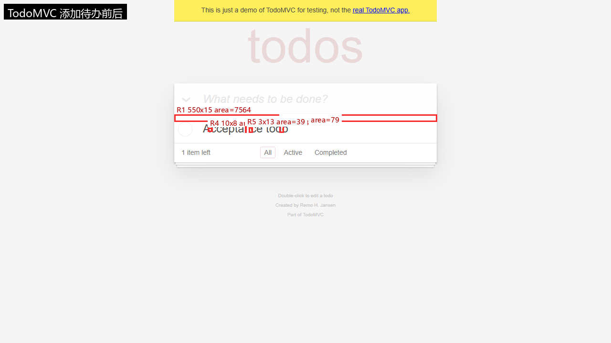
- [comparison] 2560x720 `evidence/diff/RUN-20261029-02/TC-TODO-001-before-after/comparison.png`  
  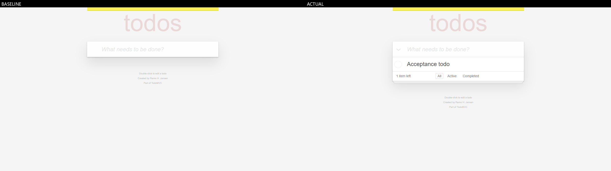
- [heatmap] 1280x720 `evidence/diff/RUN-20261029-02/TC-TODO-001-before-after/heatmap.png`  
  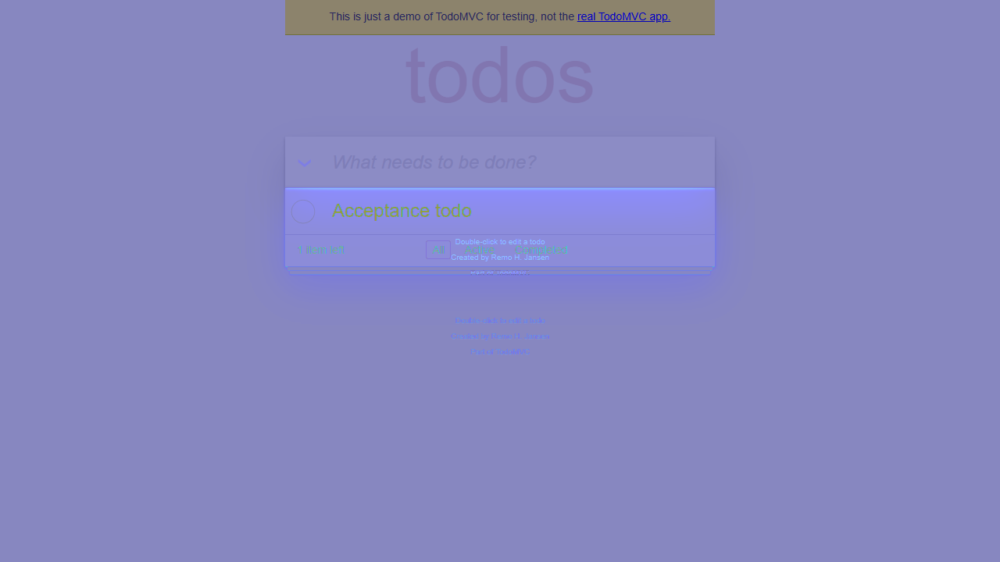
- [diff] 1280x720 `evidence/diff/RUN-20261029-02/TC-TODO-001-before-after/diff.png`  
  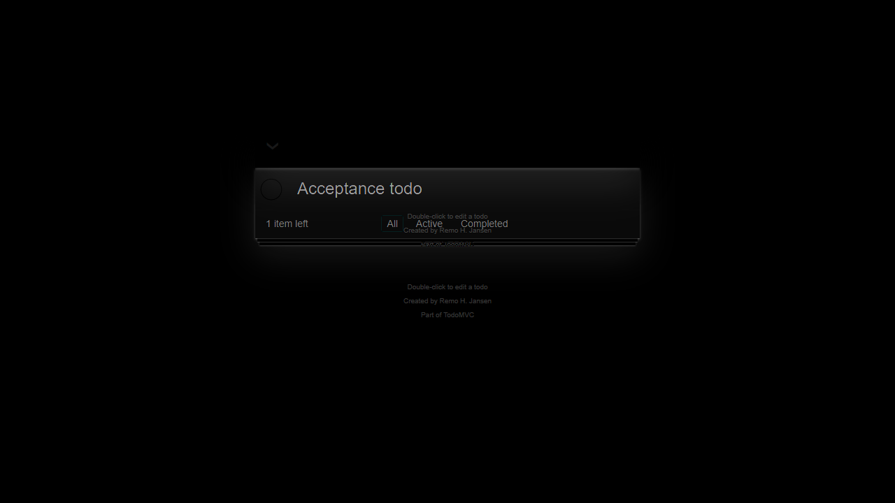
- [metrics] `evidence/diff/RUN-20261029-02/TC-TODO-001-before-after/metrics.json`  
- [regions] `evidence/diff/RUN-20261029-02/TC-TODO-001-before-after/regions.json`  
- [annotation] 1280x720 `evidence/annotated/RUN-20261029-02/TC-TODO-001/new-item-annotated.png`  
  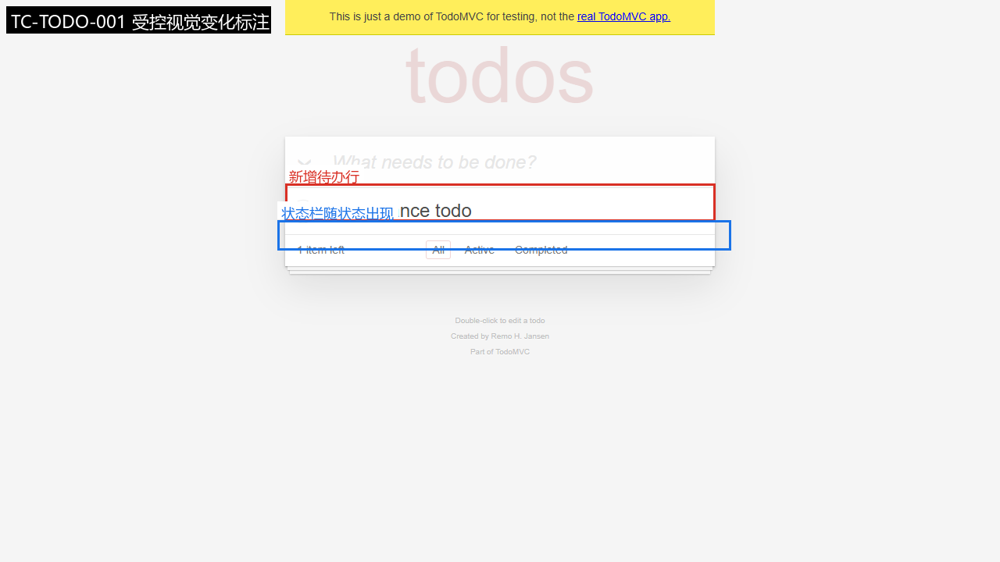
- [crop] 550x48 `evidence/annotated/RUN-20261029-02/TC-TODO-001/new-item-crop.png`  
  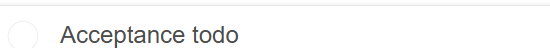

## 6. 缺陷与异常

未登记产品缺陷。若存在 `xfailed` 用例，它仅用于验证失败取证链路，不等同于产品缺陷。

## 7. 视觉差异证据

### TodoMVC 添加待办前后

- 基准图：`evidence\raw\RUN-20261029-01\browser\viewport.png`
- 实际图：`evidence\raw\RUN-20261029-01\browser\fullpage.png`
- 判定：`visual-change-detected（受控变化，待人工复核，不构成缺陷结论）`，差异像素 8122 / 921600（0.008813）
- 差异区域数：5；PSNR：30.2297
- 指标文件：`evidence/diff/RUN-20261029-02/TC-TODO-001-before-after/metrics.json`
- 说明：Pixel changes are review signals. Confirm with DOM, expected behavior, and reproducible steps before filing a defect.

| 区域 | x | y | w | h | 面积 | 平均差 |
|---|---:|---:|---:|---:|---:|---:|
| R1 | 365 | 240 | 550 | 15 | 7564 | 32.803 |
| R2 | 585 | 261 | 9 | 17 | 79 | 101.139 |
| R3 | 521 | 267 | 8 | 11 | 68 | 87.441 |
| R4 | 435 | 268 | 10 | 8 | 49 | 108.286 |
| R5 | 513 | 265 | 3 | 13 | 39 | 111.359 |

## 8. 证据完整性

- 已登记证据：33；校验通过：33
- 缺失文件：0；哈希不一致：0

## 9. 执行日志

- JUnit：`<PROJECT_ROOT>\reports\executions\RUN-20261029-02\junit.xml`
- 控制台日志：`<PROJECT_ROOT>\evidence\logs\RUN-20261029-02\pytest-console.log`
- 统计：tests=8 failures=0 errors=0 xfailed=1

## 10. 结论与限制

本轮执行的功能用例全部通过；受控预期失败用例已按预期被捕获并保留证据。

- 未覆盖（设计完成但本轮未执行，不计入通过率）：TC-TODO-008 刷新后持久化；TC-TODO-009 全部完成/取消全部；TC-TODO-010 清除已完成；TC-TODO-012 键盘可访问性。
- 部分覆盖（仅覆盖部分判定条件）：TC-TODO-011 计数单复数。
- 本报告不把像素差异直接等同于产品缺陷。
- 未执行的场景不会在本报告中标记为通过。
- 比赛前需确认当届赛项对 AI 辅助工具的合规要求。

## 附录：测试用例设计

见 `reports/test-cases/todomvc-test-cases.md`。

