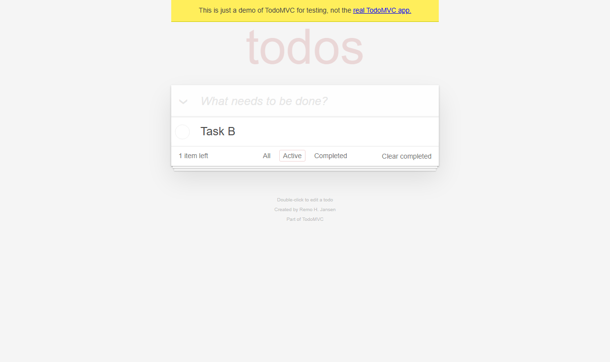
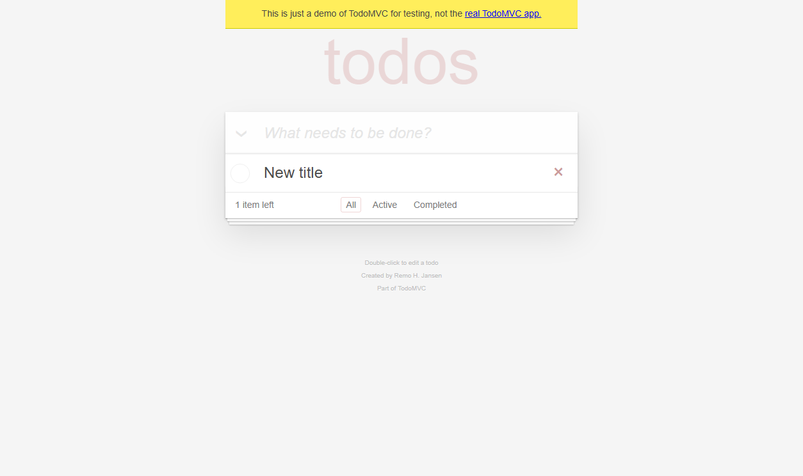
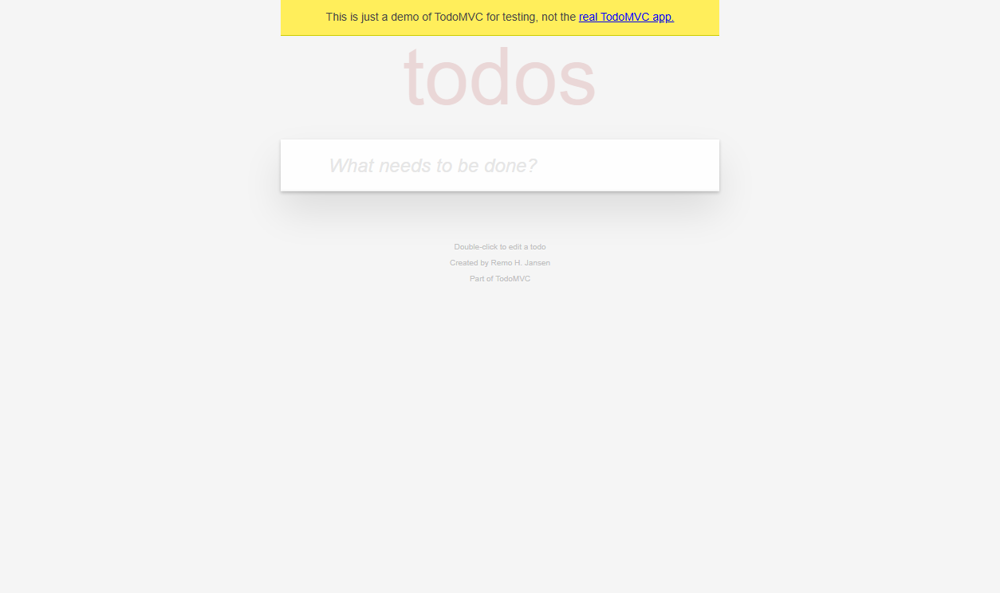
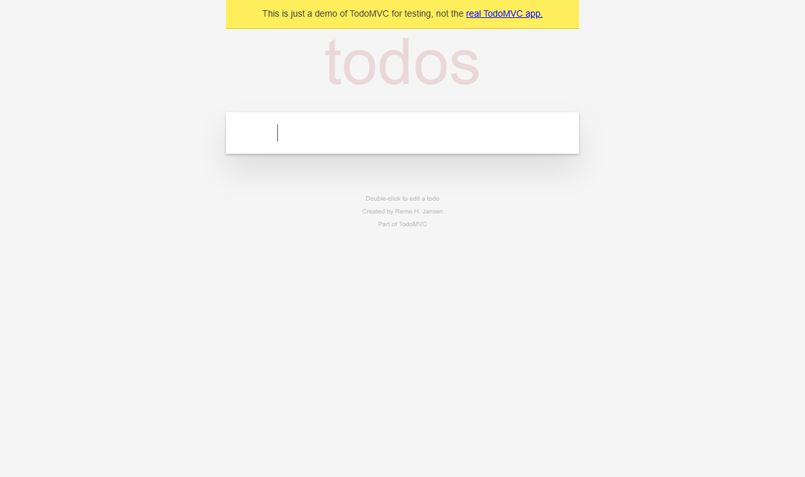
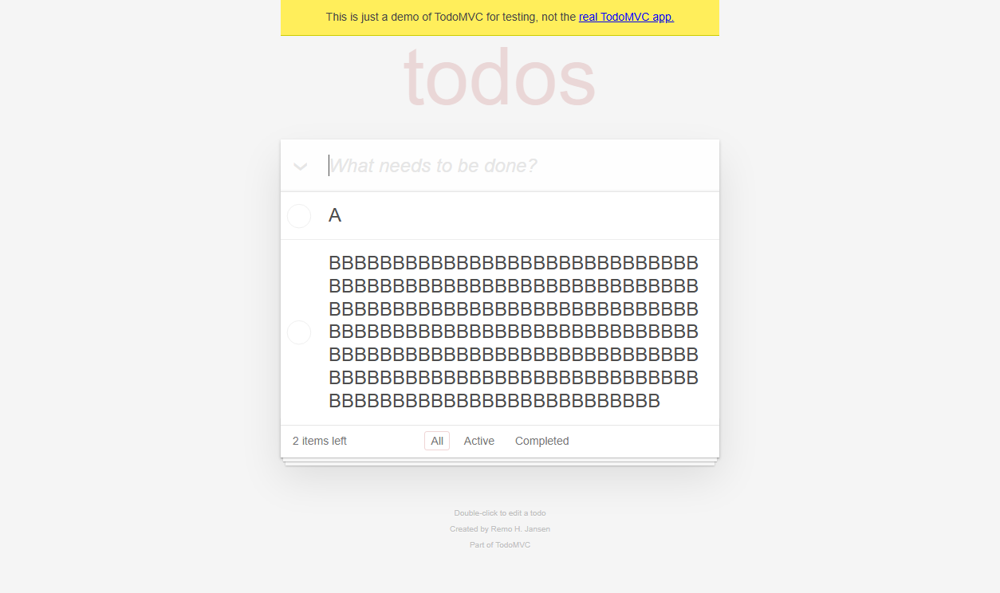
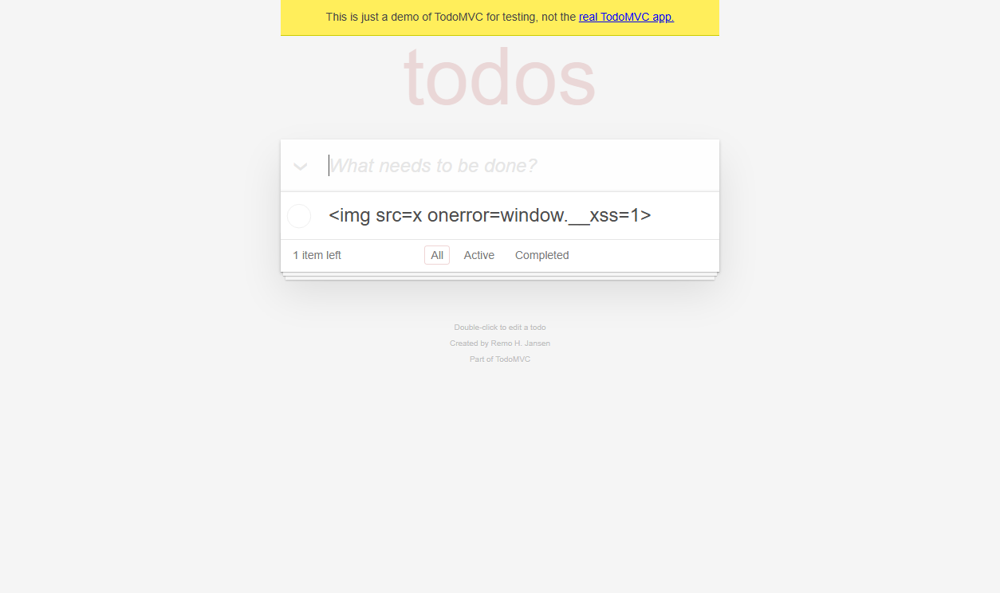
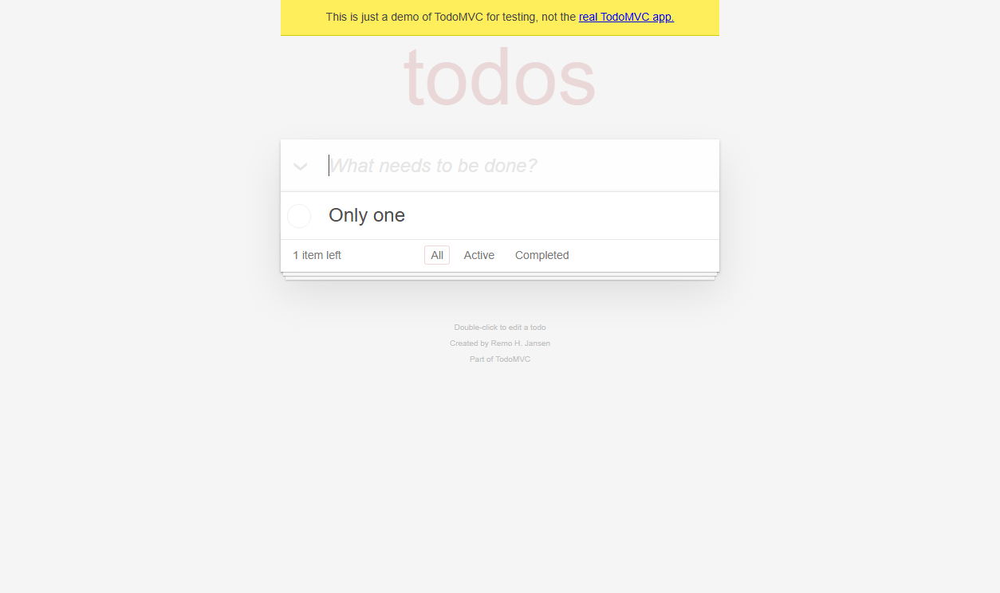
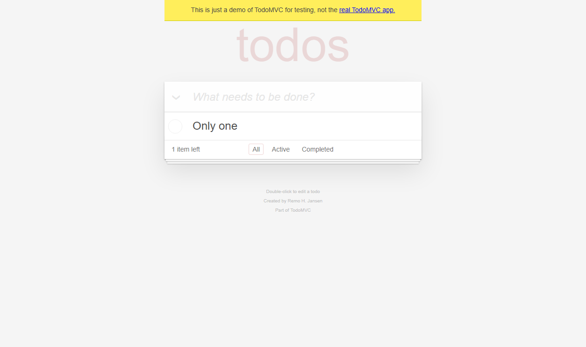

# TodoMVC 回归基线（schema 1.1）

- 生成时间：2026-10-31T00:57:25+08:00
- 运行 ID：`RUN-20261031-BASELINE-01`
- 目标：https://demo.playwright.dev/todomvc
- 状态：**通过**
- 阶段：executed
- 执行窗口：2026-10-31T00:46:29+08:00 → 2026-10-31T00:46:47+08:00
- 交付门禁：**WARNING**（exit 0）

## 1. 测试目标与范围

| 项目 | 内容 |
|---|---|
| 目标 URL | https://demo.playwright.dev/todomvc |
| 测试范围 | 未声明（来源：missing） |
| 需求来源 | 未找到本运行的用例表 |
| 用例表 | 未采集 |
| 用例设计文档 | 未采集 |
| 用例数 | 8 |
| 通过率 | 100.0%（7/7） |

本报告只陈述运行 `RUN-20261031-BASELINE-01` 在 `evidence/manifest.json` 中登记、且能在 JUnit 与证据文件中追溯的结果。未执行、被跳过、受控预期失败的结果单独统计，不并入通过率。

## 2. 测试环境

| 项目 | 值 | 来源 | 运行记录原值 |
|---|---|---|---|
| 操作系统 | 11 | 运行记录 | 11 |
| 平台 | win32 | 运行记录 | win32 |
| Python | 3.13.9 | 运行记录 | 3.13.9 |
| Selenium | 4.51.0 | 运行记录 | 4.51.0 |
| pytest | 9.1.1 | 运行记录 | 9.1.1 |
| Chrome | Chrome 156.0.8078.74 | 运行记录 | Chrome 156.0.8078.74 |
| ChromeDriver | ChromeDriver 156.0.8078.80 (fb096c0011f9d50f0a264a9376420cdea9c421e3-refs/branch-heads/8078@{#1705}) | 运行记录 | ChromeDriver 156.0.8078.80 (fb096c0011f9d50f0a264a9376420cdea9c421e3-refs/branch-heads/8078@{#1705}) |
| Node.js | v24.14.1 | 运行记录 | v24.14.1 |
| 目标 URL | https://demo.playwright.dev/todomvc | 运行记录 | https://demo.playwright.dev/todomvc |
| Chrome 路径 | C:\Users\<user>\AppData\Local\Google\Chrome\Application\chrome.exe | 运行记录 | C:\Users\<user>\AppData\Local\Google\Chrome\Application\chrome.exe |

### 运行备注

- 2026-10-31T00:46:29+08:00：pytest started
- 2026-10-31T00:46:47+08:00：pytest exit=0; total=8; failed=False; blocked=False; xfailed=True
- 2026-10-31T00:46:47+08:00：pytest exit=0; tests=8; failures=0; errors=0; xfailed=1; elapsed=18.17s; case_counts={'passed': 7, 'xfailed': 1}

### 环境补充探测

> 报告生成时探测，不是运行时刻记录；只作参考，不覆盖 manifest 中的运行环境（探测时间 2026-10-31T00:57:25+08:00）。这些值不覆盖上表的运行记录。

| 项目 | 探测值 |
|---|---|
| python | 3.13.9 |
| platform | Windows-11-10.0.26340-SP0 |
| os | 11 |
| pytest | 9.1.1 |
| selenium | 4.51.0 |
| chrome | 156.0.8078.74 |
| chrome_path | C:\Users\<user>\AppData\Local\Google\Chrome\Application\chrome.exe |
| chromedriver | ChromeDriver 156.0.8078.80 (fb096c0011f9d50f0a264a9376420cdea9c421e3-refs/branch-heads/8078@{#1705}) |
| node | v24.14.1 |
| openpyxl | 3.1.5 |
| pillow | 12.2.0 |

| 项目 | 值 |
|---|---|
| 证据清单 | `evidence/manifest.json` |
| 证据校验 | 登记 15 / 通过 15 |

## 3. 测试策略与设计方法

设计方法分布按用例表 `method` 列聚合（无法聚合时明确标注，不做推测）：

- 未找到本运行的用例表，无法从 method 列聚合设计方法分布。

- method 未登记：TC-TODO-001、TC-TODO-002、TC-TODO-003、TC-TODO-004、TC-TODO-005、TC-TODO-006、TC-TODO-007、TC-TODO-099

执行策略：

- 浏览器探索优先使用 DOM/无障碍快照，截图只用于视觉证据。
- 功能用例使用 Selenium + pytest + 显式等待，断言直接绑定可观察状态。
- 失败与受控预期失败自动保存视口/整页截图、页面源码和浏览器日志。
- 视觉差异只作为复核信号，不单独据此判定产品缺陷。

## 4. 用例与执行结果

计数口径：manifest 登记用例 8 条（通过 7、受控预期失败 1、失败 0、未执行 0、跳过 0、阻塞 0）；JUnit：tests=8、passed=7、failed=0、xfailed=1。xfailed 不计入通过率（100.0%（7/7））。

| 用例 ID | 标题 | 类型 | 优先级 | 方法与需求 | 状态 | 证据数 | 日志 |
|---|---|---|---|---|---|---:|---|
| TC-TODO-001 | test_add_todo | 未登记 | 未登记 | 方法未登记 / 需求未登记 | 通过 | 3 | `evidence/logs/RUN-20261031-BASELINE-01/TC-TODO-001.log` |
| TC-TODO-002 | test_complete_and_filter | 未登记 | 未登记 | 方法未登记 / 需求未登记 | 通过 | 2 | `evidence/logs/RUN-20261031-BASELINE-01/TC-TODO-002.log` |
| TC-TODO-003 | test_edit_todo | 未登记 | 未登记 | 方法未登记 / 需求未登记 | 通过 | 1 | `evidence/logs/RUN-20261031-BASELINE-01/TC-TODO-003.log` |
| TC-TODO-004 | test_delete_todo | 未登记 | 未登记 | 方法未登记 / 需求未登记 | 通过 | 2 | `evidence/logs/RUN-20261031-BASELINE-01/TC-TODO-004.log` |
| TC-TODO-005 | test_empty_and_whitespace_rejected | 未登记 | 未登记 | 方法未登记 / 需求未登记 | 通过 | 1 | `evidence/logs/RUN-20261031-BASELINE-01/TC-TODO-005.log` |
| TC-TODO-006 | test_boundary_lengths | 未登记 | 未登记 | 方法未登记 / 需求未登记 | 通过 | 1 | `evidence/logs/RUN-20261031-BASELINE-01/TC-TODO-006.log` |
| TC-TODO-007 | test_text_is_escaped | 未登记 | 未登记 | 方法未登记 / 需求未登记 | 通过 | 1 | `evidence/logs/RUN-20261031-BASELINE-01/TC-TODO-007.log` |
| TC-TODO-099 | test_expected_failure_captures_evidence | 未登记 | 未登记 | 方法未登记 / 需求未登记 | 受控预期失败 | 4 | `evidence/logs/RUN-20261031-BASELINE-01/TC-TODO-099.log` |

## 5. 用例明细

### TC-TODO-001 test_add_todo

| 字段 | 值 |
|---|---|
| 状态 | **通过** |
| 用例类型 | 未登记 |
| 优先级 | 未登记 |
| 设计方法 | 未登记 |
| 需求 | 未登记 |
| 自动化 | tests/test_todomvc.py::test_add_todo |
| 耗时 | 4144 ms |
| 执行日志 | `evidence/logs/RUN-20261031-BASELINE-01/TC-TODO-001.log` |

**前置条件**

未登记

**测试数据**

未登记

**步骤**

1. 打开 TodoMVC 演示页
2. 在新增输入框中输入 Buy milk 并回车

**用例级预期**

见断言明细（3 条断言）

> 运行记录未写入用例级预期

**用例级实际**

见断言明细（3 条断言）

**断言（3 条，通过 3）**

| # | 断言 | 预期 | 实际 | 结果 |
|---:|---|---|---|---|
| 1 | 待办列表包含新增项 | ['Buy milk'] | ['Buy milk'] | 通过 |
| 2 | 剩余计数为 1 | 1 item left | 1 item left | 通过 |
| 3 | 底部状态栏可见 | True | True | 通过 |

**证据（3）**

- `EV-f150d28bc9` [element-screenshot] 550x59 `evidence/raw/RUN-20261031-BASELINE-01/TC-TODO-001/TC-TODO-001__case__element__20261030T164635-739.png`

  

- `EV-126e4c6686` [fullpage-screenshot] 1254x744 `evidence/raw/RUN-20261031-BASELINE-01/TC-TODO-001/TC-TODO-001__case__fullpage__20261030T164635-879.png`

  

- `EV-2d67043862` [screenshot] 1254x744 `evidence/raw/RUN-20261031-BASELINE-01/TC-TODO-001/TC-TODO-001__final__viewport__20261030T164635-979.png`

  

### TC-TODO-002 test_complete_and_filter

| 字段 | 值 |
|---|---|
| 状态 | **通过** |
| 用例类型 | 未登记 |
| 优先级 | 未登记 |
| 设计方法 | 未登记 |
| 需求 | 未登记 |
| 自动化 | tests/test_todomvc.py::test_complete_and_filter |
| 耗时 | 1331 ms |
| 执行日志 | `evidence/logs/RUN-20261031-BASELINE-01/TC-TODO-002.log` |

**前置条件**

未登记

**测试数据**

未登记

**步骤**

1. 新增 Task A 与 Task B
2. 勾选第一条待办
3. 切换到 Completed 过滤器
4. 切换到 Active 过滤器

**用例级预期**

见断言明细（3 条断言）

> 运行记录未写入用例级预期

**用例级实际**

见断言明细（3 条断言）

**断言（3 条，通过 3）**

| # | 断言 | 预期 | 实际 | 结果 |
|---:|---|---|---|---|
| 1 | 完成后剩余计数为 1 | 1 item left | 1 item left | 通过 |
| 2 | Completed 仅显示已完成项 | ['Task A'] | ['Task A'] | 通过 |
| 3 | Active 仅显示未完成项 | ['Task B'] | ['Task B'] | 通过 |

**证据（2）**

- `EV-e50333fb0a` [fullpage-screenshot] 1254x744 `evidence/raw/RUN-20261031-BASELINE-01/TC-TODO-002/TC-TODO-002__Active__fullpage__20261030T164637-352.png`

  

- `EV-e962f8944f` [screenshot] 1254x744 `evidence/raw/RUN-20261031-BASELINE-01/TC-TODO-002/TC-TODO-002__final__viewport__20261030T164637-437.png`

  

### TC-TODO-003 test_edit_todo

| 字段 | 值 |
|---|---|
| 状态 | **通过** |
| 用例类型 | 未登记 |
| 优先级 | 未登记 |
| 设计方法 | 未登记 |
| 需求 | 未登记 |
| 自动化 | tests/test_todomvc.py::test_edit_todo |
| 耗时 | 1120 ms |
| 执行日志 | `evidence/logs/RUN-20261031-BASELINE-01/TC-TODO-003.log` |

**前置条件**

未登记

**测试数据**

未登记

**步骤**

1. 新增 Old title
2. 双击标题并改为 New title

**用例级预期**

见断言明细（1 条断言）

> 运行记录未写入用例级预期

**用例级实际**

见断言明细（1 条断言）

**断言（1 条，通过 1）**

| # | 断言 | 预期 | 实际 | 结果 |
|---:|---|---|---|---|
| 1 | 标题被更新 | ['New title'] | ['New title'] | 通过 |

**证据（1）**

- `EV-3168e8184a` [screenshot] 1254x744 `evidence/raw/RUN-20261031-BASELINE-01/TC-TODO-003/TC-TODO-003__final__viewport__20261030T164638-700.png`

  

### TC-TODO-004 test_delete_todo

| 字段 | 值 |
|---|---|
| 状态 | **通过** |
| 用例类型 | 未登记 |
| 优先级 | 未登记 |
| 设计方法 | 未登记 |
| 需求 | 未登记 |
| 自动化 | tests/test_todomvc.py::test_delete_todo |
| 耗时 | 1126 ms |
| 执行日志 | `evidence/logs/RUN-20261031-BASELINE-01/TC-TODO-004.log` |

**前置条件**

未登记

**测试数据**

未登记

**步骤**

1. 新增 Delete me
2. 悬停并点击删除按钮

**用例级预期**

见断言明细（2 条断言）

> 运行记录未写入用例级预期

**用例级实际**

见断言明细（2 条断言）

**断言（2 条，通过 2）**

| # | 断言 | 预期 | 实际 | 结果 |
|---:|---|---|---|---|
| 1 | 列表被清空 | [] | [] | 通过 |
| 2 | 无待办时底部状态栏隐藏 | False | False | 通过 |

**证据（2）**

- `EV-2c24c2e7f3` [fullpage-screenshot] 1254x744 `evidence/raw/RUN-20261031-BASELINE-01/TC-TODO-004/TC-TODO-004__case__fullpage__20261030T164639-843.png`

  

- `EV-5bf6851e8a` [screenshot] 1254x744 `evidence/raw/RUN-20261031-BASELINE-01/TC-TODO-004/TC-TODO-004__final__viewport__20261030T164639-948.png`

  

### TC-TODO-005 test_empty_and_whitespace_rejected

| 字段 | 值 |
|---|---|
| 状态 | **通过** |
| 用例类型 | 未登记 |
| 优先级 | 未登记 |
| 设计方法 | 未登记 |
| 需求 | 未登记 |
| 自动化 | tests/test_todomvc.py::test_empty_and_whitespace_rejected |
| 耗时 | 900 ms |
| 执行日志 | `evidence/logs/RUN-20261031-BASELINE-01/TC-TODO-005.log` |

**前置条件**

未登记

**测试数据**

未登记

**步骤**

1. 直接回车，不输入内容
2. 输入三个空格并回车

**用例级预期**

见断言明细（2 条断言）

> 运行记录未写入用例级预期

**用例级实际**

见断言明细（2 条断言）

**断言（2 条，通过 2）**

| # | 断言 | 预期 | 实际 | 结果 |
|---:|---|---|---|---|
| 1 | 空输入不新增待办 | [] | [] | 通过 |
| 2 | 纯空白输入不新增待办 | [] | [] | 通过 |

**证据（1）**

- `EV-e4712298d6` [screenshot] 1254x744 `evidence/raw/RUN-20261031-BASELINE-01/TC-TODO-005/TC-TODO-005__final__viewport__20261030T164641-004.png`

  

### TC-TODO-006 test_boundary_lengths

| 字段 | 值 |
|---|---|
| 状态 | **通过** |
| 用例类型 | 未登记 |
| 优先级 | 未登记 |
| 设计方法 | 未登记 |
| 需求 | 未登记 |
| 自动化 | tests/test_todomvc.py::test_boundary_lengths |
| 耗时 | 1189 ms |
| 执行日志 | `evidence/logs/RUN-20261031-BASELINE-01/TC-TODO-006.log` |

**前置条件**

未登记

**测试数据**

未登记

**步骤**

1. 输入 1 个字符 A
2. 再输入 200 个字符

**用例级预期**

见断言明细（2 条断言）

> 运行记录未写入用例级预期

**用例级实际**

见断言明细（2 条断言）

**断言（2 条，通过 2）**

| # | 断言 | 预期 | 实际 | 结果 |
|---:|---|---|---|---|
| 1 | 1 字符边界被接受 | ['A'] | ['A'] | 通过 |
| 2 | 200 字符输入被完整保存 | ['A', 'BBBBBBBBBBBBBBBBBBBBBBBBBBBBBBBBBBBBBBBBBBBBBBBBBBBBBBBBBBBBBBBBBBBBBBBBBBBBBBBBBBBBBBBBBBBBBBBBBBBBBBBBBBBBBBBBBBBBBBBBBBBBBBBBBBBBBBBBBBBBBBBBBBBBBBBBBBBBBBBBBBBBBBBBBBBBBBBBBBBBBBBBBBBBBBBBBBBBBBBB'] | ['A', 'BBBBBBBBBBBBBBBBBBBBBBBBBBBBBBBBBBBBBBBBBBBBBBBBBBBBBBBBBBBBBBBBBBBBBBBBBBBBBBBBBBBBBBBBBBBBBBBBBBBBBBBBBBBBBBBBBBBBBBBBBBBBBBBBBBBBBBBBBBBBBBBBBBBBBBBBBBBBBBBBBBBBBBBBBBBBBBBBBBBBBBBBBBBBBBBBBBBBBBBB'] | 通过 |

**证据（1）**

- `EV-fbe30bed45` [screenshot] 1254x744 `evidence/raw/RUN-20261031-BASELINE-01/TC-TODO-006/TC-TODO-006__final__viewport__20261030T164642-329.png`

  

### TC-TODO-007 test_text_is_escaped

| 字段 | 值 |
|---|---|
| 状态 | **通过** |
| 用例类型 | 未登记 |
| 优先级 | 未登记 |
| 设计方法 | 未登记 |
| 需求 | 未登记 |
| 自动化 | tests/test_todomvc.py::test_text_is_escaped |
| 耗时 | 674 ms |
| 执行日志 | `evidence/logs/RUN-20261031-BASELINE-01/TC-TODO-007.log` |

**前置条件**

未登记

**测试数据**

未登记

**步骤**

1. 输入包含 HTML 事件属性的文本

**用例级预期**

见断言明细（2 条断言）

> 运行记录未写入用例级预期

**用例级实际**

见断言明细（2 条断言）

**断言（2 条，通过 2）**

| # | 断言 | 预期 | 实际 | 结果 |
|---:|---|---|---|---|
| 1 | HTML 文本按纯文本展示 | [''] | [''] | 通过 |
| 2 | 未执行注入脚本 | None | None | 通过 |

**证据（1）**

- `EV-43450b2049` [screenshot] 1254x744 `evidence/raw/RUN-20261031-BASELINE-01/TC-TODO-007/TC-TODO-007__final__viewport__20261030T164643-134.png`

  

### TC-TODO-099 test_expected_failure_captures_evidence

| 字段 | 值 |
|---|---|
| 状态 | **受控预期失败** |
| 用例类型 | 未登记 |
| 优先级 | 未登记 |
| 设计方法 | 未登记 |
| 需求 | 未登记 |
| 自动化 | tests/test_todomvc_expected_failure.py::test_expected_failure_captures_evidence |
| 耗时 | 1017 ms |
| 执行日志 | `evidence/logs/RUN-20261031-BASELINE-01/TC-TODO-099.log` |

**前置条件**

未登记

**测试数据**

未登记

**步骤**

1. 新增 Only one
2. 故意断言剩余计数为 2（实际为 1）

**用例级预期**

见断言明细（1 条断言）

> 运行记录未写入用例级预期

**用例级实际**

tests\test_todomvc_expected_failure.py:22: in test_expected_failure_captures_evidence
    case_ctx.check(page.count_text().startswith("2"), "受控失败断言", "2 items left", page.count_text())
tests\conftest.py:444: in check
    raise AssertionError(f"{name}: expected={expected!r} actual={actual!r}")
E   AssertionError: 受控失败断言: expected='2 items left' actual='1 item left'

**断言（1 条，通过 0）**

| # | 断言 | 预期 | 实际 | 结果 |
|---:|---|---|---|---|
| 1 | 受控失败断言 | 2 items left | 1 item left | 失败 |

**证据（4）**

- `EV-37d4e8f0f5` [screenshot] 1254x744 `evidence/raw/RUN-20261031-BASELINE-01/TC-TODO-099/TC-TODO-099__failure__viewport__20261030T164644-269.png`

  

- `EV-cc5d0035a9` [fullpage-screenshot] 1254x744 `evidence/raw/RUN-20261031-BASELINE-01/TC-TODO-099/TC-TODO-099__failure__fullpage__20261030T164644-269.png`

  

- `EV-c1cbcf505f` [page-source] `evidence/raw/RUN-20261031-BASELINE-01/TC-TODO-099/TC-TODO-099__failure__page-source__20261030T164644-269.html`
- `EV-6cc3a4c13c` [log] `evidence/logs/RUN-20261031-BASELINE-01/TC-TODO-099__browser__20261030T164644-269.log`
## 6. 缺陷

本轮未登记产品缺陷。若存在 `xfailed` 用例，它只用于验证失败取证链路，不等同于产品缺陷。

## 7. 视觉差异

本轮未生成差异图；有效截图证据见第 5 节。

## 8. 证据完整性

| 指标 | 数量 |
|---|---:|
| checked（登记） | 15 |
| ok（校验通过） | 15 |
| missing（文件缺失） | 0 |
| mismatched（哈希不一致） | 0 |
| cross_run（跨 run 引用） | 0 |
| unscoped（路径无 run id） | 0 |
| duplicates（重复登记） | 0 |

## 9. 执行日志

- JUnit 汇总：`<PROJECT_ROOT>\reports\executions\RUN-20261031-BASELINE-01\junit.xml`
- 控制台日志：`<PROJECT_ROOT>\evidence\logs\RUN-20261031-BASELINE-01\pytest-console.log`
- 统计：tests=8 failures=0 errors=0 skipped=1 xfailed=1 elapsed=18.17s exit=0

| 测试函数 | 类 | 耗时(s) | 状态 | 信息 |
|---|---|---:|---|---|
| test_add_todo | tests.test_todomvc | 4.168 | passed |  |
| test_complete_and_filter | tests.test_todomvc | 1.36 | passed |  |
| test_edit_todo | tests.test_todomvc | 1.151 | passed |  |
| test_delete_todo | tests.test_todomvc | 1.166 | passed |  |
| test_empty_and_whitespace_rejected | tests.test_todomvc | 0.933 | passed |  |
| test_boundary_lengths | tests.test_todomvc | 1.214 | passed |  |
| test_text_is_escaped | tests.test_todomvc | 0.7 | passed |  |
| test_expected_failure_captures_evidence | tests.test_todomvc_expected_failure | 3.04 | xfailed | 受控失败：验证失败截图、日志和断言记录链路 |

- 用例日志目录：`evidence/logs/RUN-20261031-BASELINE-01/`
  - TC-TODO-001：`evidence/logs/RUN-20261031-BASELINE-01/TC-TODO-001.log`
  - TC-TODO-002：`evidence/logs/RUN-20261031-BASELINE-01/TC-TODO-002.log`
  - TC-TODO-003：`evidence/logs/RUN-20261031-BASELINE-01/TC-TODO-003.log`
  - TC-TODO-004：`evidence/logs/RUN-20261031-BASELINE-01/TC-TODO-004.log`
  - TC-TODO-005：`evidence/logs/RUN-20261031-BASELINE-01/TC-TODO-005.log`
  - TC-TODO-006：`evidence/logs/RUN-20261031-BASELINE-01/TC-TODO-006.log`
  - TC-TODO-007：`evidence/logs/RUN-20261031-BASELINE-01/TC-TODO-007.log`
  - TC-TODO-099：`evidence/logs/RUN-20261031-BASELINE-01/TC-TODO-099.log`

## 10. 需求覆盖情况

未找到本运行的用例表，需求覆盖只能依据 manifest 中登记的 meta.requirement_ids。

## 11. 未执行项与已知限制

本轮没有登记未执行项。

**已知限制**

- 未找到本运行的用例表（没有 CSV 的 executed_in_run 包含 RUN-20261031-BASELINE-01），设计方法与需求覆盖无法按用例表聚合。
- 本次未运行质量门禁（qualification/gate-runs/<run>/gate-report.json 不存在）。
- 1 条 xfailed 用例只用于验证失败取证链路，不计入通过率，也不等同于产品缺陷。
- 运行备注：pytest exit=0; total=8; failed=False; blocked=False; xfailed=True（2026-10-31T00:46:47+08:00）
- 比赛前需确认当届赛项对 AI 辅助工具的合规要求。

## 12. 质量门禁结果

本次未运行质量门禁（未找到 `qualification/gate-runs/RUN-20261031-BASELINE-01/gate-report.json`）。

**报告交付门禁**

- 结论：**WARNING**（退出码 0）
- 分布：WARNING 10

| 代码 | 级别 | 对象 | 说明 |
|---|---|---|---|
| CASE_EXPECTED_FROM_ASSERTIONS | WARNING | TC-TODO-001 | 用例级预期缺失或为历史断言取值，报告已回退到断言明细 |
| CASE_EXPECTED_FROM_ASSERTIONS | WARNING | TC-TODO-002 | 用例级预期缺失或为历史断言取值，报告已回退到断言明细 |
| CASE_EXPECTED_FROM_ASSERTIONS | WARNING | TC-TODO-003 | 用例级预期缺失或为历史断言取值，报告已回退到断言明细 |
| CASE_EXPECTED_FROM_ASSERTIONS | WARNING | TC-TODO-004 | 用例级预期缺失或为历史断言取值，报告已回退到断言明细 |
| CASE_EXPECTED_FROM_ASSERTIONS | WARNING | TC-TODO-005 | 用例级预期缺失或为历史断言取值，报告已回退到断言明细 |
| CASE_EXPECTED_FROM_ASSERTIONS | WARNING | TC-TODO-006 | 用例级预期缺失或为历史断言取值，报告已回退到断言明细 |
| CASE_EXPECTED_FROM_ASSERTIONS | WARNING | TC-TODO-007 | 用例级预期缺失或为历史断言取值，报告已回退到断言明细 |
| CASE_EXPECTED_FROM_ASSERTIONS | WARNING | TC-TODO-099 | 用例级预期缺失或为历史断言取值，报告已回退到断言明细 |
| CASE_TABLE_MISSING | WARNING | RUN-20261031-BASELINE-01 | 未找到本运行的用例表（没有 CSV 的 executed_in_run 包含 RUN-20261031-BASELINE-01） |
| QUALITY_GATE_NOT_RUN | WARNING | RUN-20261031-BASELINE-01 | 未找到质量门禁报告，交付结论只依赖本报告的门禁 |

## 附录

- 报告生成器：`tools/generate_report.py` v2.0
- 报告 schema：`2.0`
- 用例表来源：未采集
- 用例表查找说明：未找到本运行的用例表（没有 CSV 的 executed_in_run 包含 RUN-20261031-BASELINE-01）
- 已检查的用例表：
  - `reports/test-cases/TodoMVC-CMDCHECK-test-cases.csv`（8 行；run 标记：无 executed_in_run）
  - `reports/test-cases/TodoMVC-CMDCHECK3-test-cases.csv`（9 行；run 标记：RUN-CMDCHECK-03）
  - `reports/test-cases/todomvc-test-cases.csv`（13 行；run 标记：无 executed_in_run）

