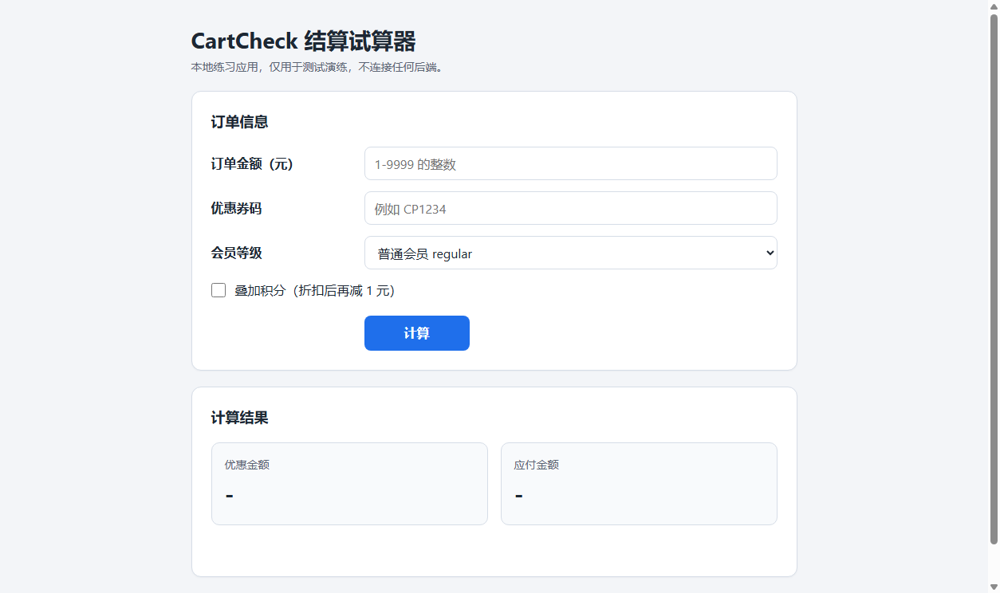
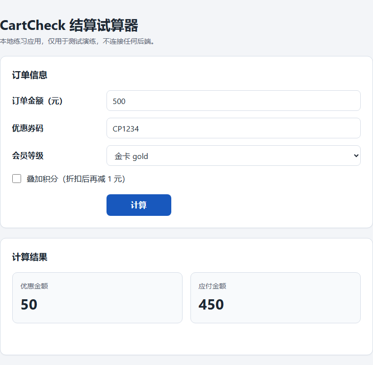
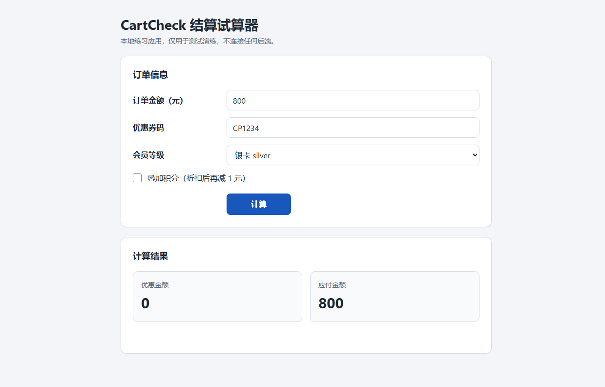
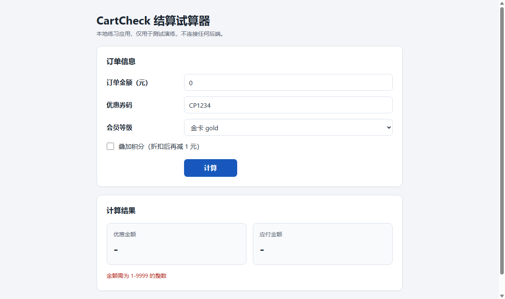
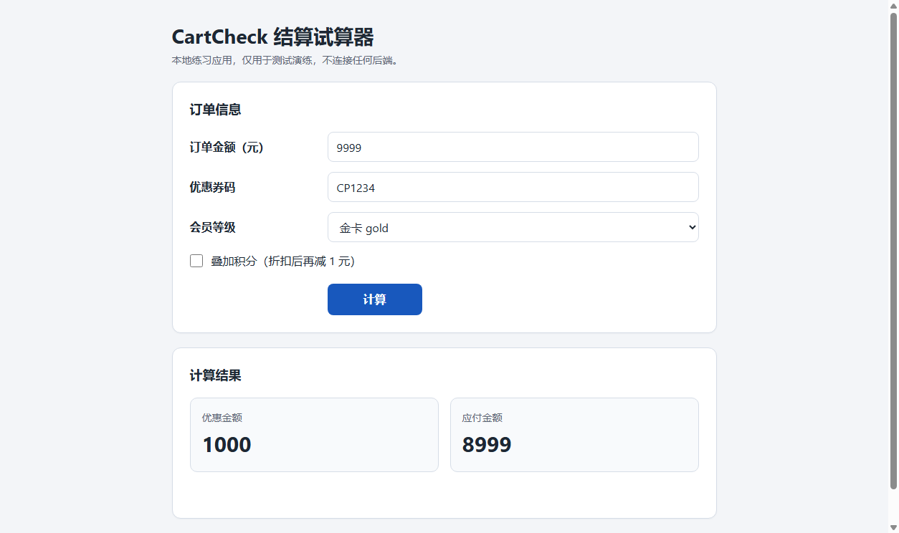
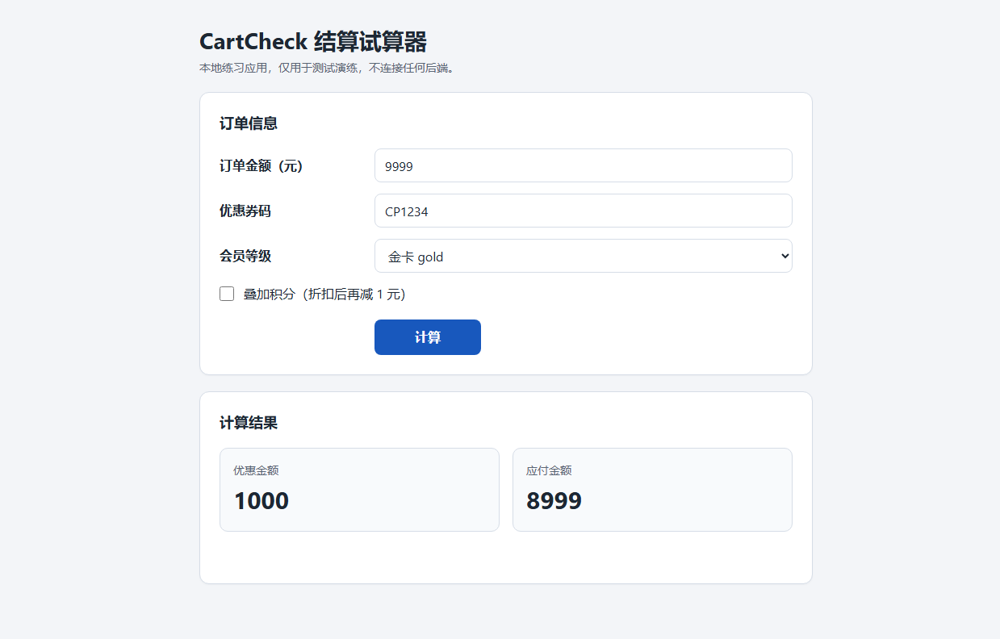
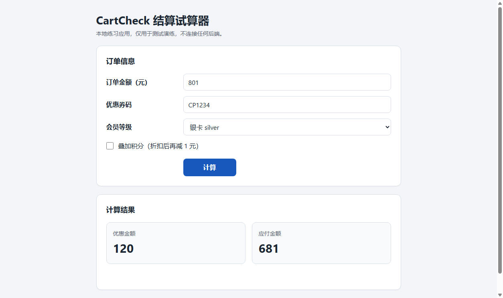
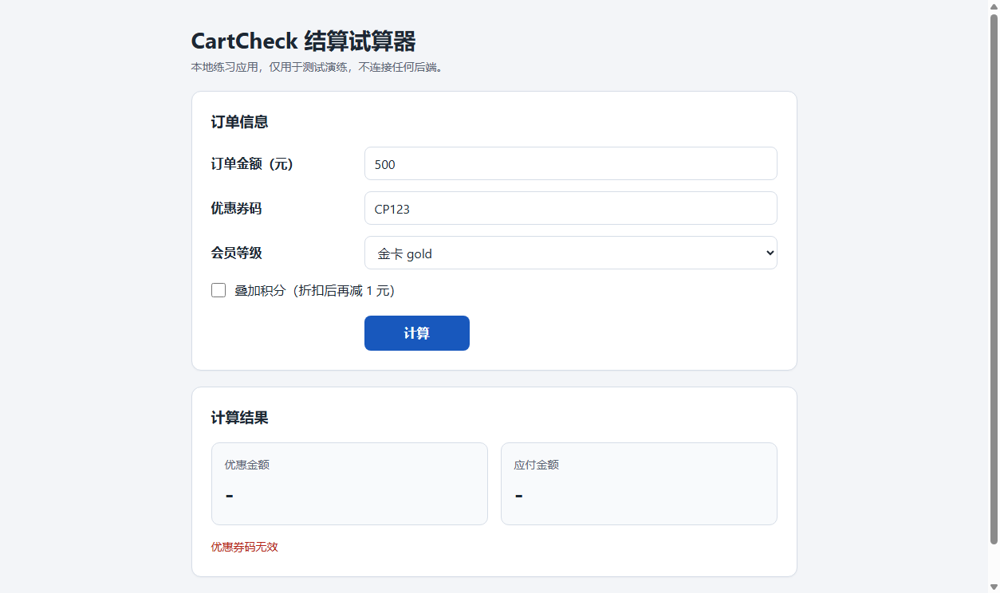
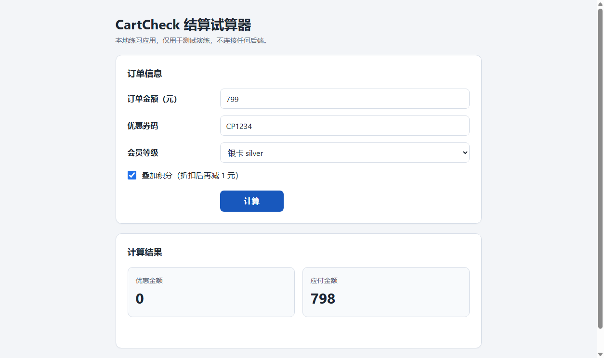
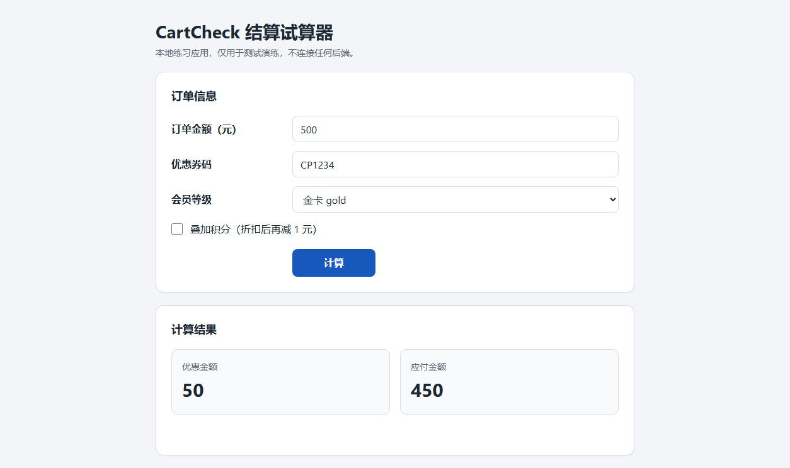

# CartCheck 结算试算器 自动化测试报告

- 生成时间：2026-10-31T01:08:31+08:00
- 运行 ID：`RUN-20261031-COLDSTART-01`
- 目标：http://127.0.0.1:8765/
- 状态：**失败**
- 阶段：package-ready
- 执行窗口：2026-10-31T01:00:26+08:00 → 2026-10-31T01:04:34+08:00
- 交付门禁：**WARNING**（exit 0）

## 1. 测试目标与范围

| 项目 | 内容 |
|---|---|
| 目标 URL | http://127.0.0.1:8765/ |
| 测试范围 | 未声明（来源：missing） |
| 需求来源 | 本运行用例表的 requirement_ids 列 |
| 用例表 | `<PROJECT_ROOT>\reports\test-cases\cartcheck-test-cases.csv` |
| 用例设计文档 | `reports/test-cases/cartcheck-requirements.md` |
| 用例数 | 31 |
| 通过率 | 83.3%（25/30） |

本报告只陈述运行 `RUN-20261031-COLDSTART-01` 在 `evidence/manifest.json` 中登记、且能在 JUnit 与证据文件中追溯的结果。未执行、被跳过、受控预期失败的结果单独统计，不并入通过率。

## 2. 测试环境

| 项目 | 值 | 来源 | 运行记录原值 |
|---|---|---|---|
| 操作系统 | 11 | 运行记录 | 11 |
| 平台 | win32 | 运行记录 | win32 |
| Python | 3.13.9 | 运行记录 | 3.13.9 |
| Selenium | 4.51.0 | 运行记录 | 4.51.0 |
| pytest | 9.1.1 | 运行记录 | 9.1.1 |
| Chrome | Chrome 156.0.8078.74 | 运行记录 | Chrome 156.0.8078.74 |
| ChromeDriver | ChromeDriver 156.0.8078.80 (fb096c0011f9d50f0a264a9376420cdea9c421e3-refs/branch-heads/8078@{#1705}) | 运行记录 | ChromeDriver 156.0.8078.80 (fb096c0011f9d50f0a264a9376420cdea9c421e3-refs/branch-heads/8078@{#1705}) |
| Node.js | v24.14.1 | 运行记录 | v24.14.1 |
| 目标 URL | http://127.0.0.1:8765/ | 运行记录 | http://127.0.0.1:8765/ |
| Chrome 路径 | C:\Users\<user>\AppData\Local\Google\Chrome\Application\chrome.exe | 运行记录 | C:\Users\<user>\AppData\Local\Google\Chrome\Application\chrome.exe |

### 运行备注

- 2026-10-31T01:03:57+08:00：pytest started
- 2026-10-31T01:04:34+08:00：pytest exit=1; total=30; failed=True; blocked=False; xfailed=False
- 2026-10-31T01:04:34+08:00：pytest exit=1; tests=30; failures=5; errors=0; xfailed=0; elapsed=36.89s; case_counts={'running': 1, 'passed': 25, 'failed': 5}
- 2026-10-31T01:08:14+08:00：交付限制1：tools/package_submission.py 的 _copy_test_code 只收集 tests/conftest.py、tests/pages/**、pytest.ini、requirements.txt 与 automation 指向的测试文件，未包含 tests/generated/cartcheck/page_cartcheck.py；交付包 test-code 目录缺少该 Page Object，包内代码不能独立运行，需从仓库同一路径取该文件。
- 2026-10-31T01:08:14+08:00：交付限制2：质量门禁的 requirements 加载器不解析 JSON，--requirements requirements.json 会被逐行当纯文本解析成伪 ID；最终门禁使用内容等价的 requirements.csv（13 条 ID 一致），首次尝试结果保存在 qualification/gate-runs/RUN-20261031-COLDSTART-01/_attempt-requirements-json/。
- 2026-10-31T01:08:14+08:00：交付限制3：需求未规定成功计算的 message 文案（G-01）、输出格式（G-03）与输入前导零/空格（G-02），这些行为未纳入断言；TC-CART-030 的 2 秒阈值起点定义为 driver.get 返回到按钮可点击（G-05）。

### 环境补充探测

> 报告生成时探测，不是运行时刻记录；只作参考，不覆盖 manifest 中的运行环境（探测时间 2026-10-31T01:08:31+08:00）。这些值不覆盖上表的运行记录。

| 项目 | 探测值 |
|---|---|
| python | 3.13.9 |
| platform | Windows-11-10.0.26340-SP0 |
| os | 11 |
| pytest | 9.1.1 |
| selenium | 4.51.0 |
| chrome | 156.0.8078.74 |
| chrome_path | C:\Users\<user>\AppData\Local\Google\Chrome\Application\chrome.exe |
| chromedriver | ChromeDriver 156.0.8078.80 (fb096c0011f9d50f0a264a9376420cdea9c421e3-refs/branch-heads/8078@{#1705}) |
| node | v24.14.1 |
| openpyxl | 3.1.5 |
| pillow | 12.2.0 |

| 项目 | 值 |
|---|---|
| 证据清单 | `evidence/manifest.json` |
| 证据校验 | 登记 83 / 通过 83 |

## 3. 测试策略与设计方法

设计方法分布按用例表 `method` 列聚合（无法聚合时明确标注，不做推测）：

| 设计方法 | 用例数 | 用例 |
|---|---:|---|
| 格式错误猜测（字符集） | 3 | TC-CART-021、TC-CART-022、TC-CART-023 |
| 判定表 | 2 | TC-CART-004、TC-CART-005 |
| 判定表+等价类 | 2 | TC-CART-001、TC-CART-002 |
| 格式边界（长度 5/6/7） | 2 | TC-CART-019、TC-CART-020 |
| 边界值 3-value（0/1/2） | 2 | TC-CART-009、TC-CART-010 |
| 边界值 3-value（499/500/501） | 2 | TC-CART-006、TC-CART-014 |
| 边界值 3-value（799/800/801） | 2 | TC-CART-007、TC-CART-015 |
| 边界值 3-value（9998/9999/10000） | 2 | TC-CART-011、TC-CART-012 |
| 判定表（规则列 6 + 7） | 1 | TC-CART-028 |
| 判定表（规则列 8） | 1 | TC-CART-027 |
| 判定表（规则列 9：C2=否 且 C5=是） | 1 | TC-CART-025 |
| 格式等价类（大写字母类） | 1 | TC-CART-029 |
| 格式错误猜测（前缀） | 1 | TC-CART-024 |
| 等价类（空值无效分区） | 1 | TC-CART-016 |
| 等价类（非数字无效分区） | 1 | TC-CART-018 |
| 等价类（非整数无效分区） | 1 | TC-CART-017 |
| 输出边界值（0/1）+ 判定表 | 1 | TC-CART-026 |
| 边界值 3-value（0/1/2）+ 无效分区 | 1 | TC-CART-008 |
| 边界值 3-value（9998/9999/10000）+ 无效分区 | 1 | TC-CART-013 |
| 边界值+取整口径 | 1 | TC-CART-003 |
| 非功能阈值检查（MS-07） | 1 | TC-CART-030 |

| 用例类型 | 用例数 |
|---|---:|
| boundary | 12 |
| negative | 9 |
| positive | 6 |
| combination | 2 |
| nonfunctional | 1 |

| 优先级 | 用例数 |
|---|---:|
| P0 | 14 |
| P1 | 13 |
| P2 | 3 |

- method 未登记：EXPLORE

执行策略：

- 浏览器探索优先使用 DOM/无障碍快照，截图只用于视觉证据。
- 功能用例使用 Selenium + pytest + 显式等待，断言直接绑定可观察状态。
- 失败与受控预期失败自动保存视口/整页截图、页面源码和浏览器日志。
- 视觉差异只作为复核信号，不单独据此判定产品缺陷。

## 4. 用例与执行结果

计数口径：manifest 登记用例 31 条（通过 25、受控预期失败 0、失败 5、未执行 1、跳过 0、阻塞 0）；JUnit：tests=30、passed=25、failed=5、xfailed=0。xfailed 不计入通过率（83.3%（25/30））。

| 用例 ID | 标题 | 类型 | 优先级 | 方法与需求 | 状态 | 证据数 | 日志 |
|---|---|---|---|---|---|---:|---|
| EXPLORE | 浏览器探索（证据容器，非测试用例） | 未登记 | 未登记 | 方法未登记 / 需求未登记 | 未执行 | 3 | 未登记 |
| TC-CART-001 | 金卡满 500 享 10% 折扣：E1 应得优惠 50、应付 450 | positive | P0 | 判定表+等价类 / REQ-10、REQ-05 | 通过 | 2 | `evidence/logs/RUN-20261031-COLDSTART-01/TC-CART-001.log` |
| TC-CART-002 | 银卡满 800 享 15% 折扣：E2 应得优惠 120、应付 680 | positive | P0 | 判定表+等价类 / REQ-10、REQ-06 | 失败 | 6 | `evidence/logs/RUN-20261031-COLDSTART-01/TC-CART-002.log` |
| TC-CART-003 | 金卡 555 元的 10% 折扣必须向下取整：55 而非 56 | boundary | P0 | 边界值+取整口径 / REQ-10、REQ-05 | 失败 | 6 | `evidence/logs/RUN-20261031-COLDSTART-01/TC-CART-003.log` |
| TC-CART-004 | 金卡 500 元叠加积分：折后应付再减 1 元等于 449 | positive | P0 | 判定表 / REQ-10、REQ-08 | 通过 | 2 | `evidence/logs/RUN-20261031-COLDSTART-01/TC-CART-004.log` |
| TC-CART-005 | 普通会员 1000 元无折扣：优惠 0、应付等于订单金额 | positive | P0 | 判定表 / REQ-10、REQ-07 | 通过 | 2 | `evidence/logs/RUN-20261031-COLDSTART-01/TC-CART-005.log` |
| TC-CART-006 | 金卡 499 元未达门槛：优惠 0、应付 499 | boundary | P0 | 边界值 3-value（499/500/501） / REQ-10、REQ-07、REQ-11 | 通过 | 2 | `evidence/logs/RUN-20261031-COLDSTART-01/TC-CART-006.log` |
| TC-CART-007 | 银卡 799 元未达门槛：优惠 0、应付 799 | boundary | P0 | 边界值 3-value（799/800/801） / REQ-10、REQ-07、REQ-11 | 通过 | 2 | `evidence/logs/RUN-20261031-COLDSTART-01/TC-CART-007.log` |
| TC-CART-008 | 金额 0 低于下边界：提示金额错误且两项输出为 - | boundary | P0 | 边界值 3-value（0/1/2）+ 无效分区 / REQ-02、REQ-11 | 通过 | 2 | `evidence/logs/RUN-20261031-COLDSTART-01/TC-CART-008.log` |
| TC-CART-009 | 金额 1 为最小有效值：普通会员优惠 0、应付 1 | boundary | P1 | 边界值 3-value（0/1/2） / REQ-01、REQ-11 | 通过 | 2 | `evidence/logs/RUN-20261031-COLDSTART-01/TC-CART-009.log` |
| TC-CART-010 | 金额 2 为下边界邻近有效值：普通会员应付 2 | boundary | P2 | 边界值 3-value（0/1/2） / REQ-01、REQ-11 | 通过 | 2 | `evidence/logs/RUN-20261031-COLDSTART-01/TC-CART-010.log` |
| TC-CART-011 | 金额 9998 为有效上边界邻近值：金卡优惠 999、应付 8999 | boundary | P1 | 边界值 3-value（9998/9999/10000） / REQ-01、REQ-05、REQ-11 | 失败 | 6 | `evidence/logs/RUN-20261031-COLDSTART-01/TC-CART-011.log` |
| TC-CART-012 | 金额 9999 为有效上边界：金卡优惠 999、应付 9000 | boundary | P1 | 边界值 3-value（9998/9999/10000） / REQ-01、REQ-05、REQ-11 | 失败 | 6 | `evidence/logs/RUN-20261031-COLDSTART-01/TC-CART-012.log` |
| TC-CART-013 | 金额 10000 超出上边界：提示金额错误且两项输出为 - | boundary | P0 | 边界值 3-value（9998/9999/10000）+ 无效分区 / REQ-02、REQ-11 | 通过 | 2 | `evidence/logs/RUN-20261031-COLDSTART-01/TC-CART-013.log` |
| TC-CART-014 | 金卡 501 元刚过门槛：优惠 floor(50.1)=50、应付 451 | boundary | P1 | 边界值 3-value（499/500/501） / REQ-05、REQ-11 | 通过 | 2 | `evidence/logs/RUN-20261031-COLDSTART-01/TC-CART-014.log` |
| TC-CART-015 | 银卡 801 元刚过门槛：优惠 floor(120.15)=120、应付 681 | boundary | P1 | 边界值 3-value（799/800/801） / REQ-06、REQ-11 | 通过 | 2 | `evidence/logs/RUN-20261031-COLDSTART-01/TC-CART-015.log` |
| TC-CART-016 | 金额为空：提示金额错误且不进行计算 | negative | P0 | 等价类（空值无效分区） / REQ-02 | 通过 | 2 | `evidence/logs/RUN-20261031-COLDSTART-01/TC-CART-016.log` |
| TC-CART-017 | 金额为小数 500.5：属于非整数，必须拒绝 | negative | P0 | 等价类（非整数无效分区） / REQ-02 | 通过 | 2 | `evidence/logs/RUN-20261031-COLDSTART-01/TC-CART-017.log` |
| TC-CART-018 | 金额为非数字 abc：提示金额错误且两项输出为 - | negative | P1 | 等价类（非数字无效分区） / REQ-02 | 通过 | 2 | `evidence/logs/RUN-20261031-COLDSTART-01/TC-CART-018.log` |
| TC-CART-019 | 券码 5 位 CP123：长度不足应提示券码无效 | negative | P1 | 格式边界（长度 5/6/7） / REQ-04、REQ-11 | 通过 | 2 | `evidence/logs/RUN-20261031-COLDSTART-01/TC-CART-019.log` |
| TC-CART-020 | 券码 7 位 CP12345：长度超出应提示券码无效 | negative | P1 | 格式边界（长度 5/6/7） / REQ-04、REQ-11 | 通过 | 2 | `evidence/logs/RUN-20261031-COLDSTART-01/TC-CART-020.log` |
| TC-CART-021 | 券码含小写 cp1234：字符集不符必须拒绝 | negative | P0 | 格式错误猜测（字符集） / REQ-04、REQ-11 | 失败 | 6 | `evidence/logs/RUN-20261031-COLDSTART-01/TC-CART-021.log` |
| TC-CART-022 | 券码含符号 CP12!4：符号属于非法字符应拒绝 | negative | P1 | 格式错误猜测（字符集） / REQ-04、REQ-11 | 通过 | 2 | `evidence/logs/RUN-20261031-COLDSTART-01/TC-CART-022.log` |
| TC-CART-023 | 券码含空格 CP 234：空格属于非法字符应拒绝 | negative | P1 | 格式错误猜测（字符集） / REQ-04、REQ-11 | 通过 | 2 | `evidence/logs/RUN-20261031-COLDSTART-01/TC-CART-023.log` |
| TC-CART-024 | 券码前缀错误 XX1234：前缀不是 CP 应拒绝 | negative | P1 | 格式错误猜测（前缀） / REQ-04 | 通过 | 2 | `evidence/logs/RUN-20261031-COLDSTART-01/TC-CART-024.log` |
| TC-CART-025 | 券码 4 位 CP12 与金卡折扣同时存在：券码校验优先，不得产生金额 | combination | P0 | 判定表（规则列 9：C2=否 且 C5=是） / REQ-04 | 通过 | 2 | `evidence/logs/RUN-20261031-COLDSTART-01/TC-CART-025.log` |
| TC-CART-026 | 金额 1 元叠加积分：应付不得为负，最小为 0 | boundary | P0 | 输出边界值（0/1）+ 判定表 / REQ-08 | 通过 | 2 | `evidence/logs/RUN-20261031-COLDSTART-01/TC-CART-026.log` |
| TC-CART-027 | 普通会员 1000 元叠加积分：应付为 999 且不报错 | positive | P1 | 判定表（规则列 8） / REQ-08、REQ-09 | 通过 | 2 | `evidence/logs/RUN-20261031-COLDSTART-01/TC-CART-027.log` |
| TC-CART-028 | 银卡 799 元未达门槛并叠加积分：优惠 0、应付 798 | combination | P2 | 判定表（规则列 6 + 7） / REQ-07、REQ-08 | 通过 | 2 | `evidence/logs/RUN-20261031-COLDSTART-01/TC-CART-028.log` |
| TC-CART-029 | 券码 CPABCD（4 位大写字母）合法：按金卡 10% 计算 50/450 | positive | P2 | 格式等价类（大写字母类） / REQ-03、REQ-11 | 通过 | 2 | `evidence/logs/RUN-20261031-COLDSTART-01/TC-CART-029.log` |
| TC-CART-030 | 1280x900 视口无横向滚动、结果区计算前后可见、无弹窗且 2 秒内可交互 | nonfunctional | P1 | 非功能阈值检查（MS-07） / REQ-12、REQ-13 | 通过 | 2 | `evidence/logs/RUN-20261031-COLDSTART-01/TC-CART-030.log` |

## 5. 用例明细

### EXPLORE 浏览器探索（证据容器，非测试用例）

| 字段 | 值 |
|---|---|
| 状态 | **未执行** |
| 用例类型 | 未登记 |
| 优先级 | 未登记 |
| 设计方法 | 未登记 |
| 需求 | 未登记 |
| 自动化 | 未登记（手工或未实现） |
| 执行日志 | 未登记（文件缺失） |

**前置条件**

未登记

**测试数据**

未登记

**步骤**

未登记

**用例级预期**

完成只读探索：枚举 8 个 data-testid 元素（tag/role/可见性）、记录 select 三个选项、2 张截图与浏览器控制台日志已登记，console SEVERE 条目 0

**用例级实际**

8 个 data-testid 全部显示且可交互；截图 2 张 + 控制台日志 1 份已登记；控制台错误 0 条

**断言**

未登记断言。

**证据（3）**

- `EV-851b174e12` [screenshot] 1254x744 `evidence/raw/RUN-20261031-COLDSTART-01/EXPLORE/EXPLORE__initial__viewport__20261030T170004-883.png`

  

- `EV-bc836119bd` [element-screenshot] 760x744 `evidence/raw/RUN-20261031-COLDSTART-01/EXPLORE/EXPLORE__e1-result__element__20261030T170005-325.png`

  

- `EV-231a844f7d` [log] `evidence/logs/RUN-20261031-COLDSTART-01/EXPLORE__browser__20261030T170006-425.log`
### TC-CART-001 金卡满 500 享 10% 折扣：E1 应得优惠 50、应付 450

| 字段 | 值 |
|---|---|
| 状态 | **通过** |
| 用例类型 | positive |
| 优先级 | P0 |
| 设计方法 | 判定表+等价类 |
| 需求 | REQ-10、REQ-05 |
| 自动化 | tests/generated/cartcheck/test_cartcheck.py::test_tc_cart_001 |
| 耗时 | 2180 ms |
| 执行日志 | `evidence/logs/RUN-20261031-COLDSTART-01/TC-CART-001.log` |

**前置条件**

1. 页面已打开 http://127.0.0.1:8765/，表单为初始状态（amount 与 coupon 为空，level=regular，points 未勾选）

**测试数据**

amount=500；coupon=CP1234；level=gold；points=未勾选

**步骤**

1. 打开 http://127.0.0.1:8765/，等待「计算」按钮可点击（实测 0.235s）
2. 在 amount 输入 '500'，在 coupon 输入 'CP1234'
3. level 选择 gold，points 不勾选
4. 点击「计算」按钮
5. 等待输出变化完成（触发通道：amount）

**用例级预期**

discount=50；payable=450（需求 E1）

**用例级实际**

discount=50；payable=450；message=(空)

**断言（3 条，通过 3）**

| # | 断言 | 预期 | 实际 | 结果 |
|---:|---|---|---|---|
| 1 | 优惠金额 | 50 | 50 | 通过 |
| 2 | 应付金额 | 450 | 450 | 通过 |
| 3 | 合法输入不应出现错误提示 | message 不属于 (金额需为 1-9999 的整数 \| 优惠券码无效) | (空) | 通过 |

**证据（2）**

- `EV-302193cec1` [element-screenshot] 760x239 `evidence/raw/RUN-20261031-COLDSTART-01/TC-CART-001/TC-CART-001__result__element__20261030T170402-200.png`

  

- `EV-c1d3831593` [screenshot] 1254x744 `evidence/raw/RUN-20261031-COLDSTART-01/TC-CART-001/TC-CART-001__final__viewport__20261030T170402-406.png`

  

### TC-CART-002 银卡满 800 享 15% 折扣：E2 应得优惠 120、应付 680

| 字段 | 值 |
|---|---|
| 状态 | **失败** |
| 用例类型 | positive |
| 优先级 | P0 |
| 设计方法 | 判定表+等价类 |
| 需求 | REQ-10、REQ-06 |
| 自动化 | tests/generated/cartcheck/test_cartcheck.py::test_tc_cart_002 |
| 耗时 | 1120 ms |
| 执行日志 | `evidence/logs/RUN-20261031-COLDSTART-01/TC-CART-002.log` |

**前置条件**

1. 页面已打开 http://127.0.0.1:8765/，表单为初始状态（amount 与 coupon 为空，level=regular，points 未勾选）

**测试数据**

amount=800；coupon=CP1234；level=silver；points=未勾选

**步骤**

1. 打开 http://127.0.0.1:8765/，等待「计算」按钮可点击（实测 0.077s）
2. 在 amount 输入 '800'，在 coupon 输入 'CP1234'
3. level 选择 silver，points 不勾选
4. 点击「计算」按钮
5. 等待输出变化完成（触发通道：amount）

**用例级预期**

discount=120；payable=680（需求 E2）

**用例级实际**

tests\generated\cartcheck\test_cartcheck.py:111: in test_tc_cart_002
    _assert_amounts(case_ctx, observed, 120, 680)
tests\generated\cartcheck\test_cartcheck.py:65: in _assert_amounts
    case_ctx.check(discount == expected_discount, "优惠金额", expected_discount, raw_discount)
tests\conftest.py:444: in check
    raise AssertionError(f"{name}: expected={expected!r} actual={actual!r}")
E   AssertionError: 优惠金额: expected=120 actual='0'

**断言（1 条，通过 0）**

| # | 断言 | 预期 | 实际 | 结果 |
|---:|---|---|---|---|
| 1 | 优惠金额 | 120 | 0 | 失败 |

**证据（6）**

- `EV-b4ff76d876` [element-screenshot] 760x239 `evidence/raw/RUN-20261031-COLDSTART-01/TC-CART-002/TC-CART-002__result__element__20261030T170403-230.png`

  

- `EV-251a55b185` [screenshot] 1254x744 `evidence/raw/RUN-20261031-COLDSTART-01/TC-CART-002/TC-CART-002__failure__viewport__20261030T170403-655.png`

  

- `EV-40f4dfc5e9` [fullpage-screenshot] 1239x792 `evidence/raw/RUN-20261031-COLDSTART-01/TC-CART-002/TC-CART-002__failure__fullpage__20261030T170403-655.png`

  

- `EV-e0593fe1fd` [page-source] `evidence/raw/RUN-20261031-COLDSTART-01/TC-CART-002/TC-CART-002__failure__page-source__20261030T170403-655.html`
- `EV-eaafe3550e` [log] `evidence/logs/RUN-20261031-COLDSTART-01/TC-CART-002__browser__20261030T170403-655.log`
- `EV-7fff3e1b62` [element-screenshot] 760x239 `evidence/raw/RUN-20261031-COLDSTART-01/TC-CART-002/TC-CART-002__repro__element__20261030T170517-678.png`

  

**缺陷**

- `DEF-001` [主要] 银卡订单 800 元未享受 15% 折扣：门槛判断使用 >800 而非 >=800

### TC-CART-003 金卡 555 元的 10% 折扣必须向下取整：55 而非 56

| 字段 | 值 |
|---|---|
| 状态 | **失败** |
| 用例类型 | boundary |
| 优先级 | P0 |
| 设计方法 | 边界值+取整口径 |
| 需求 | REQ-10、REQ-05 |
| 自动化 | tests/generated/cartcheck/test_cartcheck.py::test_tc_cart_003 |
| 耗时 | 841 ms |
| 执行日志 | `evidence/logs/RUN-20261031-COLDSTART-01/TC-CART-003.log` |

**前置条件**

1. 页面已打开 http://127.0.0.1:8765/，表单为初始状态（amount 与 coupon 为空，level=regular，points 未勾选）

**测试数据**

amount=555；coupon=CP1234；level=gold；points=未勾选

**步骤**

1. 打开 http://127.0.0.1:8765/，等待「计算」按钮可点击（实测 0.077s）
2. 在 amount 输入 '555'，在 coupon 输入 'CP1234'
3. level 选择 gold，points 不勾选
4. 点击「计算」按钮
5. 等待输出变化完成（触发通道：amount）

**用例级预期**

discount=55；payable=500（555x0.1=55.5 floor=55，需求 E3 + R3 取整）

**用例级实际**

tests\generated\cartcheck\test_cartcheck.py:123: in test_tc_cart_003
    _assert_amounts(case_ctx, observed, 55, 500)
tests\generated\cartcheck\test_cartcheck.py:65: in _assert_amounts
    case_ctx.check(discount == expected_discount, "优惠金额", expected_discount, raw_discount)
tests\conftest.py:444: in check
    raise AssertionError(f"{name}: expected={expected!r} actual={actual!r}")
E   AssertionError: 优惠金额: expected=55 actual='56'

**断言（1 条，通过 0）**

| # | 断言 | 预期 | 实际 | 结果 |
|---:|---|---|---|---|
| 1 | 优惠金额 | 55 | 56 | 失败 |

**证据（6）**

- `EV-196b03f496` [element-screenshot] 760x239 `evidence/raw/RUN-20261031-COLDSTART-01/TC-CART-003/TC-CART-003__result__element__20261030T170404-653.png`

  

- `EV-f172e16f67` [screenshot] 1254x744 `evidence/raw/RUN-20261031-COLDSTART-01/TC-CART-003/TC-CART-003__failure__viewport__20261030T170404-808.png`

  

- `EV-4f33c8a003` [fullpage-screenshot] 1239x792 `evidence/raw/RUN-20261031-COLDSTART-01/TC-CART-003/TC-CART-003__failure__fullpage__20261030T170404-808.png`

  

- `EV-0978a3a65b` [page-source] `evidence/raw/RUN-20261031-COLDSTART-01/TC-CART-003/TC-CART-003__failure__page-source__20261030T170404-808.html`
- `EV-433b78b87e` [log] `evidence/logs/RUN-20261031-COLDSTART-01/TC-CART-003__browser__20261030T170404-808.log`
- `EV-6d367d383c` [element-screenshot] 760x239 `evidence/raw/RUN-20261031-COLDSTART-01/TC-CART-003/TC-CART-003__repro__element__20261030T170518-304.png`

  

**缺陷**

- `DEF-002` [主要] 金卡 10% 折扣采用四舍五入而非向下取整：555 元得 56（应 55）

### TC-CART-004 金卡 500 元叠加积分：折后应付再减 1 元等于 449

| 字段 | 值 |
|---|---|
| 状态 | **通过** |
| 用例类型 | positive |
| 优先级 | P0 |
| 设计方法 | 判定表 |
| 需求 | REQ-10、REQ-08 |
| 自动化 | tests/generated/cartcheck/test_cartcheck.py::test_tc_cart_004 |
| 耗时 | 928 ms |
| 执行日志 | `evidence/logs/RUN-20261031-COLDSTART-01/TC-CART-004.log` |

**前置条件**

1. 页面已打开 http://127.0.0.1:8765/，表单为初始状态（amount 与 coupon 为空，level=regular，points 未勾选）

**测试数据**

amount=500；coupon=CP1234；level=gold；points=勾选

**步骤**

1. 打开 http://127.0.0.1:8765/，等待「计算」按钮可点击（实测 0.070s）
2. 在 amount 输入 '500'，在 coupon 输入 'CP1234'
3. level 选择 gold，points 勾选
4. 点击「计算」按钮
5. 等待输出变化完成（触发通道：amount）

**用例级预期**

discount=50；payable=449（需求 E4）

**用例级实际**

discount=50；payable=449；message=(空)

**断言（3 条，通过 3）**

| # | 断言 | 预期 | 实际 | 结果 |
|---:|---|---|---|---|
| 1 | 优惠金额 | 50 | 50 | 通过 |
| 2 | 应付金额 | 449 | 449 | 通过 |
| 3 | 合法输入不应出现错误提示 | message 不属于 (金额需为 1-9999 的整数 \| 优惠券码无效) | (空) | 通过 |

**证据（2）**

- `EV-81421592c5` [element-screenshot] 760x239 `evidence/raw/RUN-20261031-COLDSTART-01/TC-CART-004/TC-CART-004__result__element__20261030T170405-894.png`

  

- `EV-2e6ac19761` [screenshot] 1254x744 `evidence/raw/RUN-20261031-COLDSTART-01/TC-CART-004/TC-CART-004__final__viewport__20261030T170406-079.png`

  

### TC-CART-005 普通会员 1000 元无折扣：优惠 0、应付等于订单金额

| 字段 | 值 |
|---|---|
| 状态 | **通过** |
| 用例类型 | positive |
| 优先级 | P0 |
| 设计方法 | 判定表 |
| 需求 | REQ-10、REQ-07 |
| 自动化 | tests/generated/cartcheck/test_cartcheck.py::test_tc_cart_005 |
| 耗时 | 825 ms |
| 执行日志 | `evidence/logs/RUN-20261031-COLDSTART-01/TC-CART-005.log` |

**前置条件**

1. 页面已打开 http://127.0.0.1:8765/，表单为初始状态（amount 与 coupon 为空，level=regular，points 未勾选）

**测试数据**

amount=1000；coupon=CP1234；level=regular；points=未勾选

**步骤**

1. 打开 http://127.0.0.1:8765/，等待「计算」按钮可点击（实测 0.067s）
2. 在 amount 输入 '1000'，在 coupon 输入 'CP1234'
3. level 选择 regular，points 不勾选
4. 点击「计算」按钮
5. 等待输出变化完成（触发通道：amount）

**用例级预期**

discount=0；payable=1000（需求 E5）

**用例级实际**

discount=0；payable=1000；message=(空)

**断言（3 条，通过 3）**

| # | 断言 | 预期 | 实际 | 结果 |
|---:|---|---|---|---|
| 1 | 优惠金额 | 0 | 0 | 通过 |
| 2 | 应付金额 | 1000 | 1000 | 通过 |
| 3 | 合法输入不应出现错误提示 | message 不属于 (金额需为 1-9999 的整数 \| 优惠券码无效) | (空) | 通过 |

**证据（2）**

- `EV-f6177a66c3` [element-screenshot] 760x239 `evidence/raw/RUN-20261031-COLDSTART-01/TC-CART-005/TC-CART-005__result__element__20261030T170406-823.png`

  

- `EV-ee9945159c` [screenshot] 1254x744 `evidence/raw/RUN-20261031-COLDSTART-01/TC-CART-005/TC-CART-005__final__viewport__20261030T170407-022.png`

  

### TC-CART-006 金卡 499 元未达门槛：优惠 0、应付 499

| 字段 | 值 |
|---|---|
| 状态 | **通过** |
| 用例类型 | boundary |
| 优先级 | P0 |
| 设计方法 | 边界值 3-value（499/500/501） |
| 需求 | REQ-10、REQ-07、REQ-11 |
| 自动化 | tests/generated/cartcheck/test_cartcheck.py::test_tc_cart_006 |
| 耗时 | 912 ms |
| 执行日志 | `evidence/logs/RUN-20261031-COLDSTART-01/TC-CART-006.log` |

**前置条件**

1. 页面已打开 http://127.0.0.1:8765/，表单为初始状态（amount 与 coupon 为空，level=regular，points 未勾选）

**测试数据**

amount=499；coupon=CP1234；level=gold；points=未勾选

**步骤**

1. 打开 http://127.0.0.1:8765/，等待「计算」按钮可点击（实测 0.076s）
2. 在 amount 输入 '499'，在 coupon 输入 'CP1234'
3. level 选择 gold，points 不勾选
4. 点击「计算」按钮
5. 等待输出变化完成（触发通道：amount）

**用例级预期**

discount=0；payable=499（需求 E6）

**用例级实际**

discount=0；payable=499；message=(空)

**断言（3 条，通过 3）**

| # | 断言 | 预期 | 实际 | 结果 |
|---:|---|---|---|---|
| 1 | 优惠金额 | 0 | 0 | 通过 |
| 2 | 应付金额 | 499 | 499 | 通过 |
| 3 | 合法输入不应出现错误提示 | message 不属于 (金额需为 1-9999 的整数 \| 优惠券码无效) | (空) | 通过 |

**证据（2）**

- `EV-cfa6bb682e` [element-screenshot] 760x239 `evidence/raw/RUN-20261031-COLDSTART-01/TC-CART-006/TC-CART-006__result__element__20261030T170407-925.png`

  

- `EV-9e2dfa97b5` [screenshot] 1254x744 `evidence/raw/RUN-20261031-COLDSTART-01/TC-CART-006/TC-CART-006__final__viewport__20261030T170408-089.png`

  

### TC-CART-007 银卡 799 元未达门槛：优惠 0、应付 799

| 字段 | 值 |
|---|---|
| 状态 | **通过** |
| 用例类型 | boundary |
| 优先级 | P0 |
| 设计方法 | 边界值 3-value（799/800/801） |
| 需求 | REQ-10、REQ-07、REQ-11 |
| 自动化 | tests/generated/cartcheck/test_cartcheck.py::test_tc_cart_007 |
| 耗时 | 855 ms |
| 执行日志 | `evidence/logs/RUN-20261031-COLDSTART-01/TC-CART-007.log` |

**前置条件**

1. 页面已打开 http://127.0.0.1:8765/，表单为初始状态（amount 与 coupon 为空，level=regular，points 未勾选）

**测试数据**

amount=799；coupon=CP1234；level=silver；points=未勾选

**步骤**

1. 打开 http://127.0.0.1:8765/，等待「计算」按钮可点击（实测 0.074s）
2. 在 amount 输入 '799'，在 coupon 输入 'CP1234'
3. level 选择 silver，points 不勾选
4. 点击「计算」按钮
5. 等待输出变化完成（触发通道：amount）

**用例级预期**

discount=0；payable=799（需求 E7）

**用例级实际**

discount=0；payable=799；message=(空)

**断言（3 条，通过 3）**

| # | 断言 | 预期 | 实际 | 结果 |
|---:|---|---|---|---|
| 1 | 优惠金额 | 0 | 0 | 通过 |
| 2 | 应付金额 | 799 | 799 | 通过 |
| 3 | 合法输入不应出现错误提示 | message 不属于 (金额需为 1-9999 的整数 \| 优惠券码无效) | (空) | 通过 |

**证据（2）**

- `EV-e2e4af1758` [element-screenshot] 760x239 `evidence/raw/RUN-20261031-COLDSTART-01/TC-CART-007/TC-CART-007__result__element__20261030T170408-918.png`

  

- `EV-a5f762fba7` [screenshot] 1254x744 `evidence/raw/RUN-20261031-COLDSTART-01/TC-CART-007/TC-CART-007__final__viewport__20261030T170409-070.png`

  

### TC-CART-008 金额 0 低于下边界：提示金额错误且两项输出为 -

| 字段 | 值 |
|---|---|
| 状态 | **通过** |
| 用例类型 | boundary |
| 优先级 | P0 |
| 设计方法 | 边界值 3-value（0/1/2）+ 无效分区 |
| 需求 | REQ-02、REQ-11 |
| 自动化 | tests/generated/cartcheck/test_cartcheck.py::test_tc_cart_008 |
| 耗时 | 783 ms |
| 执行日志 | `evidence/logs/RUN-20261031-COLDSTART-01/TC-CART-008.log` |

**前置条件**

1. 页面已打开 http://127.0.0.1:8765/，表单为初始状态（amount 与 coupon 为空，level=regular，points 未勾选）

**测试数据**

amount=0；coupon=CP1234；level=gold；points=未勾选

**步骤**

1. 打开 http://127.0.0.1:8765/，等待「计算」按钮可点击（实测 0.062s）
2. 在 amount 输入 '0'，在 coupon 输入 'CP1234'
3. level 选择 gold，points 不勾选
4. 点击「计算」按钮
5. 等待输出变化完成（触发通道：message）

**用例级预期**

message=金额需为 1-9999 的整数；discount=-；payable=-

**用例级实际**

discount=-；payable=-；message=金额需为 1-9999 的整数

**断言（3 条，通过 3）**

| # | 断言 | 预期 | 实际 | 结果 |
|---:|---|---|---|---|
| 1 | 提示文案 | 金额需为 1-9999 的整数 | 金额需为 1-9999 的整数 | 通过 |
| 2 | 优惠金额为 - | - | - | 通过 |
| 3 | 应付金额为 - | - | - | 通过 |

**证据（2）**

- `EV-192f4bf535` [element-screenshot] 760x239 `evidence/raw/RUN-20261031-COLDSTART-01/TC-CART-008/TC-CART-008__result__element__20261030T170409-812.png`

  

- `EV-4cf2dce3e2` [screenshot] 1254x744 `evidence/raw/RUN-20261031-COLDSTART-01/TC-CART-008/TC-CART-008__final__viewport__20261030T170409-982.png`

  

### TC-CART-009 金额 1 为最小有效值：普通会员优惠 0、应付 1

| 字段 | 值 |
|---|---|
| 状态 | **通过** |
| 用例类型 | boundary |
| 优先级 | P1 |
| 设计方法 | 边界值 3-value（0/1/2） |
| 需求 | REQ-01、REQ-11 |
| 自动化 | tests/generated/cartcheck/test_cartcheck.py::test_tc_cart_009 |
| 耗时 | 772 ms |
| 执行日志 | `evidence/logs/RUN-20261031-COLDSTART-01/TC-CART-009.log` |

**前置条件**

1. 页面已打开 http://127.0.0.1:8765/，表单为初始状态（amount 与 coupon 为空，level=regular，points 未勾选）

**测试数据**

amount=1；coupon=CP1234；level=regular；points=未勾选

**步骤**

1. 打开 http://127.0.0.1:8765/，等待「计算」按钮可点击（实测 0.073s）
2. 在 amount 输入 '1'，在 coupon 输入 'CP1234'
3. level 选择 regular，points 不勾选
4. 点击「计算」按钮
5. 等待输出变化完成（触发通道：amount）

**用例级预期**

discount=0；payable=1

**用例级实际**

discount=0；payable=1；message=(空)

**断言（3 条，通过 3）**

| # | 断言 | 预期 | 实际 | 结果 |
|---:|---|---|---|---|
| 1 | 优惠金额 | 0 | 0 | 通过 |
| 2 | 应付金额 | 1 | 1 | 通过 |
| 3 | 合法输入不应出现错误提示 | message 不属于 (金额需为 1-9999 的整数 \| 优惠券码无效) | (空) | 通过 |

**证据（2）**

- `EV-ef743656d3` [element-screenshot] 760x239 `evidence/raw/RUN-20261031-COLDSTART-01/TC-CART-009/TC-CART-009__result__element__20261030T170410-728.png`

  

- `EV-26140b366a` [screenshot] 1254x744 `evidence/raw/RUN-20261031-COLDSTART-01/TC-CART-009/TC-CART-009__final__viewport__20261030T170410-896.png`

  

### TC-CART-010 金额 2 为下边界邻近有效值：普通会员应付 2

| 字段 | 值 |
|---|---|
| 状态 | **通过** |
| 用例类型 | boundary |
| 优先级 | P2 |
| 设计方法 | 边界值 3-value（0/1/2） |
| 需求 | REQ-01、REQ-11 |
| 自动化 | tests/generated/cartcheck/test_cartcheck.py::test_tc_cart_010 |
| 耗时 | 766 ms |
| 执行日志 | `evidence/logs/RUN-20261031-COLDSTART-01/TC-CART-010.log` |

**前置条件**

1. 页面已打开 http://127.0.0.1:8765/，表单为初始状态（amount 与 coupon 为空，level=regular，points 未勾选）

**测试数据**

amount=2；coupon=CP1234；level=regular；points=未勾选

**步骤**

1. 打开 http://127.0.0.1:8765/，等待「计算」按钮可点击（实测 0.064s）
2. 在 amount 输入 '2'，在 coupon 输入 'CP1234'
3. level 选择 regular，points 不勾选
4. 点击「计算」按钮
5. 等待输出变化完成（触发通道：amount）

**用例级预期**

discount=0；payable=2

**用例级实际**

discount=0；payable=2；message=(空)

**断言（3 条，通过 3）**

| # | 断言 | 预期 | 实际 | 结果 |
|---:|---|---|---|---|
| 1 | 优惠金额 | 0 | 0 | 通过 |
| 2 | 应付金额 | 2 | 2 | 通过 |
| 3 | 合法输入不应出现错误提示 | message 不属于 (金额需为 1-9999 的整数 \| 优惠券码无效) | (空) | 通过 |

**证据（2）**

- `EV-afdc596fad` [element-screenshot] 760x239 `evidence/raw/RUN-20261031-COLDSTART-01/TC-CART-010/TC-CART-010__result__element__20261030T170411-631.png`

  

- `EV-106e62a284` [screenshot] 1254x744 `evidence/raw/RUN-20261031-COLDSTART-01/TC-CART-010/TC-CART-010__final__viewport__20261030T170411-787.png`

  

### TC-CART-011 金额 9998 为有效上边界邻近值：金卡优惠 999、应付 8999

| 字段 | 值 |
|---|---|
| 状态 | **失败** |
| 用例类型 | boundary |
| 优先级 | P1 |
| 设计方法 | 边界值 3-value（9998/9999/10000） |
| 需求 | REQ-01、REQ-05、REQ-11 |
| 自动化 | tests/generated/cartcheck/test_cartcheck.py::test_tc_cart_011 |
| 耗时 | 782 ms |
| 执行日志 | `evidence/logs/RUN-20261031-COLDSTART-01/TC-CART-011.log` |

**前置条件**

1. 页面已打开 http://127.0.0.1:8765/，表单为初始状态（amount 与 coupon 为空，level=regular，points 未勾选）

**测试数据**

amount=9998；coupon=CP1234；level=gold；points=未勾选

**步骤**

1. 打开 http://127.0.0.1:8765/，等待「计算」按钮可点击（实测 0.070s）
2. 在 amount 输入 '9998'，在 coupon 输入 'CP1234'
3. level 选择 gold，points 不勾选
4. 点击「计算」按钮
5. 等待输出变化完成（触发通道：amount）

**用例级预期**

discount=999；payable=8999（9998x0.1=999.8 floor=999）

**用例级实际**

tests\generated\cartcheck\test_cartcheck.py:222: in test_tc_cart_011
    _assert_amounts(case_ctx, observed, 999, 8999)
tests\generated\cartcheck\test_cartcheck.py:65: in _assert_amounts
    case_ctx.check(discount == expected_discount, "优惠金额", expected_discount, raw_discount)
tests\conftest.py:444: in check
    raise AssertionError(f"{name}: expected={expected!r} actual={actual!r}")
E   AssertionError: 优惠金额: expected=999 actual='1000'

**断言（1 条，通过 0）**

| # | 断言 | 预期 | 实际 | 结果 |
|---:|---|---|---|---|
| 1 | 优惠金额 | 999 | 1000 | 失败 |

**证据（6）**

- `EV-b10b2ed669` [element-screenshot] 760x239 `evidence/raw/RUN-20261031-COLDSTART-01/TC-CART-011/TC-CART-011__result__element__20261030T170412-556.png`

  

- `EV-0a25812b8d` [screenshot] 1254x744 `evidence/raw/RUN-20261031-COLDSTART-01/TC-CART-011/TC-CART-011__failure__viewport__20261030T170412-696.png`

  

- `EV-31d3753564` [fullpage-screenshot] 1239x792 `evidence/raw/RUN-20261031-COLDSTART-01/TC-CART-011/TC-CART-011__failure__fullpage__20261030T170412-696.png`

  

- `EV-a0d83f3944` [page-source] `evidence/raw/RUN-20261031-COLDSTART-01/TC-CART-011/TC-CART-011__failure__page-source__20261030T170412-696.html`
- `EV-98e92d076c` [log] `evidence/logs/RUN-20261031-COLDSTART-01/TC-CART-011__browser__20261030T170412-696.log`
- `EV-ee7085ab95` [element-screenshot] 760x239 `evidence/raw/RUN-20261031-COLDSTART-01/TC-CART-011/TC-CART-011__repro__element__20261030T170518-810.png`

  

**缺陷**

- `DEF-003` [次要] 金卡 9998 元折扣四舍五入为 1000（应 999）

### TC-CART-012 金额 9999 为有效上边界：金卡优惠 999、应付 9000

| 字段 | 值 |
|---|---|
| 状态 | **失败** |
| 用例类型 | boundary |
| 优先级 | P1 |
| 设计方法 | 边界值 3-value（9998/9999/10000） |
| 需求 | REQ-01、REQ-05、REQ-11 |
| 自动化 | tests/generated/cartcheck/test_cartcheck.py::test_tc_cart_012 |
| 耗时 | 753 ms |
| 执行日志 | `evidence/logs/RUN-20261031-COLDSTART-01/TC-CART-012.log` |

**前置条件**

1. 页面已打开 http://127.0.0.1:8765/，表单为初始状态（amount 与 coupon 为空，level=regular，points 未勾选）

**测试数据**

amount=9999；coupon=CP1234；level=gold；points=未勾选

**步骤**

1. 打开 http://127.0.0.1:8765/，等待「计算」按钮可点击（实测 0.064s）
2. 在 amount 输入 '9999'，在 coupon 输入 'CP1234'
3. level 选择 gold，points 不勾选
4. 点击「计算」按钮
5. 等待输出变化完成（触发通道：amount）

**用例级预期**

discount=999；payable=9000（9999x0.1=999.9 floor=999）

**用例级实际**

tests\generated\cartcheck\test_cartcheck.py:234: in test_tc_cart_012
    _assert_amounts(case_ctx, observed, 999, 9000)
tests\generated\cartcheck\test_cartcheck.py:65: in _assert_amounts
    case_ctx.check(discount == expected_discount, "优惠金额", expected_discount, raw_discount)
tests\conftest.py:444: in check
    raise AssertionError(f"{name}: expected={expected!r} actual={actual!r}")
E   AssertionError: 优惠金额: expected=999 actual='1000'

**断言（1 条，通过 0）**

| # | 断言 | 预期 | 实际 | 结果 |
|---:|---|---|---|---|
| 1 | 优惠金额 | 999 | 1000 | 失败 |

**证据（6）**

- `EV-7853ca95bc` [element-screenshot] 760x239 `evidence/raw/RUN-20261031-COLDSTART-01/TC-CART-012/TC-CART-012__result__element__20261030T170413-627.png`

  

- `EV-5bf2046869` [screenshot] 1254x744 `evidence/raw/RUN-20261031-COLDSTART-01/TC-CART-012/TC-CART-012__failure__viewport__20261030T170413-762.png`

  

- `EV-3623e012c8` [fullpage-screenshot] 1239x792 `evidence/raw/RUN-20261031-COLDSTART-01/TC-CART-012/TC-CART-012__failure__fullpage__20261030T170413-762.png`

  

- `EV-4d662b533b` [page-source] `evidence/raw/RUN-20261031-COLDSTART-01/TC-CART-012/TC-CART-012__failure__page-source__20261030T170413-762.html`
- `EV-a4a4ab41d6` [log] `evidence/logs/RUN-20261031-COLDSTART-01/TC-CART-012__browser__20261030T170413-762.log`
- `EV-fead5dfe76` [element-screenshot] 760x239 `evidence/raw/RUN-20261031-COLDSTART-01/TC-CART-012/TC-CART-012__repro__element__20261030T170519-364.png`

  

**缺陷**

- `DEF-004` [次要] 金卡 9999 元折扣四舍五入为 1000（应 999）

### TC-CART-013 金额 10000 超出上边界：提示金额错误且两项输出为 -

| 字段 | 值 |
|---|---|
| 状态 | **通过** |
| 用例类型 | boundary |
| 优先级 | P0 |
| 设计方法 | 边界值 3-value（9998/9999/10000）+ 无效分区 |
| 需求 | REQ-02、REQ-11 |
| 自动化 | tests/generated/cartcheck/test_cartcheck.py::test_tc_cart_013 |
| 耗时 | 782 ms |
| 执行日志 | `evidence/logs/RUN-20261031-COLDSTART-01/TC-CART-013.log` |

**前置条件**

1. 页面已打开 http://127.0.0.1:8765/，表单为初始状态（amount 与 coupon 为空，level=regular，points 未勾选）

**测试数据**

amount=10000；coupon=CP1234；level=gold；points=未勾选

**步骤**

1. 打开 http://127.0.0.1:8765/，等待「计算」按钮可点击（实测 0.064s）
2. 在 amount 输入 '10000'，在 coupon 输入 'CP1234'
3. level 选择 gold，points 不勾选
4. 点击「计算」按钮
5. 等待输出变化完成（触发通道：message）

**用例级预期**

message=金额需为 1-9999 的整数；discount=-；payable=-

**用例级实际**

discount=-；payable=-；message=金额需为 1-9999 的整数

**断言（3 条，通过 3）**

| # | 断言 | 预期 | 实际 | 结果 |
|---:|---|---|---|---|
| 1 | 提示文案 | 金额需为 1-9999 的整数 | 金额需为 1-9999 的整数 | 通过 |
| 2 | 优惠金额为 - | - | - | 通过 |
| 3 | 应付金额为 - | - | - | 通过 |

**证据（2）**

- `EV-09c27f6edc` [element-screenshot] 760x239 `evidence/raw/RUN-20261031-COLDSTART-01/TC-CART-013/TC-CART-013__result__element__20261030T170414-695.png`

  

- `EV-a55359d604` [screenshot] 1254x744 `evidence/raw/RUN-20261031-COLDSTART-01/TC-CART-013/TC-CART-013__final__viewport__20261030T170414-861.png`

  

### TC-CART-014 金卡 501 元刚过门槛：优惠 floor(50.1)=50、应付 451

| 字段 | 值 |
|---|---|
| 状态 | **通过** |
| 用例类型 | boundary |
| 优先级 | P1 |
| 设计方法 | 边界值 3-value（499/500/501） |
| 需求 | REQ-05、REQ-11 |
| 自动化 | tests/generated/cartcheck/test_cartcheck.py::test_tc_cart_014 |
| 耗时 | 817 ms |
| 执行日志 | `evidence/logs/RUN-20261031-COLDSTART-01/TC-CART-014.log` |

**前置条件**

1. 页面已打开 http://127.0.0.1:8765/，表单为初始状态（amount 与 coupon 为空，level=regular，points 未勾选）

**测试数据**

amount=501；coupon=CP1234；level=gold；points=未勾选

**步骤**

1. 打开 http://127.0.0.1:8765/，等待「计算」按钮可点击（实测 0.069s）
2. 在 amount 输入 '501'，在 coupon 输入 'CP1234'
3. level 选择 gold，points 不勾选
4. 点击「计算」按钮
5. 等待输出变化完成（触发通道：amount）

**用例级预期**

discount=50；payable=451

**用例级实际**

discount=50；payable=451；message=(空)

**断言（3 条，通过 3）**

| # | 断言 | 预期 | 实际 | 结果 |
|---:|---|---|---|---|
| 1 | 优惠金额 | 50 | 50 | 通过 |
| 2 | 应付金额 | 451 | 451 | 通过 |
| 3 | 合法输入不应出现错误提示 | message 不属于 (金额需为 1-9999 的整数 \| 优惠券码无效) | (空) | 通过 |

**证据（2）**

- `EV-19f2df71cd` [element-screenshot] 760x239 `evidence/raw/RUN-20261031-COLDSTART-01/TC-CART-014/TC-CART-014__result__element__20261030T170415-645.png`

  

- `EV-ba9d0c6ca2` [screenshot] 1254x744 `evidence/raw/RUN-20261031-COLDSTART-01/TC-CART-014/TC-CART-014__final__viewport__20261030T170415-809.png`

  

### TC-CART-015 银卡 801 元刚过门槛：优惠 floor(120.15)=120、应付 681

| 字段 | 值 |
|---|---|
| 状态 | **通过** |
| 用例类型 | boundary |
| 优先级 | P1 |
| 设计方法 | 边界值 3-value（799/800/801） |
| 需求 | REQ-06、REQ-11 |
| 自动化 | tests/generated/cartcheck/test_cartcheck.py::test_tc_cart_015 |
| 耗时 | 790 ms |
| 执行日志 | `evidence/logs/RUN-20261031-COLDSTART-01/TC-CART-015.log` |

**前置条件**

1. 页面已打开 http://127.0.0.1:8765/，表单为初始状态（amount 与 coupon 为空，level=regular，points 未勾选）

**测试数据**

amount=801；coupon=CP1234；level=silver；points=未勾选

**步骤**

1. 打开 http://127.0.0.1:8765/，等待「计算」按钮可点击（实测 0.070s）
2. 在 amount 输入 '801'，在 coupon 输入 'CP1234'
3. level 选择 silver，points 不勾选
4. 点击「计算」按钮
5. 等待输出变化完成（触发通道：amount）

**用例级预期**

discount=120；payable=681

**用例级实际**

discount=120；payable=681；message=(空)

**断言（3 条，通过 3）**

| # | 断言 | 预期 | 实际 | 结果 |
|---:|---|---|---|---|
| 1 | 优惠金额 | 120 | 120 | 通过 |
| 2 | 应付金额 | 681 | 681 | 通过 |
| 3 | 合法输入不应出现错误提示 | message 不属于 (金额需为 1-9999 的整数 \| 优惠券码无效) | (空) | 通过 |

**证据（2）**

- `EV-1210e9f882` [element-screenshot] 760x239 `evidence/raw/RUN-20261031-COLDSTART-01/TC-CART-015/TC-CART-015__result__element__20261030T170416-561.png`

  

- `EV-104634f454` [screenshot] 1254x744 `evidence/raw/RUN-20261031-COLDSTART-01/TC-CART-015/TC-CART-015__final__viewport__20261030T170416-724.png`

  

### TC-CART-016 金额为空：提示金额错误且不进行计算

| 字段 | 值 |
|---|---|
| 状态 | **通过** |
| 用例类型 | negative |
| 优先级 | P0 |
| 设计方法 | 等价类（空值无效分区） |
| 需求 | REQ-02 |
| 自动化 | tests/generated/cartcheck/test_cartcheck.py::test_tc_cart_016 |
| 耗时 | 753 ms |
| 执行日志 | `evidence/logs/RUN-20261031-COLDSTART-01/TC-CART-016.log` |

**前置条件**

1. 页面已打开 http://127.0.0.1:8765/，表单为初始状态（amount 与 coupon 为空，level=regular，points 未勾选）

**测试数据**

amount=（空）；coupon=CP1234；level=gold；points=未勾选

**步骤**

1. 打开 http://127.0.0.1:8765/，等待「计算」按钮可点击（实测 0.067s）
2. 在 amount 输入 ''，在 coupon 输入 'CP1234'
3. level 选择 gold，points 不勾选
4. 点击「计算」按钮
5. 等待输出变化完成（触发通道：message）

**用例级预期**

message=金额需为 1-9999 的整数；discount=-；payable=-

**用例级实际**

discount=-；payable=-；message=金额需为 1-9999 的整数

**断言（3 条，通过 3）**

| # | 断言 | 预期 | 实际 | 结果 |
|---:|---|---|---|---|
| 1 | 提示文案 | 金额需为 1-9999 的整数 | 金额需为 1-9999 的整数 | 通过 |
| 2 | 优惠金额为 - | - | - | 通过 |
| 3 | 应付金额为 - | - | - | 通过 |

**证据（2）**

- `EV-56fa262ed6` [element-screenshot] 760x239 `evidence/raw/RUN-20261031-COLDSTART-01/TC-CART-016/TC-CART-016__result__element__20261030T170417-446.png`

  

- `EV-bcfd8ff112` [screenshot] 1254x744 `evidence/raw/RUN-20261031-COLDSTART-01/TC-CART-016/TC-CART-016__final__viewport__20261030T170417-608.png`

  

### TC-CART-017 金额为小数 500.5：属于非整数，必须拒绝

| 字段 | 值 |
|---|---|
| 状态 | **通过** |
| 用例类型 | negative |
| 优先级 | P0 |
| 设计方法 | 等价类（非整数无效分区） |
| 需求 | REQ-02 |
| 自动化 | tests/generated/cartcheck/test_cartcheck.py::test_tc_cart_017 |
| 耗时 | 809 ms |
| 执行日志 | `evidence/logs/RUN-20261031-COLDSTART-01/TC-CART-017.log` |

**前置条件**

1. 页面已打开 http://127.0.0.1:8765/，表单为初始状态（amount 与 coupon 为空，level=regular，points 未勾选）

**测试数据**

amount=500.5；coupon=CP1234；level=gold；points=未勾选

**步骤**

1. 打开 http://127.0.0.1:8765/，等待「计算」按钮可点击（实测 0.068s）
2. 在 amount 输入 '500.5'，在 coupon 输入 'CP1234'
3. level 选择 gold，points 不勾选
4. 点击「计算」按钮
5. 等待输出变化完成（触发通道：message）

**用例级预期**

message=金额需为 1-9999 的整数；discount=-；payable=-

**用例级实际**

discount=-；payable=-；message=金额需为 1-9999 的整数

**断言（3 条，通过 3）**

| # | 断言 | 预期 | 实际 | 结果 |
|---:|---|---|---|---|
| 1 | 提示文案 | 金额需为 1-9999 的整数 | 金额需为 1-9999 的整数 | 通过 |
| 2 | 优惠金额为 - | - | - | 通过 |
| 3 | 应付金额为 - | - | - | 通过 |

**证据（2）**

- `EV-42b7114bb3` [element-screenshot] 760x239 `evidence/raw/RUN-20261031-COLDSTART-01/TC-CART-017/TC-CART-017__result__element__20261030T170418-368.png`

  

- `EV-2ff66c4d70` [screenshot] 1254x744 `evidence/raw/RUN-20261031-COLDSTART-01/TC-CART-017/TC-CART-017__final__viewport__20261030T170418-541.png`

  

### TC-CART-018 金额为非数字 abc：提示金额错误且两项输出为 -

| 字段 | 值 |
|---|---|
| 状态 | **通过** |
| 用例类型 | negative |
| 优先级 | P1 |
| 设计方法 | 等价类（非数字无效分区） |
| 需求 | REQ-02 |
| 自动化 | tests/generated/cartcheck/test_cartcheck.py::test_tc_cart_018 |
| 耗时 | 852 ms |
| 执行日志 | `evidence/logs/RUN-20261031-COLDSTART-01/TC-CART-018.log` |

**前置条件**

1. 页面已打开 http://127.0.0.1:8765/，表单为初始状态（amount 与 coupon 为空，level=regular，points 未勾选）

**测试数据**

amount=abc；coupon=CP1234；level=gold；points=未勾选

**步骤**

1. 打开 http://127.0.0.1:8765/，等待「计算」按钮可点击（实测 0.077s）
2. 在 amount 输入 'abc'，在 coupon 输入 'CP1234'
3. level 选择 gold，points 不勾选
4. 点击「计算」按钮
5. 等待输出变化完成（触发通道：message）

**用例级预期**

message=金额需为 1-9999 的整数；discount=-；payable=-

**用例级实际**

discount=-；payable=-；message=金额需为 1-9999 的整数

**断言（3 条，通过 3）**

| # | 断言 | 预期 | 实际 | 结果 |
|---:|---|---|---|---|
| 1 | 提示文案 | 金额需为 1-9999 的整数 | 金额需为 1-9999 的整数 | 通过 |
| 2 | 优惠金额为 - | - | - | 通过 |
| 3 | 应付金额为 - | - | - | 通过 |

**证据（2）**

- `EV-bc8da73870` [element-screenshot] 760x239 `evidence/raw/RUN-20261031-COLDSTART-01/TC-CART-018/TC-CART-018__result__element__20261030T170419-358.png`

  

- `EV-3d04225198` [screenshot] 1254x744 `evidence/raw/RUN-20261031-COLDSTART-01/TC-CART-018/TC-CART-018__final__viewport__20261030T170419-525.png`

  

### TC-CART-019 券码 5 位 CP123：长度不足应提示券码无效

| 字段 | 值 |
|---|---|
| 状态 | **通过** |
| 用例类型 | negative |
| 优先级 | P1 |
| 设计方法 | 格式边界（长度 5/6/7） |
| 需求 | REQ-04、REQ-11 |
| 自动化 | tests/generated/cartcheck/test_cartcheck.py::test_tc_cart_019 |
| 耗时 | 845 ms |
| 执行日志 | `evidence/logs/RUN-20261031-COLDSTART-01/TC-CART-019.log` |

**前置条件**

1. 页面已打开 http://127.0.0.1:8765/，表单为初始状态（amount 与 coupon 为空，level=regular，points 未勾选）

**测试数据**

amount=500；coupon=CP123；level=gold；points=未勾选

**步骤**

1. 打开 http://127.0.0.1:8765/，等待「计算」按钮可点击（实测 0.069s）
2. 在 amount 输入 '500'，在 coupon 输入 'CP123'
3. level 选择 gold，points 不勾选
4. 点击「计算」按钮
5. 等待输出变化完成（触发通道：message）

**用例级预期**

message=优惠券码无效；discount=-；payable=-

**用例级实际**

discount=-；payable=-；message=优惠券码无效

**断言（3 条，通过 3）**

| # | 断言 | 预期 | 实际 | 结果 |
|---:|---|---|---|---|
| 1 | 提示文案 | 优惠券码无效 | 优惠券码无效 | 通过 |
| 2 | 优惠金额为 - | - | - | 通过 |
| 3 | 应付金额为 - | - | - | 通过 |

**证据（2）**

- `EV-df86048c4e` [element-screenshot] 760x239 `evidence/raw/RUN-20261031-COLDSTART-01/TC-CART-019/TC-CART-019__result__element__20261030T170420-304.png`

  

- `EV-0c271559e4` [screenshot] 1254x744 `evidence/raw/RUN-20261031-COLDSTART-01/TC-CART-019/TC-CART-019__final__viewport__20261030T170420-492.png`

  

### TC-CART-020 券码 7 位 CP12345：长度超出应提示券码无效

| 字段 | 值 |
|---|---|
| 状态 | **通过** |
| 用例类型 | negative |
| 优先级 | P1 |
| 设计方法 | 格式边界（长度 5/6/7） |
| 需求 | REQ-04、REQ-11 |
| 自动化 | tests/generated/cartcheck/test_cartcheck.py::test_tc_cart_020 |
| 耗时 | 844 ms |
| 执行日志 | `evidence/logs/RUN-20261031-COLDSTART-01/TC-CART-020.log` |

**前置条件**

1. 页面已打开 http://127.0.0.1:8765/，表单为初始状态（amount 与 coupon 为空，level=regular，points 未勾选）

**测试数据**

amount=500；coupon=CP12345；level=gold；points=未勾选

**步骤**

1. 打开 http://127.0.0.1:8765/，等待「计算」按钮可点击（实测 0.077s）
2. 在 amount 输入 '500'，在 coupon 输入 'CP12345'
3. level 选择 gold，points 不勾选
4. 点击「计算」按钮
5. 等待输出变化完成（触发通道：message）

**用例级预期**

message=优惠券码无效；discount=-；payable=-

**用例级实际**

discount=-；payable=-；message=优惠券码无效

**断言（3 条，通过 3）**

| # | 断言 | 预期 | 实际 | 结果 |
|---:|---|---|---|---|
| 1 | 提示文案 | 优惠券码无效 | 优惠券码无效 | 通过 |
| 2 | 优惠金额为 - | - | - | 通过 |
| 3 | 应付金额为 - | - | - | 通过 |

**证据（2）**

- `EV-bd891df993` [element-screenshot] 760x239 `evidence/raw/RUN-20261031-COLDSTART-01/TC-CART-020/TC-CART-020__result__element__20261030T170421-299.png`

  

- `EV-c0f07467ff` [screenshot] 1254x744 `evidence/raw/RUN-20261031-COLDSTART-01/TC-CART-020/TC-CART-020__final__viewport__20261030T170421-466.png`

  

### TC-CART-021 券码含小写 cp1234：字符集不符必须拒绝

| 字段 | 值 |
|---|---|
| 状态 | **失败** |
| 用例类型 | negative |
| 优先级 | P0 |
| 设计方法 | 格式错误猜测（字符集） |
| 需求 | REQ-04、REQ-11 |
| 自动化 | tests/generated/cartcheck/test_cartcheck.py::test_tc_cart_021 |
| 耗时 | 802 ms |
| 执行日志 | `evidence/logs/RUN-20261031-COLDSTART-01/TC-CART-021.log` |

**前置条件**

1. 页面已打开 http://127.0.0.1:8765/，表单为初始状态（amount 与 coupon 为空，level=regular，points 未勾选）

**测试数据**

amount=500；coupon=cp1234；level=gold；points=未勾选

**步骤**

1. 打开 http://127.0.0.1:8765/，等待「计算」按钮可点击（实测 0.071s）
2. 在 amount 输入 '500'，在 coupon 输入 'cp1234'
3. level 选择 gold，points 不勾选
4. 点击「计算」按钮
5. 等待输出变化完成（触发通道：amount）

**用例级预期**

message=优惠券码无效；discount=-；payable=-

**用例级实际**

tests\generated\cartcheck\test_cartcheck.py:348: in test_tc_cart_021
    _assert_error(case_ctx, observed, MSG_COUPON)
tests\generated\cartcheck\test_cartcheck.py:81: in _assert_error
    case_ctx.check(observed["message"] == expected_message, "提示文案", expected_message,
tests\conftest.py:444: in check
    raise AssertionError(f"{name}: expected={expected!r} actual={actual!r}")
E   AssertionError: 提示文案: expected='优惠券码无效' actual='(空)'

**断言（1 条，通过 0）**

| # | 断言 | 预期 | 实际 | 结果 |
|---:|---|---|---|---|
| 1 | 提示文案 | 优惠券码无效 | (空) | 失败 |

**证据（6）**

- `EV-7847d10e4a` [element-screenshot] 760x239 `evidence/raw/RUN-20261031-COLDSTART-01/TC-CART-021/TC-CART-021__result__element__20261030T170422-258.png`

  

- `EV-38a49db792` [screenshot] 1254x744 `evidence/raw/RUN-20261031-COLDSTART-01/TC-CART-021/TC-CART-021__failure__viewport__20261030T170422-411.png`

  

- `EV-603df52158` [fullpage-screenshot] 1239x792 `evidence/raw/RUN-20261031-COLDSTART-01/TC-CART-021/TC-CART-021__failure__fullpage__20261030T170422-411.png`

  

- `EV-c36b916598` [page-source] `evidence/raw/RUN-20261031-COLDSTART-01/TC-CART-021/TC-CART-021__failure__page-source__20261030T170422-411.html`
- `EV-2ac99205d4` [log] `evidence/logs/RUN-20261031-COLDSTART-01/TC-CART-021__browser__20261030T170422-411.log`
- `EV-16852fea4e` [element-screenshot] 760x239 `evidence/raw/RUN-20261031-COLDSTART-01/TC-CART-021/TC-CART-021__repro__element__20261030T170519-913.png`

  

**缺陷**

- `DEF-005` [主要] 优惠券码大小写校验缺失：cp1234 被接受并完成折扣计算

### TC-CART-022 券码含符号 CP12!4：符号属于非法字符应拒绝

| 字段 | 值 |
|---|---|
| 状态 | **通过** |
| 用例类型 | negative |
| 优先级 | P1 |
| 设计方法 | 格式错误猜测（字符集） |
| 需求 | REQ-04、REQ-11 |
| 自动化 | tests/generated/cartcheck/test_cartcheck.py::test_tc_cart_022 |
| 耗时 | 869 ms |
| 执行日志 | `evidence/logs/RUN-20261031-COLDSTART-01/TC-CART-022.log` |

**前置条件**

1. 页面已打开 http://127.0.0.1:8765/，表单为初始状态（amount 与 coupon 为空，level=regular，points 未勾选）

**测试数据**

amount=500；coupon=CP12!4；level=gold；points=未勾选

**步骤**

1. 打开 http://127.0.0.1:8765/，等待「计算」按钮可点击（实测 0.074s）
2. 在 amount 输入 '500'，在 coupon 输入 'CP12!4'
3. level 选择 gold，points 不勾选
4. 点击「计算」按钮
5. 等待输出变化完成（触发通道：message）

**用例级预期**

message=优惠券码无效；discount=-；payable=-

**用例级实际**

discount=-；payable=-；message=优惠券码无效

**断言（3 条，通过 3）**

| # | 断言 | 预期 | 实际 | 结果 |
|---:|---|---|---|---|
| 1 | 提示文案 | 优惠券码无效 | 优惠券码无效 | 通过 |
| 2 | 优惠金额为 - | - | - | 通过 |
| 3 | 应付金额为 - | - | - | 通过 |

**证据（2）**

- `EV-d3aea220fe` [element-screenshot] 760x239 `evidence/raw/RUN-20261031-COLDSTART-01/TC-CART-022/TC-CART-022__result__element__20261030T170423-430.png`

  

- `EV-c9095e4331` [screenshot] 1254x744 `evidence/raw/RUN-20261031-COLDSTART-01/TC-CART-022/TC-CART-022__final__viewport__20261030T170423-610.png`

  

### TC-CART-023 券码含空格 CP 234：空格属于非法字符应拒绝

| 字段 | 值 |
|---|---|
| 状态 | **通过** |
| 用例类型 | negative |
| 优先级 | P1 |
| 设计方法 | 格式错误猜测（字符集） |
| 需求 | REQ-04、REQ-11 |
| 自动化 | tests/generated/cartcheck/test_cartcheck.py::test_tc_cart_023 |
| 耗时 | 869 ms |
| 执行日志 | `evidence/logs/RUN-20261031-COLDSTART-01/TC-CART-023.log` |

**前置条件**

1. 页面已打开 http://127.0.0.1:8765/，表单为初始状态（amount 与 coupon 为空，level=regular，points 未勾选）

**测试数据**

amount=500；coupon=CP 234；level=gold；points=未勾选

**步骤**

1. 打开 http://127.0.0.1:8765/，等待「计算」按钮可点击（实测 0.074s）
2. 在 amount 输入 '500'，在 coupon 输入 'CP 234'
3. level 选择 gold，points 不勾选
4. 点击「计算」按钮
5. 等待输出变化完成（触发通道：message）

**用例级预期**

message=优惠券码无效；discount=-；payable=-

**用例级实际**

discount=-；payable=-；message=优惠券码无效

**断言（3 条，通过 3）**

| # | 断言 | 预期 | 实际 | 结果 |
|---:|---|---|---|---|
| 1 | 提示文案 | 优惠券码无效 | 优惠券码无效 | 通过 |
| 2 | 优惠金额为 - | - | - | 通过 |
| 3 | 应付金额为 - | - | - | 通过 |

**证据（2）**

- `EV-7cd49c7027` [element-screenshot] 760x239 `evidence/raw/RUN-20261031-COLDSTART-01/TC-CART-023/TC-CART-023__result__element__20261030T170424-449.png`

  

- `EV-c20d9f348c` [screenshot] 1254x744 `evidence/raw/RUN-20261031-COLDSTART-01/TC-CART-023/TC-CART-023__final__viewport__20261030T170424-613.png`

  

### TC-CART-024 券码前缀错误 XX1234：前缀不是 CP 应拒绝

| 字段 | 值 |
|---|---|
| 状态 | **通过** |
| 用例类型 | negative |
| 优先级 | P1 |
| 设计方法 | 格式错误猜测（前缀） |
| 需求 | REQ-04 |
| 自动化 | tests/generated/cartcheck/test_cartcheck.py::test_tc_cart_024 |
| 耗时 | 869 ms |
| 执行日志 | `evidence/logs/RUN-20261031-COLDSTART-01/TC-CART-024.log` |

**前置条件**

1. 页面已打开 http://127.0.0.1:8765/，表单为初始状态（amount 与 coupon 为空，level=regular，points 未勾选）

**测试数据**

amount=500；coupon=XX1234；level=gold；points=未勾选

**步骤**

1. 打开 http://127.0.0.1:8765/，等待「计算」按钮可点击（实测 0.075s）
2. 在 amount 输入 '500'，在 coupon 输入 'XX1234'
3. level 选择 gold，points 不勾选
4. 点击「计算」按钮
5. 等待输出变化完成（触发通道：message）

**用例级预期**

message=优惠券码无效；discount=-；payable=-

**用例级实际**

discount=-；payable=-；message=优惠券码无效

**断言（3 条，通过 3）**

| # | 断言 | 预期 | 实际 | 结果 |
|---:|---|---|---|---|
| 1 | 提示文案 | 优惠券码无效 | 优惠券码无效 | 通过 |
| 2 | 优惠金额为 - | - | - | 通过 |
| 3 | 应付金额为 - | - | - | 通过 |

**证据（2）**

- `EV-4b31c28034` [element-screenshot] 760x239 `evidence/raw/RUN-20261031-COLDSTART-01/TC-CART-024/TC-CART-024__result__element__20261030T170425-461.png`

  

- `EV-114ecaf534` [screenshot] 1254x744 `evidence/raw/RUN-20261031-COLDSTART-01/TC-CART-024/TC-CART-024__final__viewport__20261030T170425-628.png`

  

### TC-CART-025 券码 4 位 CP12 与金卡折扣同时存在：券码校验优先，不得产生金额

| 字段 | 值 |
|---|---|
| 状态 | **通过** |
| 用例类型 | combination |
| 优先级 | P0 |
| 设计方法 | 判定表（规则列 9：C2=否 且 C5=是） |
| 需求 | REQ-04 |
| 自动化 | tests/generated/cartcheck/test_cartcheck.py::test_tc_cart_025 |
| 耗时 | 895 ms |
| 执行日志 | `evidence/logs/RUN-20261031-COLDSTART-01/TC-CART-025.log` |

**前置条件**

1. 页面已打开 http://127.0.0.1:8765/，表单为初始状态（amount 与 coupon 为空，level=regular，points 未勾选）

**测试数据**

amount=600；coupon=CP12；level=gold；points=勾选

**步骤**

1. 打开 http://127.0.0.1:8765/，等待「计算」按钮可点击（实测 0.074s）
2. 在 amount 输入 '600'，在 coupon 输入 'CP12'
3. level 选择 gold，points 勾选
4. 点击「计算」按钮
5. 等待输出变化完成（触发通道：message）

**用例级预期**

message=优惠券码无效；discount=-；payable=-

**用例级实际**

discount=-；payable=-；message=优惠券码无效

**断言（3 条，通过 3）**

| # | 断言 | 预期 | 实际 | 结果 |
|---:|---|---|---|---|
| 1 | 提示文案 | 优惠券码无效 | 优惠券码无效 | 通过 |
| 2 | 优惠金额为 - | - | - | 通过 |
| 3 | 应付金额为 - | - | - | 通过 |

**证据（2）**

- `EV-b0f8b15d31` [element-screenshot] 760x239 `evidence/raw/RUN-20261031-COLDSTART-01/TC-CART-025/TC-CART-025__result__element__20261030T170426-482.png`

  

- `EV-f871fd2bea` [screenshot] 1254x744 `evidence/raw/RUN-20261031-COLDSTART-01/TC-CART-025/TC-CART-025__final__viewport__20261030T170426-656.png`

  

### TC-CART-026 金额 1 元叠加积分：应付不得为负，最小为 0

| 字段 | 值 |
|---|---|
| 状态 | **通过** |
| 用例类型 | boundary |
| 优先级 | P0 |
| 设计方法 | 输出边界值（0/1）+ 判定表 |
| 需求 | REQ-08 |
| 自动化 | tests/generated/cartcheck/test_cartcheck.py::test_tc_cart_026 |
| 耗时 | 929 ms |
| 执行日志 | `evidence/logs/RUN-20261031-COLDSTART-01/TC-CART-026.log` |

**前置条件**

1. 页面已打开 http://127.0.0.1:8765/，表单为初始状态（amount 与 coupon 为空，level=regular，points 未勾选）

**测试数据**

amount=1；coupon=CP1234；level=regular；points=勾选

**步骤**

1. 打开 http://127.0.0.1:8765/，等待「计算」按钮可点击（实测 0.074s）
2. 在 amount 输入 '1'，在 coupon 输入 'CP1234'
3. level 选择 regular，points 勾选
4. 点击「计算」按钮
5. 等待输出变化完成（触发通道：amount）

**用例级预期**

discount=0；payable=0

**用例级实际**

discount=0；payable=0；message=(空)

**断言（4 条，通过 4）**

| # | 断言 | 预期 | 实际 | 结果 |
|---:|---|---|---|---|
| 1 | 优惠金额 | 0 | 0 | 通过 |
| 2 | 应付金额 | 0 | 0 | 通过 |
| 3 | 合法输入不应出现错误提示 | message 不属于 (金额需为 1-9999 的整数 \| 优惠券码无效) | (空) | 通过 |
| 4 | 应付金额非负 | >=0 | 0 | 通过 |

**证据（2）**

- `EV-701f26169a` [element-screenshot] 760x239 `evidence/raw/RUN-20261031-COLDSTART-01/TC-CART-026/TC-CART-026__result__element__20261030T170427-508.png`

  

- `EV-290e19e60f` [screenshot] 1254x744 `evidence/raw/RUN-20261031-COLDSTART-01/TC-CART-026/TC-CART-026__final__viewport__20261030T170427-722.png`

  

### TC-CART-027 普通会员 1000 元叠加积分：应付为 999 且不报错

| 字段 | 值 |
|---|---|
| 状态 | **通过** |
| 用例类型 | positive |
| 优先级 | P1 |
| 设计方法 | 判定表（规则列 8） |
| 需求 | REQ-08、REQ-09 |
| 自动化 | tests/generated/cartcheck/test_cartcheck.py::test_tc_cart_027 |
| 耗时 | 923 ms |
| 执行日志 | `evidence/logs/RUN-20261031-COLDSTART-01/TC-CART-027.log` |

**前置条件**

1. 页面已打开 http://127.0.0.1:8765/，表单为初始状态（amount 与 coupon 为空，level=regular，points 未勾选）

**测试数据**

amount=1000；coupon=CP1234；level=regular；points=勾选

**步骤**

1. 打开 http://127.0.0.1:8765/，等待「计算」按钮可点击（实测 0.072s）
2. 在 amount 输入 '1000'，在 coupon 输入 'CP1234'
3. level 选择 regular，points 勾选
4. 点击「计算」按钮
5. 等待输出变化完成（触发通道：amount）

**用例级预期**

discount=0；payable=999

**用例级实际**

discount=0；payable=999；message=(空)

**断言（4 条，通过 4）**

| # | 断言 | 预期 | 实际 | 结果 |
|---:|---|---|---|---|
| 1 | 优惠金额 | 0 | 0 | 通过 |
| 2 | 应付金额 | 999 | 999 | 通过 |
| 3 | 合法输入不应出现错误提示 | message 不属于 (金额需为 1-9999 的整数 \| 优惠券码无效) | (空) | 通过 |
| 4 | 普通会员不因无折扣报错 | 无错误提示 | (空) | 通过 |

**证据（2）**

- `EV-4699f09496` [element-screenshot] 760x239 `evidence/raw/RUN-20261031-COLDSTART-01/TC-CART-027/TC-CART-027__result__element__20261030T170428-578.png`

  

- `EV-33ae7d1b74` [screenshot] 1254x744 `evidence/raw/RUN-20261031-COLDSTART-01/TC-CART-027/TC-CART-027__final__viewport__20261030T170428-785.png`

  

### TC-CART-028 银卡 799 元未达门槛并叠加积分：优惠 0、应付 798

| 字段 | 值 |
|---|---|
| 状态 | **通过** |
| 用例类型 | combination |
| 优先级 | P2 |
| 设计方法 | 判定表（规则列 6 + 7） |
| 需求 | REQ-07、REQ-08 |
| 自动化 | tests/generated/cartcheck/test_cartcheck.py::test_tc_cart_028 |
| 耗时 | 914 ms |
| 执行日志 | `evidence/logs/RUN-20261031-COLDSTART-01/TC-CART-028.log` |

**前置条件**

1. 页面已打开 http://127.0.0.1:8765/，表单为初始状态（amount 与 coupon 为空，level=regular，points 未勾选）

**测试数据**

amount=799；coupon=CP1234；level=silver；points=勾选

**步骤**

1. 打开 http://127.0.0.1:8765/，等待「计算」按钮可点击（实测 0.076s）
2. 在 amount 输入 '799'，在 coupon 输入 'CP1234'
3. level 选择 silver，points 勾选
4. 点击「计算」按钮
5. 等待输出变化完成（触发通道：amount）

**用例级预期**

discount=0；payable=798

**用例级实际**

discount=0；payable=798；message=(空)

**断言（3 条，通过 3）**

| # | 断言 | 预期 | 实际 | 结果 |
|---:|---|---|---|---|
| 1 | 优惠金额 | 0 | 0 | 通过 |
| 2 | 应付金额 | 798 | 798 | 通过 |
| 3 | 合法输入不应出现错误提示 | message 不属于 (金额需为 1-9999 的整数 \| 优惠券码无效) | (空) | 通过 |

**证据（2）**

- `EV-03bd5d245c` [element-screenshot] 760x239 `evidence/raw/RUN-20261031-COLDSTART-01/TC-CART-028/TC-CART-028__result__element__20261030T170429-680.png`

  

- `EV-9beb0b4eab` [screenshot] 1254x744 `evidence/raw/RUN-20261031-COLDSTART-01/TC-CART-028/TC-CART-028__final__viewport__20261030T170429-851.png`

  

### TC-CART-029 券码 CPABCD（4 位大写字母）合法：按金卡 10% 计算 50/450

| 字段 | 值 |
|---|---|
| 状态 | **通过** |
| 用例类型 | positive |
| 优先级 | P2 |
| 设计方法 | 格式等价类（大写字母类） |
| 需求 | REQ-03、REQ-11 |
| 自动化 | tests/generated/cartcheck/test_cartcheck.py::test_tc_cart_029 |
| 耗时 | 864 ms |
| 执行日志 | `evidence/logs/RUN-20261031-COLDSTART-01/TC-CART-029.log` |

**前置条件**

1. 页面已打开 http://127.0.0.1:8765/，表单为初始状态（amount 与 coupon 为空，level=regular，points 未勾选）

**测试数据**

amount=500；coupon=CPABCD；level=gold；points=未勾选

**步骤**

1. 打开 http://127.0.0.1:8765/，等待「计算」按钮可点击（实测 0.066s）
2. 在 amount 输入 '500'，在 coupon 输入 'CPABCD'
3. level 选择 gold，points 不勾选
4. 点击「计算」按钮
5. 等待输出变化完成（触发通道：amount）

**用例级预期**

discount=50；payable=450（券码视为合法，无券码错误提示）

**用例级实际**

discount=50；payable=450；message=(空)

**断言（3 条，通过 3）**

| # | 断言 | 预期 | 实际 | 结果 |
|---:|---|---|---|---|
| 1 | 优惠金额 | 50 | 50 | 通过 |
| 2 | 应付金额 | 450 | 450 | 通过 |
| 3 | 合法输入不应出现错误提示 | message 不属于 (金额需为 1-9999 的整数 \| 优惠券码无效) | (空) | 通过 |

**证据（2）**

- `EV-13438dcdbc` [element-screenshot] 760x239 `evidence/raw/RUN-20261031-COLDSTART-01/TC-CART-029/TC-CART-029__result__element__20261030T170430-695.png`

  

- `EV-d49760e34f` [screenshot] 1254x744 `evidence/raw/RUN-20261031-COLDSTART-01/TC-CART-029/TC-CART-029__final__viewport__20261030T170430-872.png`

  

### TC-CART-030 1280x900 视口无横向滚动、结果区计算前后可见、无弹窗且 2 秒内可交互

| 字段 | 值 |
|---|---|
| 状态 | **通过** |
| 用例类型 | nonfunctional |
| 优先级 | P1 |
| 设计方法 | 非功能阈值检查（MS-07） |
| 需求 | REQ-12、REQ-13 |
| 自动化 | tests/generated/cartcheck/test_cartcheck.py::test_tc_cart_030 |
| 耗时 | 916 ms |
| 执行日志 | `evidence/logs/RUN-20261031-COLDSTART-01/TC-CART-030.log` |

**前置条件**

1. 页面已打开 http://127.0.0.1:8765/，表单为初始状态（amount 与 coupon 为空，level=regular，points 未勾选）

**测试数据**

amount=500；coupon=CP1234；level=gold；points=未勾选；视口 1280x900

**步骤**

1. 1280x900 视口打开页面，计时到「计算」按钮可点击：0.084s
2. 读取布局：scrollWidth=1239 clientWidth=1239 innerWidth=1254
3. 计算完成（amount），再次读取输出可见性，alert 计数=0，原生对话框={'present': False, 'text': ''}

**用例级预期**

scrollWidth<=clientWidth；discount/payable/message 计算前后均可见；alert 计数=0；load_to_clickable<=2.0s

**用例级实际**

scrollWidth=1239；clientWidth=1239；before={'discount': True, 'payable': True, 'message': True}；after={'discount': True, 'payable': True, 'message': True}；alert_count=0；native_alert=False；load_to_clickable=0.084s

**断言（5 条，通过 5）**

| # | 断言 | 预期 | 实际 | 结果 |
|---:|---|---|---|---|
| 1 | 无横向滚动 | scrollWidth<=clientWidth (1239) | 1239 | 通过 |
| 2 | 计算前结果区可见 | True | {'discount': True, 'payable': True, 'message': True} | 通过 |
| 3 | 计算后结果区可见 | True | {'discount': True, 'payable': True, 'message': True} | 通过 |
| 4 | 无 JavaScript 弹窗 | 0 | 0 | 通过 |
| 5 | 2 秒内可交互 | <=2.0s | 0.084s | 通过 |

**证据（2）**

- `EV-a3d843928e` [fullpage-screenshot] 1239x792 `evidence/raw/RUN-20261031-COLDSTART-01/TC-CART-030/TC-CART-030__layout__fullpage__20261030T170431-675.png`

  

- `EV-4e460d1a81` [screenshot] 1254x744 `evidence/raw/RUN-20261031-COLDSTART-01/TC-CART-030/TC-CART-030__final__viewport__20261030T170431-942.png`

  

## 6. 缺陷

| 缺陷 ID | 标题 | 严重度 | 严重度依据 | 分类 | 状态 | 复现状态 | 复现次数 | 环境 |
|---|---|---|---|---|---|---|---:|---|
| DEF-001 | 银卡订单 800 元未享受 15% 折扣：门槛判断使用 >800 而非 >=800 | 主要（major） | 需求 R3 与示例 E2 明确 800 元应享 15%（120 元）。恰好 800 元的订单优惠被完全抹掉，应付多算 120 元，核心金额规则在等号边界失效；800 是常见整数价位且无任何提示。同类输入 801 元可正常得到 120/681（TC-CART-015 通过），说明门槛被写成严格大于。 | 产品（APP） | 待处理（open） | 已复现 | 2 | Windows 11 10.0.26340 / Python 3.13.9 / Selenium 4.51.0 / Chrome 156.0.8078.74 / ChromeDriver 156.0.8078.80 / headless 1280x900 / http://127.0.0.1:8765/ |
| DEF-002 | 金卡 10% 折扣采用四舍五入而非向下取整：555 元得 56（应 55） | 主要（major） | R3 明文要求「优惠金额一律向下取整到整元（不得四舍五入）」；555x0.10=55.5 被算成 56，应付 499 而非 500。凡是折扣金额小数部分 >=0.5 的订单都会多减 1 元，属系统性金额偏差，且需求用「一律」「不得」明确禁止该行为。 | 产品（APP） | 待处理（open） | 已复现 | 2 | Windows 11 10.0.26340 / Python 3.13.9 / Selenium 4.51.0 / Chrome 156.0.8078.74 / ChromeDriver 156.0.8078.80 / headless 1280x900 / http://127.0.0.1:8765/ |
| DEF-003 | 金卡 9998 元折扣四舍五入为 1000（应 999） | 次要（minor） | 与 TC-CART-003 同一根因（未向下取整），但发生在金额上边界附近，单次金额偏差 1 元，业务影响小于中段金额；单独登记以便边界回归可追溯。 | 产品（APP） | 待处理（open） | 已复现 | 2 | Windows 11 10.0.26340 / Python 3.13.9 / Selenium 4.51.0 / Chrome 156.0.8078.74 / ChromeDriver 156.0.8078.80 / headless 1280x900 / http://127.0.0.1:8765/ |
| DEF-004 | 金卡 9999 元折扣四舍五入为 1000（应 999） | 次要（minor） | 与 TC-CART-003 同一根因（未向下取整），出现在允许金额的最大值上，单次偏差 1 元；作为上边界回归证据独立登记，便于修复后逐条验证。 | 产品（APP） | 待处理（open） | 已复现 | 2 | Windows 11 10.0.26340 / Python 3.13.9 / Selenium 4.51.0 / Chrome 156.0.8078.74 / ChromeDriver 156.0.8078.80 / headless 1280x900 / http://127.0.0.1:8765/ |
| DEF-005 | 优惠券码大小写校验缺失：cp1234 被接受并完成折扣计算 | 主要（major） | R2 规定券码必须匹配 ^CP[A-Z0-9]{4}$，小写属明文列出的非法字符；实现接受小写变体并照常计算折扣，等于绕过券码校验，影响所有含小写的券码而不只是单个取值，属校验规则缺失。 | 产品（APP） | 待处理（open） | 已复现 | 2 | Windows 11 10.0.26340 / Python 3.13.9 / Selenium 4.51.0 / Chrome 156.0.8078.74 / ChromeDriver 156.0.8078.80 / headless 1280x900 / http://127.0.0.1:8765/ |

### DEF-001 银卡订单 800 元未享受 15% 折扣：门槛判断使用 >800 而非 >=800

- 严重度：主要（`major`）
- 严重度依据：需求 R3 与示例 E2 明确 800 元应享 15%（120 元）。恰好 800 元的订单优惠被完全抹掉，应付多算 120 元，核心金额规则在等号边界失效；800 是常见整数价位且无任何提示。同类输入 801 元可正常得到 120/681（TC-CART-015 通过），说明门槛被写成严格大于。
- 分类：产品 / APP
- 状态：待处理（`open`）
- 复现状态：已复现；复现次数：2
- 复现环境：Windows 11 10.0.26340 / Python 3.13.9 / Selenium 4.51.0 / Chrome 156.0.8078.74 / ChromeDriver 156.0.8078.80 / headless 1280x900 / http://127.0.0.1:8765/
- 描述：TC-CART-002 输入 amount=800、coupon=CP1234、level=silver、points 未勾选，实测 discount=0、payable=800、message 为空。需求 R3 规定银卡订单金额 >=800 时折扣率 15%，优惠 floor(800x0.15)=120，应付 680；第 3 节 E2 给出同样的期望对。独立复现脚本 repro.py 第二次执行得到相同结果。
- 预期：discount=120；payable=680（R3 silver>=800 -> 15%；E2）
- 实际：discount=0；payable=800；message=(空)

**前置条件**

1. 页面处于初始状态：amount 与 coupon 为空、level=regular、points 未勾选
2. 测试数据 amount=800、coupon=CP1234、level=silver、points 未勾选

**复现步骤**

1. 打开 http://127.0.0.1:8765/ 并等待「计算」按钮可点击
2. 在 amount 输入 800，在 coupon 输入 CP1234
3. level 选择 silver，points 保持未勾选
4. 点击「计算」按钮
5. 读取 discount 与 payable：实测 0 与 800，期望 120 与 680

**证据**

- `EV-b4ff76d876` → `evidence/raw/RUN-20261031-COLDSTART-01/TC-CART-002/TC-CART-002__result__element__20261030T170403-230.png`
- `EV-251a55b185` → `evidence/raw/RUN-20261031-COLDSTART-01/TC-CART-002/TC-CART-002__failure__viewport__20261030T170403-655.png`
- `EV-7fff3e1b62` → `evidence/raw/RUN-20261031-COLDSTART-01/TC-CART-002/TC-CART-002__repro__element__20261030T170517-678.png`

### DEF-002 金卡 10% 折扣采用四舍五入而非向下取整：555 元得 56（应 55）

- 严重度：主要（`major`）
- 严重度依据：R3 明文要求「优惠金额一律向下取整到整元（不得四舍五入）」；555x0.10=55.5 被算成 56，应付 499 而非 500。凡是折扣金额小数部分 >=0.5 的订单都会多减 1 元，属系统性金额偏差，且需求用「一律」「不得」明确禁止该行为。
- 分类：产品 / APP
- 状态：待处理（`open`）
- 复现状态：已复现；复现次数：2
- 复现环境：Windows 11 10.0.26340 / Python 3.13.9 / Selenium 4.51.0 / Chrome 156.0.8078.74 / ChromeDriver 156.0.8078.80 / headless 1280x900 / http://127.0.0.1:8765/
- 描述：TC-CART-003 输入 amount=555、coupon=CP1234、level=gold、points 未勾选，实测 discount=56、payable=499。需求 R3 与第 3 节 E3 给出 55 与 500。同一根因在 9998 元（TC-CART-011）与 9999 元（TC-CART-012）上再次出现，分别得 1000。独立复现脚本 repro.py 第二次执行结果一致。
- 预期：discount=55；payable=500（E3；R3 向下取整）
- 实际：discount=56；payable=499；message=(空)

**前置条件**

1. 页面处于初始状态：amount 与 coupon 为空、level=regular、points 未勾选
2. 测试数据 amount=555、coupon=CP1234、level=gold、points 未勾选

**复现步骤**

1. 打开 http://127.0.0.1:8765/ 并等待「计算」按钮可点击
2. 在 amount 输入 555，在 coupon 输入 CP1234
3. level 选择 gold，points 保持未勾选
4. 点击「计算」按钮
5. 读取 discount 与 payable：实测 56 与 499，期望 55 与 500

**证据**

- `EV-196b03f496` → `evidence/raw/RUN-20261031-COLDSTART-01/TC-CART-003/TC-CART-003__result__element__20261030T170404-653.png`
- `EV-f172e16f67` → `evidence/raw/RUN-20261031-COLDSTART-01/TC-CART-003/TC-CART-003__failure__viewport__20261030T170404-808.png`
- `EV-6d367d383c` → `evidence/raw/RUN-20261031-COLDSTART-01/TC-CART-003/TC-CART-003__repro__element__20261030T170518-304.png`

### DEF-003 金卡 9998 元折扣四舍五入为 1000（应 999）

- 严重度：次要（`minor`）
- 严重度依据：与 TC-CART-003 同一根因（未向下取整），但发生在金额上边界附近，单次金额偏差 1 元，业务影响小于中段金额；单独登记以便边界回归可追溯。
- 分类：产品 / APP
- 状态：待处理（`open`）
- 复现状态：已复现；复现次数：2
- 复现环境：Windows 11 10.0.26340 / Python 3.13.9 / Selenium 4.51.0 / Chrome 156.0.8078.74 / ChromeDriver 156.0.8078.80 / headless 1280x900 / http://127.0.0.1:8765/
- 描述：TC-CART-011 输入 amount=9998、coupon=CP1234、level=gold、points 未勾选，实测 discount=1000、payable=8998；9998x0.10=999.8 向下取整应为 999，应付 8999。独立复现脚本 repro.py 结果一致。根因同 DEF-002（四舍五入），本条为边界取值上的独立证据。
- 预期：discount=999；payable=8999（9998x0.1=999.8 floor）
- 实际：discount=1000；payable=8998；message=(空)

**前置条件**

1. 页面处于初始状态：amount 与 coupon 为空、level=regular、points 未勾选
2. 测试数据 amount=9998、coupon=CP1234、level=gold、points 未勾选

**复现步骤**

1. 打开 http://127.0.0.1:8765/ 并等待「计算」按钮可点击
2. 在 amount 输入 9998，在 coupon 输入 CP1234
3. level 选择 gold，points 保持未勾选
4. 点击「计算」按钮
5. 读取 discount 与 payable：实测 1000 与 8998，期望 999 与 8999

**证据**

- `EV-b10b2ed669` → `evidence/raw/RUN-20261031-COLDSTART-01/TC-CART-011/TC-CART-011__result__element__20261030T170412-556.png`
- `EV-0a25812b8d` → `evidence/raw/RUN-20261031-COLDSTART-01/TC-CART-011/TC-CART-011__failure__viewport__20261030T170412-696.png`
- `EV-ee7085ab95` → `evidence/raw/RUN-20261031-COLDSTART-01/TC-CART-011/TC-CART-011__repro__element__20261030T170518-810.png`

### DEF-004 金卡 9999 元折扣四舍五入为 1000（应 999）

- 严重度：次要（`minor`）
- 严重度依据：与 TC-CART-003 同一根因（未向下取整），出现在允许金额的最大值上，单次偏差 1 元；作为上边界回归证据独立登记，便于修复后逐条验证。
- 分类：产品 / APP
- 状态：待处理（`open`）
- 复现状态：已复现；复现次数：2
- 复现环境：Windows 11 10.0.26340 / Python 3.13.9 / Selenium 4.51.0 / Chrome 156.0.8078.74 / ChromeDriver 156.0.8078.80 / headless 1280x900 / http://127.0.0.1:8765/
- 描述：TC-CART-012 输入 amount=9999、coupon=CP1234、level=gold、points 未勾选，实测 discount=1000、payable=8999；9999x0.10=999.9 向下取整应为 999，应付 9000。探索阶段对同一输入也观察到 1000 与 8999，独立复现脚本 repro.py 第三次结果一致。
- 预期：discount=999；payable=9000（9999x0.1=999.9 floor）
- 实际：discount=1000；payable=8999；message=(空)

**前置条件**

1. 页面处于初始状态：amount 与 coupon 为空、level=regular、points 未勾选
2. 测试数据 amount=9999、coupon=CP1234、level=gold、points 未勾选

**复现步骤**

1. 打开 http://127.0.0.1:8765/ 并等待「计算」按钮可点击
2. 在 amount 输入 9999，在 coupon 输入 CP1234
3. level 选择 gold，points 保持未勾选
4. 点击「计算」按钮
5. 读取 discount 与 payable：实测 1000 与 8999，期望 999 与 9000

**证据**

- `EV-7853ca95bc` → `evidence/raw/RUN-20261031-COLDSTART-01/TC-CART-012/TC-CART-012__result__element__20261030T170413-627.png`
- `EV-5bf2046869` → `evidence/raw/RUN-20261031-COLDSTART-01/TC-CART-012/TC-CART-012__failure__viewport__20261030T170413-762.png`
- `EV-fead5dfe76` → `evidence/raw/RUN-20261031-COLDSTART-01/TC-CART-012/TC-CART-012__repro__element__20261030T170519-364.png`

### DEF-005 优惠券码大小写校验缺失：cp1234 被接受并完成折扣计算

- 严重度：主要（`major`）
- 严重度依据：R2 规定券码必须匹配 ^CP[A-Z0-9]{4}$，小写属明文列出的非法字符；实现接受小写变体并照常计算折扣，等于绕过券码校验，影响所有含小写的券码而不只是单个取值，属校验规则缺失。
- 分类：产品 / APP
- 状态：待处理（`open`）
- 复现状态：已复现；复现次数：2
- 复现环境：Windows 11 10.0.26340 / Python 3.13.9 / Selenium 4.51.0 / Chrome 156.0.8078.74 / ChromeDriver 156.0.8078.80 / headless 1280x900 / http://127.0.0.1:8765/
- 描述：TC-CART-021 输入 amount=500、coupon=cp1234、level=gold、points 未勾选，实测 message 为空、discount=50、payable=450；需求 R2 要求提示「优惠券码无效」且两项显示 -、不进行计算。探索阶段（O-01）与独立复现脚本 repro.py 均得到相同结果，说明实现对比前统一转成了大写（或使用了大小写不敏感的比较）。
- 预期：message=优惠券码无效；discount=-；payable=-
- 实际：message=(空)；discount=50；payable=450

**前置条件**

1. 页面处于初始状态：amount 与 coupon 为空、level=regular、points 未勾选
2. 测试数据 amount=500、coupon=cp1234、level=gold、points 未勾选

**复现步骤**

1. 打开 http://127.0.0.1:8765/ 并等待「计算」按钮可点击
2. 在 amount 输入 500，在 coupon 输入 cp1234（全小写）
3. level 选择 gold，points 保持未勾选
4. 点击「计算」按钮
5. 读取 message、discount 与 payable：实测空、50、450，期望优惠券码无效、-、-

**证据**

- `EV-7847d10e4a` → `evidence/raw/RUN-20261031-COLDSTART-01/TC-CART-021/TC-CART-021__result__element__20261030T170422-258.png`
- `EV-38a49db792` → `evidence/raw/RUN-20261031-COLDSTART-01/TC-CART-021/TC-CART-021__failure__viewport__20261030T170422-411.png`
- `EV-16852fea4e` → `evidence/raw/RUN-20261031-COLDSTART-01/TC-CART-021/TC-CART-021__repro__element__20261030T170519-913.png`

## 7. 视觉差异

本轮未生成差异图；有效截图证据见第 5 节。

## 8. 证据完整性

| 指标 | 数量 |
|---|---:|
| checked（登记） | 83 |
| ok（校验通过） | 83 |
| missing（文件缺失） | 0 |
| mismatched（哈希不一致） | 0 |
| cross_run（跨 run 引用） | 0 |
| unscoped（路径无 run id） | 0 |
| duplicates（重复登记） | 0 |

## 9. 执行日志

- JUnit 汇总：`<PROJECT_ROOT>\reports\executions\RUN-20261031-COLDSTART-01\junit.xml`
- 控制台日志：`<PROJECT_ROOT>\evidence\logs\RUN-20261031-COLDSTART-01\pytest-console.log`
- 统计：tests=30 failures=5 errors=0 skipped=0 xfailed=0 elapsed=36.89s exit=1

| 测试函数 | 类 | 耗时(s) | 状态 | 信息 |
|---|---|---:|---|---|
| test_tc_cart_001 | tests.generated.cartcheck.test_cartcheck | 2.208 | passed |  |
| test_tc_cart_002 | tests.generated.cartcheck.test_cartcheck | 0.839 | failed | AssertionError: 优惠金额: expected=120 actual='0' |
| test_tc_cart_003 | tests.generated.cartcheck.test_cartcheck | 0.843 | failed | AssertionError: 优惠金额: expected=55 actual='56' |
| test_tc_cart_004 | tests.generated.cartcheck.test_cartcheck | 0.953 | passed |  |
| test_tc_cart_005 | tests.generated.cartcheck.test_cartcheck | 0.864 | passed |  |
| test_tc_cart_006 | tests.generated.cartcheck.test_cartcheck | 0.939 | passed |  |
| test_tc_cart_007 | tests.generated.cartcheck.test_cartcheck | 0.879 | passed |  |
| test_tc_cart_008 | tests.generated.cartcheck.test_cartcheck | 0.813 | passed |  |
| test_tc_cart_009 | tests.generated.cartcheck.test_cartcheck | 0.798 | passed |  |
| test_tc_cart_010 | tests.generated.cartcheck.test_cartcheck | 0.791 | passed |  |
| test_tc_cart_011 | tests.generated.cartcheck.test_cartcheck | 0.785 | failed | AssertionError: 优惠金额: expected=999 actual='1000' |
| test_tc_cart_012 | tests.generated.cartcheck.test_cartcheck | 0.75 | failed | AssertionError: 优惠金额: expected=999 actual='1000' |
| test_tc_cart_013 | tests.generated.cartcheck.test_cartcheck | 0.811 | passed |  |
| test_tc_cart_014 | tests.generated.cartcheck.test_cartcheck | 0.845 | passed |  |
| test_tc_cart_015 | tests.generated.cartcheck.test_cartcheck | 0.82 | passed |  |
| test_tc_cart_016 | tests.generated.cartcheck.test_cartcheck | 0.781 | passed |  |
| test_tc_cart_017 | tests.generated.cartcheck.test_cartcheck | 0.84 | passed |  |
| test_tc_cart_018 | tests.generated.cartcheck.test_cartcheck | 0.878 | passed |  |
| test_tc_cart_019 | tests.generated.cartcheck.test_cartcheck | 0.876 | passed |  |
| test_tc_cart_020 | tests.generated.cartcheck.test_cartcheck | 0.875 | passed |  |
| test_tc_cart_021 | tests.generated.cartcheck.test_cartcheck | 0.799 | failed | AssertionError: 提示文案: expected='优惠券码无效' actual='(空)' |
| test_tc_cart_022 | tests.generated.cartcheck.test_cartcheck | 0.899 | passed |  |
| test_tc_cart_023 | tests.generated.cartcheck.test_cartcheck | 0.901 | passed |  |
| test_tc_cart_024 | tests.generated.cartcheck.test_cartcheck | 0.901 | passed |  |
| test_tc_cart_025 | tests.generated.cartcheck.test_cartcheck | 0.927 | passed |  |
| test_tc_cart_026 | tests.generated.cartcheck.test_cartcheck | 0.962 | passed |  |
| test_tc_cart_027 | tests.generated.cartcheck.test_cartcheck | 0.958 | passed |  |
| test_tc_cart_028 | tests.generated.cartcheck.test_cartcheck | 0.948 | passed |  |
| test_tc_cart_029 | tests.generated.cartcheck.test_cartcheck | 0.898 | passed |  |
| test_tc_cart_030 | tests.generated.cartcheck.test_cartcheck | 3.257 | passed |  |

- 用例日志目录：`evidence/logs/RUN-20261031-COLDSTART-01/`
  - TC-CART-001：`evidence/logs/RUN-20261031-COLDSTART-01/TC-CART-001.log`
  - TC-CART-002：`evidence/logs/RUN-20261031-COLDSTART-01/TC-CART-002.log`
  - TC-CART-003：`evidence/logs/RUN-20261031-COLDSTART-01/TC-CART-003.log`
  - TC-CART-004：`evidence/logs/RUN-20261031-COLDSTART-01/TC-CART-004.log`
  - TC-CART-005：`evidence/logs/RUN-20261031-COLDSTART-01/TC-CART-005.log`
  - TC-CART-006：`evidence/logs/RUN-20261031-COLDSTART-01/TC-CART-006.log`
  - TC-CART-007：`evidence/logs/RUN-20261031-COLDSTART-01/TC-CART-007.log`
  - TC-CART-008：`evidence/logs/RUN-20261031-COLDSTART-01/TC-CART-008.log`
  - TC-CART-009：`evidence/logs/RUN-20261031-COLDSTART-01/TC-CART-009.log`
  - TC-CART-010：`evidence/logs/RUN-20261031-COLDSTART-01/TC-CART-010.log`
  - TC-CART-011：`evidence/logs/RUN-20261031-COLDSTART-01/TC-CART-011.log`
  - TC-CART-012：`evidence/logs/RUN-20261031-COLDSTART-01/TC-CART-012.log`
  - TC-CART-013：`evidence/logs/RUN-20261031-COLDSTART-01/TC-CART-013.log`
  - TC-CART-014：`evidence/logs/RUN-20261031-COLDSTART-01/TC-CART-014.log`
  - TC-CART-015：`evidence/logs/RUN-20261031-COLDSTART-01/TC-CART-015.log`
  - TC-CART-016：`evidence/logs/RUN-20261031-COLDSTART-01/TC-CART-016.log`
  - TC-CART-017：`evidence/logs/RUN-20261031-COLDSTART-01/TC-CART-017.log`
  - TC-CART-018：`evidence/logs/RUN-20261031-COLDSTART-01/TC-CART-018.log`
  - TC-CART-019：`evidence/logs/RUN-20261031-COLDSTART-01/TC-CART-019.log`
  - TC-CART-020：`evidence/logs/RUN-20261031-COLDSTART-01/TC-CART-020.log`
  - TC-CART-021：`evidence/logs/RUN-20261031-COLDSTART-01/TC-CART-021.log`
  - TC-CART-022：`evidence/logs/RUN-20261031-COLDSTART-01/TC-CART-022.log`
  - TC-CART-023：`evidence/logs/RUN-20261031-COLDSTART-01/TC-CART-023.log`
  - TC-CART-024：`evidence/logs/RUN-20261031-COLDSTART-01/TC-CART-024.log`
  - TC-CART-025：`evidence/logs/RUN-20261031-COLDSTART-01/TC-CART-025.log`
  - TC-CART-026：`evidence/logs/RUN-20261031-COLDSTART-01/TC-CART-026.log`
  - TC-CART-027：`evidence/logs/RUN-20261031-COLDSTART-01/TC-CART-027.log`
  - TC-CART-028：`evidence/logs/RUN-20261031-COLDSTART-01/TC-CART-028.log`
  - TC-CART-029：`evidence/logs/RUN-20261031-COLDSTART-01/TC-CART-029.log`
  - TC-CART-030：`evidence/logs/RUN-20261031-COLDSTART-01/TC-CART-030.log`

## 10. 需求覆盖情况

| 需求 | 关联用例 | 已执行用例 | 状态分布 | 是否执行 |
|---|---|---|---|---|
| REQ-01 | TC-CART-009、TC-CART-010、TC-CART-011、TC-CART-012 | TC-CART-009、TC-CART-010、TC-CART-011、TC-CART-012 | 失败 2、通过 2 | 是 |
| REQ-02 | TC-CART-008、TC-CART-013、TC-CART-016、TC-CART-017、TC-CART-018 | TC-CART-008、TC-CART-013、TC-CART-016、TC-CART-017、TC-CART-018 | 通过 5 | 是 |
| REQ-03 | TC-CART-029 | TC-CART-029 | 通过 1 | 是 |
| REQ-04 | TC-CART-019、TC-CART-020、TC-CART-021、TC-CART-022、TC-CART-023、TC-CART-024、TC-CART-025 | TC-CART-019、TC-CART-020、TC-CART-021、TC-CART-022、TC-CART-023、TC-CART-024、TC-CART-025 | 失败 1、通过 6 | 是 |
| REQ-05 | TC-CART-001、TC-CART-003、TC-CART-011、TC-CART-012、TC-CART-014 | TC-CART-001、TC-CART-003、TC-CART-011、TC-CART-012、TC-CART-014 | 失败 3、通过 2 | 是 |
| REQ-06 | TC-CART-002、TC-CART-015 | TC-CART-002、TC-CART-015 | 失败 1、通过 1 | 是 |
| REQ-07 | TC-CART-005、TC-CART-006、TC-CART-007、TC-CART-028 | TC-CART-005、TC-CART-006、TC-CART-007、TC-CART-028 | 通过 4 | 是 |
| REQ-08 | TC-CART-004、TC-CART-026、TC-CART-027、TC-CART-028 | TC-CART-004、TC-CART-026、TC-CART-027、TC-CART-028 | 通过 4 | 是 |
| REQ-09 | TC-CART-027 | TC-CART-027 | 通过 1 | 是 |
| REQ-10 | TC-CART-001、TC-CART-002、TC-CART-003、TC-CART-004、TC-CART-005、TC-CART-006、TC-CART-007 | TC-CART-001、TC-CART-002、TC-CART-003、TC-CART-004、TC-CART-005、TC-CART-006、TC-CART-007 | 失败 2、通过 5 | 是 |
| REQ-11 | TC-CART-006、TC-CART-007、TC-CART-008、TC-CART-009、TC-CART-010、TC-CART-011、TC-CART-012、TC-CART-013、TC-CART-014、TC-CART-015、TC-CART-019、TC-CART-020、TC-CART-021、TC-CART-022、TC-CART-023、TC-CART-029 | TC-CART-006、TC-CART-007、TC-CART-008、TC-CART-009、TC-CART-010、TC-CART-011、TC-CART-012、TC-CART-013、TC-CART-014、TC-CART-015、TC-CART-019、TC-CART-020、TC-CART-021、TC-CART-022、TC-CART-023、TC-CART-029 | 失败 3、通过 13 | 是 |
| REQ-12 | TC-CART-030 | TC-CART-030 | 通过 1 | 是 |
| REQ-13 | TC-CART-030 | TC-CART-030 | 通过 1 | 是 |

- 所有登记需求在本轮都有执行记录。
- 未关联任何需求的用例：EXPLORE

## 11. 未执行项与已知限制

**manifest 中未产生结果的用例**

- EXPLORE 浏览器探索（证据容器，非测试用例）：未执行

**已知限制**

- 未执行/跳过的用例不会标记为通过，见第 11 节。
- 运行备注：pytest exit=1; total=30; failed=True; blocked=False; xfailed=False（2026-10-31T01:04:34+08:00）
- 比赛前需确认当届赛项对 AI 辅助工具的合规要求。

## 12. 质量门禁结果

- 门禁报告：`qualification/gate-runs/RUN-20261031-COLDSTART-01/gate-report.json`（生成于 2026-10-31T01:08:24+08:00）
- delivery_verdict：**PASS**
- test_verdict：**FAIL**

| Gate | 状态 |
|---|---|
| G0 | PASS |
| G1 | PASS |
| G2 | PASS |
| G3 | PASS |
| G4 | PASS |

质量门禁未报告 FAIL/BLOCKED findings。

**报告交付门禁**

- 结论：**WARNING**（退出码 0）
- 分布：WARNING 1

| 代码 | 级别 | 对象 | 说明 |
|---|---|---|---|
| CASE_NOT_IN_CASE_TABLE | WARNING | EXPLORE | 用例不在本运行的用例表中，需求/方法字段只能来自 manifest |

## 附录

- 报告生成器：`tools/generate_report.py` v2.0
- 报告 schema：`2.0`
- 用例表来源：`reports/test-cases/cartcheck-test-cases.csv`

