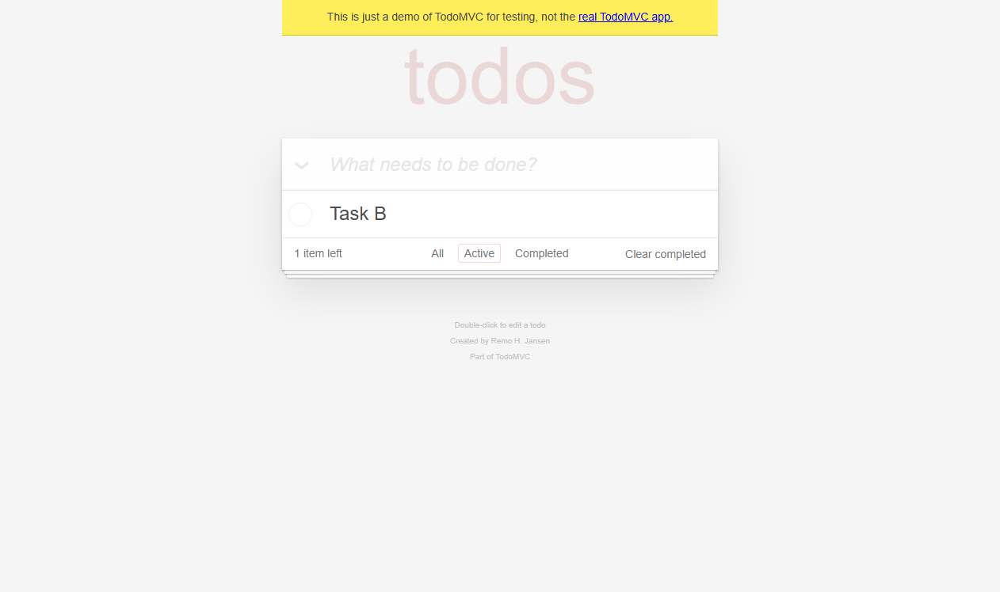
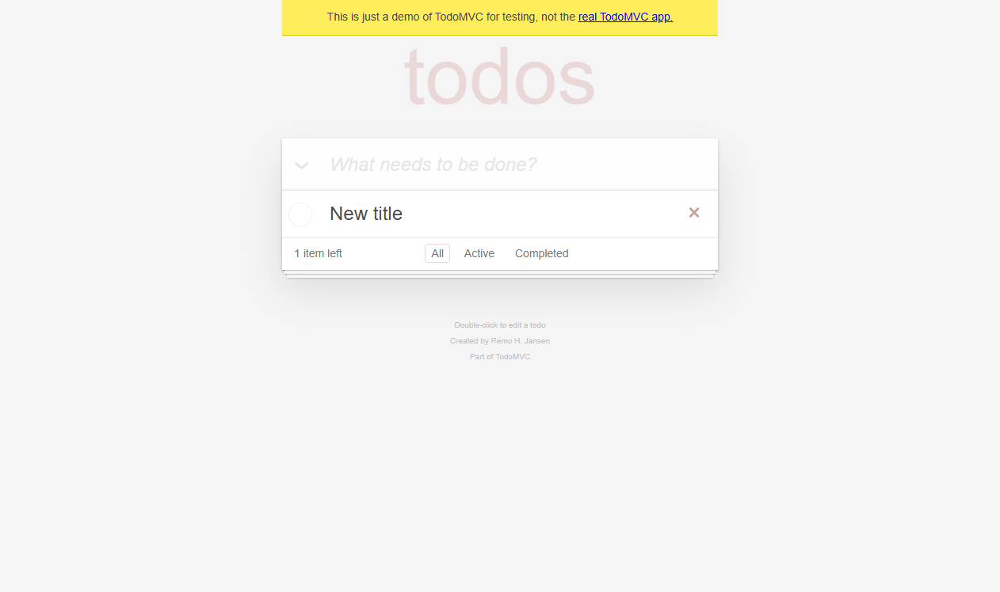
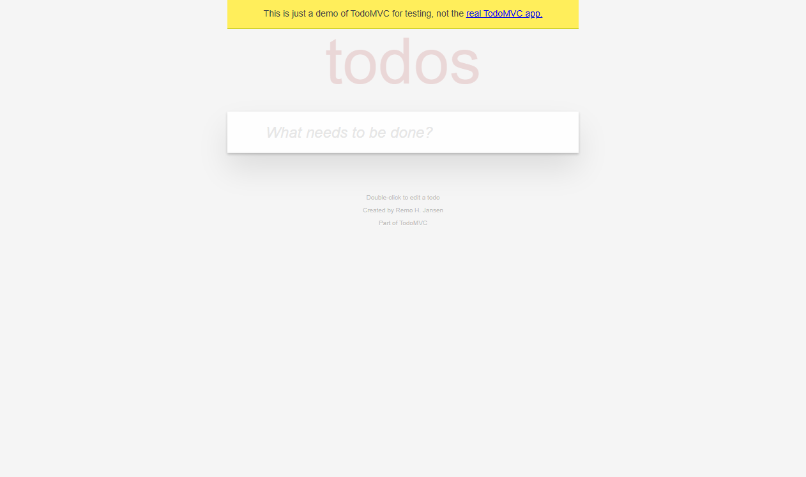
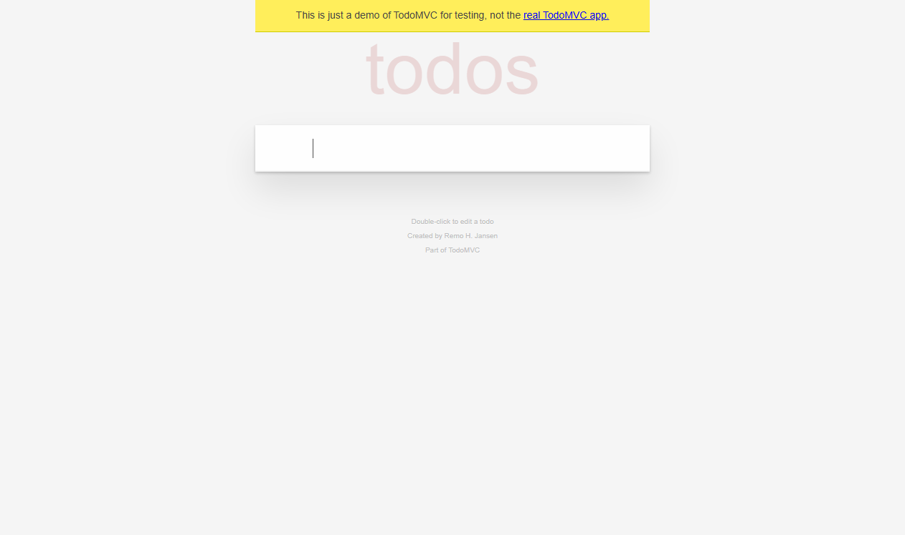
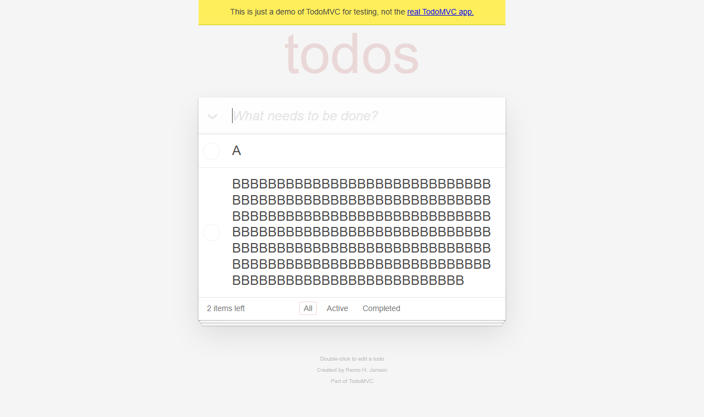
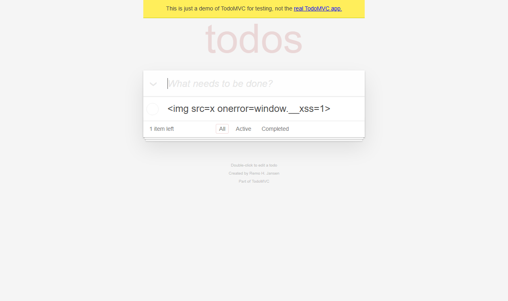
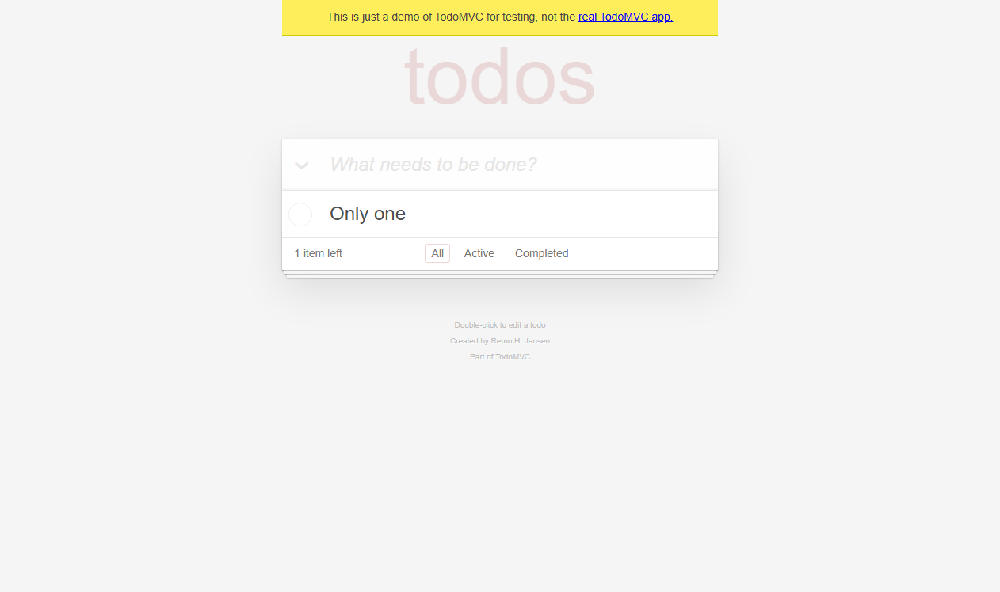

# 审计复跑：Selenium 全量回归

- 生成时间：2026-10-30T17:48:32+08:00
- 运行 ID：`RUN-AUDIT-20261030-02`
- 目标：https://demo.playwright.dev/todomvc
- 状态：**通过**
- 阶段：executed
- 执行窗口：2026-10-30T17:48:18+08:00 → 2026-10-30T17:48:29+08:00

## 1. 测试目标

验证 `https://demo.playwright.dev/todomvc` 的核心交互、输入边界、状态过滤与失败取证链路。本报告只陈述本机实际执行且能在证据清单中追溯的结果。

## 2. 测试环境

| 项目 | 值 |
|---|---|
| python | 3.13.9 |
| platform | Windows-11-10.0.26340-SP0 |
| pytest | pytest |
| target | https://demo.playwright.dev/todomvc |
| 证据清单 | `evidence/manifest.json` |

### 运行备注

- 2026-10-30T17:48:18+08:00：pytest started
- 2026-10-30T17:48:29+08:00：pytest exit=0; total=8; failed=False; xfailed=True
- 2026-10-30T17:48:29+08:00：pytest exit=0; tests=8; failures=0; errors=0; xfailed=1; elapsed=10.5s

## 3. 测试范围与策略

- 浏览器探索优先使用 DOM/无障碍快照，截图只用于视觉证据。
- 功能用例使用 Selenium + pytest + 显式等待，断言直接绑定可观察状态。
- 失败与受控预期失败自动保存视口/整页截图、页面源码和浏览器日志。
- 视觉差异只作为复核信号，不单独据此判定产品缺陷。

## 4. 测试用例与执行结果

计数口径：manifest 登记用例 8 条（通过 7、受控预期失败 1、失败 0）；其中 8 条由 JUnit 支撑（tests=8、passed=7、failed=0、xfailed=1），0 条为浏览器/视觉验收登记（无），不计入 pytest 通过率。

| 用例 ID | 标题 | 状态 | 证据数 | 日志 |
|---|---|---|---:|---|
| TC-TODO-001 | 新增一条待办 | 通过 | 3 | `evidence/logs/RUN-AUDIT-20261030-02/TC-TODO-001.log` |
| TC-TODO-002 | 完成待办并按状态过滤 | 通过 | 2 | `evidence/logs/RUN-AUDIT-20261030-02/TC-TODO-002.log` |
| TC-TODO-003 | 编辑待办标题 | 通过 | 1 | `evidence/logs/RUN-AUDIT-20261030-02/TC-TODO-003.log` |
| TC-TODO-004 | 删除待办 | 通过 | 2 | `evidence/logs/RUN-AUDIT-20261030-02/TC-TODO-004.log` |
| TC-TODO-005 | 空与纯空白输入被拒绝 | 通过 | 1 | `evidence/logs/RUN-AUDIT-20261030-02/TC-TODO-005.log` |
| TC-TODO-006 | 输入长度边界 | 通过 | 1 | `evidence/logs/RUN-AUDIT-20261030-02/TC-TODO-006.log` |
| TC-TODO-007 | HTML/脚本文本被转义 | 通过 | 1 | `evidence/logs/RUN-AUDIT-20261030-02/TC-TODO-007.log` |
| TC-TODO-099 | 受控失败断言 | 受控预期失败 | 4 | `evidence/logs/RUN-AUDIT-20261030-02/TC-TODO-099.log` |

## 5. 用例明细

### TC-TODO-001 新增一条待办

- 状态：**通过**
- 耗时：1651 ms
- 预期：True
- 实际：断言通过
- 执行日志：`evidence/logs/RUN-AUDIT-20261030-02/TC-TODO-001.log`

**步骤**
1. 打开 TodoMVC 演示页
2. 在新增输入框中输入 Buy milk 并回车

**断言**

| # | 断言 | 预期 | 实际 | 结果 |
|---:|---|---|---|---|
| 1 | 待办列表包含新增项 | ['Buy milk'] | ['Buy milk'] | 通过 |
| 2 | 剩余计数为 1 | 1 item left | 1 item left | 通过 |
| 3 | 底部状态栏可见 | True | True | 通过 |

**证据**

- [element-screenshot] 550x59 `evidence/raw/RUN-AUDIT-20261030-02/TC-TODO-001/TC-TODO-001__case__element__20261030T094821-351.png`  
  
- [fullpage-screenshot] 1262x748 `evidence/raw/RUN-AUDIT-20261030-02/TC-TODO-001/TC-TODO-001__case__fullpage__20261030T094821-450.png`  
  
- [screenshot] 1262x748 `evidence/raw/RUN-AUDIT-20261030-02/TC-TODO-001/TC-TODO-001__final__viewport__20261030T094821-526.png`  
  

### TC-TODO-002 完成待办并按状态过滤

- 状态：**通过**
- 耗时：765 ms
- 预期：['Task B']
- 实际：断言通过
- 执行日志：`evidence/logs/RUN-AUDIT-20261030-02/TC-TODO-002.log`

**步骤**
1. 新增 Task A 与 Task B
2. 勾选第一条待办
3. 切换到 Completed 过滤器
4. 切换到 Active 过滤器

**断言**

| # | 断言 | 预期 | 实际 | 结果 |
|---:|---|---|---|---|
| 1 | 完成后剩余计数为 1 | 1 item left | 1 item left | 通过 |
| 2 | Completed 仅显示已完成项 | ['Task A'] | ['Task A'] | 通过 |
| 3 | Active 仅显示未完成项 | ['Task B'] | ['Task B'] | 通过 |

**证据**

- [fullpage-screenshot] 1262x748 `evidence/raw/RUN-AUDIT-20261030-02/TC-TODO-002/TC-TODO-002__Active__fullpage__20261030T094822-312.png`  
  
- [screenshot] 1262x748 `evidence/raw/RUN-AUDIT-20261030-02/TC-TODO-002/TC-TODO-002__final__viewport__20261030T094822-393.png`  
  

### TC-TODO-003 编辑待办标题

- 状态：**通过**
- 耗时：704 ms
- 预期：['New title']
- 实际：断言通过
- 执行日志：`evidence/logs/RUN-AUDIT-20261030-02/TC-TODO-003.log`

**步骤**
1. 新增 Old title
2. 双击标题并改为 New title

**断言**

| # | 断言 | 预期 | 实际 | 结果 |
|---:|---|---|---|---|
| 1 | 标题被更新 | ['New title'] | ['New title'] | 通过 |

**证据**

- [screenshot] 1262x748 `evidence/raw/RUN-AUDIT-20261030-02/TC-TODO-003/TC-TODO-003__final__viewport__20261030T094823-181.png`  
  

### TC-TODO-004 删除待办

- 状态：**通过**
- 耗时：736 ms
- 预期：False
- 实际：断言通过
- 执行日志：`evidence/logs/RUN-AUDIT-20261030-02/TC-TODO-004.log`

**步骤**
1. 新增 Delete me
2. 悬停并点击删除按钮

**断言**

| # | 断言 | 预期 | 实际 | 结果 |
|---:|---|---|---|---|
| 1 | 列表被清空 | [] | [] | 通过 |
| 2 | 无待办时底部状态栏隐藏 | False | False | 通过 |

**证据**

- [fullpage-screenshot] 1262x748 `evidence/raw/RUN-AUDIT-20261030-02/TC-TODO-004/TC-TODO-004__case__fullpage__20261030T094823-950.png`  
  
- [screenshot] 1262x748 `evidence/raw/RUN-AUDIT-20261030-02/TC-TODO-004/TC-TODO-004__final__viewport__20261030T094824-029.png`  
  

### TC-TODO-005 空与纯空白输入被拒绝

- 状态：**通过**
- 耗时：402 ms
- 预期：[]
- 实际：断言通过
- 执行日志：`evidence/logs/RUN-AUDIT-20261030-02/TC-TODO-005.log`

**步骤**
1. 直接回车，不输入内容
2. 输入三个空格并回车

**断言**

| # | 断言 | 预期 | 实际 | 结果 |
|---:|---|---|---|---|
| 1 | 空输入不新增待办 | [] | [] | 通过 |
| 2 | 纯空白输入不新增待办 | [] | [] | 通过 |

**证据**

- [screenshot] 1262x748 `evidence/raw/RUN-AUDIT-20261030-02/TC-TODO-005/TC-TODO-005__final__viewport__20261030T094824-528.png`  
  

### TC-TODO-006 输入长度边界

- 状态：**通过**
- 耗时：527 ms
- 预期：['A', 'BBBBBBBBBBBBBBBBBBBBBBBBBBBBBBBBBBBBBBBBBBBBBBBBBBBBBBBBBBBBBBBBBBBBBBBBBBBBBBBBBBBBBBBBBBBBBBBBBBBBBBBBBBBBBBBBBBBBBBBBBBBBBBBBBBBBBBBBBBBBBBBBBBBBBBBBBBBBBBBBBBBBBBBBBBBBBBBBBBBBBBBBBBBBBBBBBBBBBBBB']
- 实际：断言通过
- 执行日志：`evidence/logs/RUN-AUDIT-20261030-02/TC-TODO-006.log`

**步骤**
1. 输入 1 个字符 A
2. 再输入 200 个字符

**断言**

| # | 断言 | 预期 | 实际 | 结果 |
|---:|---|---|---|---|
| 1 | 1 字符边界被接受 | ['A'] | ['A'] | 通过 |
| 2 | 200 字符输入被完整保存 | ['A', 'BBBBBBBBBBBBBBBBBBBBBBBBBBBBBBBBBBBBBBBBBBBBBBBBBBBBBBBBBBBBBBBBBBBBBBBBBBBBBBBBBBBBBBBBBBBBBBBBBBBBBBBBBBBBBBBBBBBBBBBBBBBBBBBBBBBBBBBBBBBBBBBBBBBBBBBBBBBBBBBBBBBBBBBBBBBBBBBBBBBBBBBBBBBBBBBBBBBBBBBB'] | ['A', 'BBBBBBBBBBBBBBBBBBBBBBBBBBBBBBBBBBBBBBBBBBBBBBBBBBBBBBBBBBBBBBBBBBBBBBBBBBBBBBBBBBBBBBBBBBBBBBBBBBBBBBBBBBBBBBBBBBBBBBBBBBBBBBBBBBBBBBBBBBBBBBBBBBBBBBBBBBBBBBBBBBBBBBBBBBBBBBBBBBBBBBBBBBBBBBBBBBBBBBBB'] | 通过 |

**证据**

- [screenshot] 1262x748 `evidence/raw/RUN-AUDIT-20261030-02/TC-TODO-006/TC-TODO-006__final__viewport__20261030T094825-153.png`  
  

### TC-TODO-007 HTML/脚本文本被转义

- 状态：**通过**
- 耗时：346 ms
- 预期：None
- 实际：断言通过
- 执行日志：`evidence/logs/RUN-AUDIT-20261030-02/TC-TODO-007.log`

**步骤**
1. 输入包含 HTML 事件属性的文本

**断言**

| # | 断言 | 预期 | 实际 | 结果 |
|---:|---|---|---|---|
| 1 | HTML 文本按纯文本展示 | [''] | [''] | 通过 |
| 2 | 未执行注入脚本 | None | None | 通过 |

**证据**

- [screenshot] 1262x748 `evidence/raw/RUN-AUDIT-20261030-02/TC-TODO-007/TC-TODO-007__final__viewport__20261030T094825-612.png`  
  

### TC-TODO-099 受控失败断言

- 状态：**受控预期失败**
- 耗时：793 ms
- 预期：2 items left
- 实际：tests\test_todomvc_expected_failure.py:22: in test_expected_failure_captures_evidence
    case_ctx.check(page.count_text().startswith("2"), "受控失败断言", "2 items left", page.count_text())
tests\conftest.py:309: in check
    raise AssertionError(f"{name}: expected={expected!r} actual={actual!r}")
E   AssertionError: 受控失败断言: expected='2 items left' actual='1 item left'
- 执行日志：`evidence/logs/RUN-AUDIT-20261030-02/TC-TODO-099.log`

**步骤**
1. 新增 Only one
2. 故意断言剩余计数为 2（实际为 1）

**断言**

| # | 断言 | 预期 | 实际 | 结果 |
|---:|---|---|---|---|
| 1 | 受控失败断言 | 2 items left | 1 item left | 失败 |

**证据**

- [screenshot] 1262x748 `evidence/raw/RUN-AUDIT-20261030-02/TC-TODO-099/TC-TODO-099__failure__viewport__20261030T094826-504.png`  
  
- [fullpage-screenshot] 1262x748 `evidence/raw/RUN-AUDIT-20261030-02/TC-TODO-099/TC-TODO-099__failure__fullpage__20261030T094826-504.png`  
  
- [page-source] `evidence/raw/RUN-AUDIT-20261030-02/TC-TODO-099/TC-TODO-099__failure__page-source__20261030T094826-504.html`  
- [log] `evidence/logs/RUN-AUDIT-20261030-02/TC-TODO-099__browser__20261030T094826-504.log`  

## 6. 缺陷与异常

未登记产品缺陷。若存在 `xfailed` 用例，它仅用于验证失败取证链路，不等同于产品缺陷。

## 7. 视觉差异证据

本轮未生成差异图；有效截图证据见第 5 节。

## 8. 证据完整性

- 已登记证据：15；校验通过：15
- 缺失文件：0；哈希不一致：0

## 9. 执行日志

- JUnit：`<PROJECT_ROOT>\reports\executions\RUN-AUDIT-20261030-02\junit.xml`
- 控制台日志：`<PROJECT_ROOT>\evidence\logs\RUN-AUDIT-20261030-02\pytest-console.log`
- 统计：tests=8 failures=0 errors=0 xfailed=1

## 10. 结论与限制

本轮执行的功能用例全部通过；受控预期失败用例已按预期被捕获并保留证据。

- 未覆盖（设计完成但本轮未执行，不计入通过率）：TC-TODO-008 刷新后持久化；TC-TODO-009 全部完成/取消全部；TC-TODO-010 清除已完成；TC-TODO-012 键盘可访问性。
- 部分覆盖（仅覆盖部分判定条件）：TC-TODO-011 计数单复数。
- 本报告不把像素差异直接等同于产品缺陷。
- 未执行的场景不会在本报告中标记为通过。
- 比赛前需确认当届赛项对 AI 辅助工具的合规要求。

## 附录：测试用例设计

见 `reports/test-cases/todomvc-test-cases.md`。

