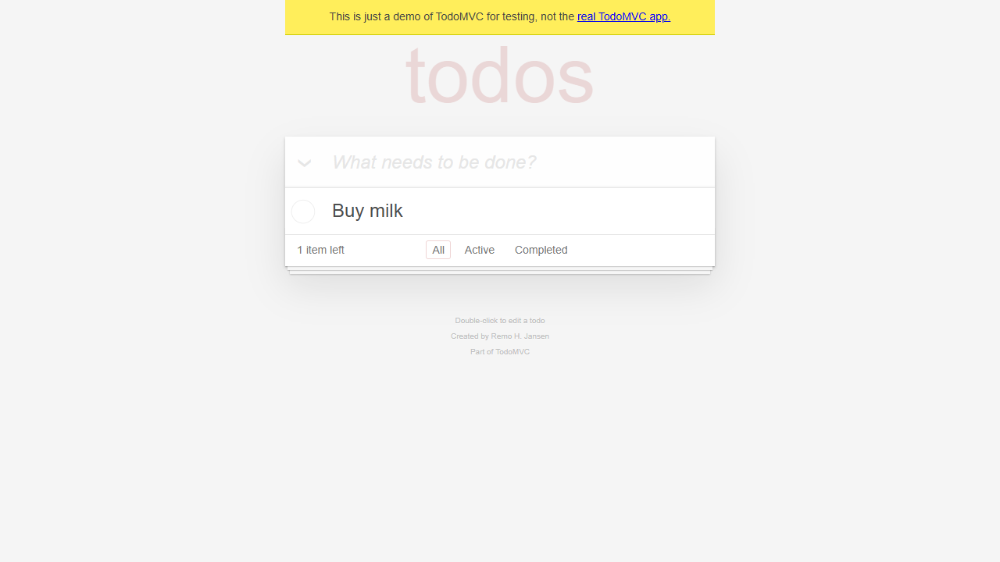
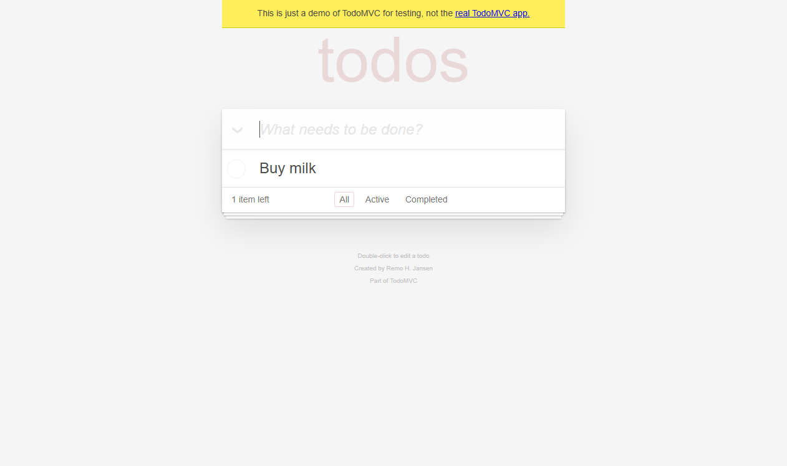

# 完整命令链演练报告

- 生成时间：2026-10-29T18:29:36+08:00
- 运行 ID：`RUN-CMDCHECK-03`
- 目标：https://demo.playwright.dev/todomvc
- 状态：**通过**
- 阶段：done
- 执行窗口：2026-10-29T18:26:50+08:00 → 2026-10-29T18:27:54+08:00

## 1. 测试目标

验证 `https://demo.playwright.dev/todomvc` 的核心交互、输入边界、状态过滤与失败取证链路。本报告只陈述本机实际执行且能在证据清单中追溯的结果。

## 2. 测试环境

| 项目 | 值 |
|---|---|
| python | 3.13.9 |
| platform | Windows-11-10.0.26340-SP0 |
| pytest | pytest |
| target | https://demo.playwright.dev/todomvc |
| 证据清单 | `evidence/manifest.json` |

### 运行备注

- 2026-10-29T18:26:54+08:00：开始用例设计
- 2026-10-29T18:27:30+08:00：用例 9 条（TC-TODO-001..009），探索验证 input.new-todo/.todo-list li/span.todo-count/footer.footer；控制台仅 favicon 404
- 2026-10-29T18:27:33+08:00：pytest started
- 2026-10-29T18:27:39+08:00：pytest exit=0; total=1; failed=False; xfailed=False
- 2026-10-29T18:27:39+08:00：pytest exit=0; tests=1; failures=0; errors=0; xfailed=0; elapsed=5.46s
- 2026-10-29T18:27:47+08:00：Selenium smoke: test_add_todo 通过 (1 passed, 0 failed)
- 2026-10-29T18:27:54+08:00：报告已生成；视觉检查：5 张截图均非空（stddev>9），无差异对比需求（单状态 smoke）

## 3. 测试范围与策略

- 浏览器探索优先使用 DOM/无障碍快照，截图只用于视觉证据。
- 功能用例使用 Selenium + pytest + 显式等待，断言直接绑定可观察状态。
- 失败与受控预期失败自动保存视口/整页截图、页面源码和浏览器日志。
- 视觉差异只作为复核信号，不单独据此判定产品缺陷。

## 4. 测试用例与执行结果

计数口径：manifest 登记用例 1 条（通过 1、受控预期失败 0、失败 0）；其中 1 条由 JUnit 支撑（tests=1、passed=1、failed=0、xfailed=0），0 条为浏览器/视觉验收登记（无），不计入 pytest 通过率。

| 用例 ID | 标题 | 状态 | 证据数 | 日志 |
|---|---|---|---:|---|
| TC-TODO-001 | 新增待办 | 通过 | 7 | `evidence/logs/RUN-CMDCHECK-03/TC-TODO-001.log` |

## 5. 用例明细

### TC-TODO-001 新增待办

- 状态：**通过**
- 耗时：1842 ms
- 预期：True
- 实际：断言通过
- 执行日志：`evidence/logs/RUN-CMDCHECK-03/TC-TODO-001.log`

**步骤**
1. 打开 TodoMVC 演示页
2. 在新增输入框中输入 Buy milk 并回车

**断言**

| # | 断言 | 预期 | 实际 | 结果 |
|---:|---|---|---|---|
| 1 | 待办列表包含新增项 | ['Buy milk'] | ['Buy milk'] | 通过 |
| 2 | 剩余计数为 1 | 1 item left | 1 item left | 通过 |
| 3 | 底部状态栏可见 | True | True | 通过 |

**证据**

- [element-screenshot] 550x59 `evidence/raw/RUN-CMDCHECK-03/TC-TODO-001/TC-TODO-001__exploration__element__20261029T102720Z.png`  
  
- [screenshot] 1280x720 `evidence/raw/RUN-CMDCHECK-03/TC-TODO-001/TC-TODO-001__exploration__viewport__20261029T102721Z.png`  
  
- [snapshot] `evidence/raw/RUN-CMDCHECK-03/TC-TODO-001/TC-TODO-001__exploration__snapshot__20261029T102714Z.yml`  
- [log] `evidence/logs/RUN-CMDCHECK-03/TC-TODO-001__browser__20261029T102654Z.log`  
- [element-screenshot] 550x59 `evidence/raw/RUN-CMDCHECK-03/TC-TODO-001/TC-TODO-001__case__element__20261029T102736-653.png`  
  
- [fullpage-screenshot] 1262x748 `evidence/raw/RUN-CMDCHECK-03/TC-TODO-001/TC-TODO-001__case__fullpage__20261029T102736-759.png`  
  
- [screenshot] 1262x748 `evidence/raw/RUN-CMDCHECK-03/TC-TODO-001/TC-TODO-001__final__viewport__20261029T102736-822.png`  
  

## 6. 缺陷与异常

未登记产品缺陷。若存在 `xfailed` 用例，它仅用于验证失败取证链路，不等同于产品缺陷。

## 7. 视觉差异证据

本轮未生成差异图；有效截图证据见第 5 节。

## 8. 证据完整性

- 已登记证据：7；校验通过：7
- 缺失文件：0；哈希不一致：0

## 9. 执行日志

- JUnit：`<PROJECT_ROOT>\reports\executions\RUN-CMDCHECK-03\junit.xml`
- 控制台日志：`<PROJECT_ROOT>\evidence\logs\RUN-CMDCHECK-03\pytest-console.log`
- 统计：tests=1 failures=0 errors=0 xfailed=0

## 10. 结论与限制

本轮执行的功能用例全部通过；本轮无受控预期失败用例。

- 未覆盖（设计完成但本轮未执行，不计入通过率）：TC-TODO-002 完成状态与过滤器；TC-TODO-003 编辑标题；TC-TODO-004 删除待办；TC-TODO-005 空与空白输入被拒绝；TC-TODO-006 长度边界；TC-TODO-007 HTML 文本转义；TC-TODO-008 全选与清除完成项；TC-TODO-009 刷新持久化。
- 本报告不把像素差异直接等同于产品缺陷。
- 未执行的场景不会在本报告中标记为通过。
- 比赛前需确认当届赛项对 AI 辅助工具的合规要求。

## 附录：测试用例设计

见 `reports/test-cases/TodoMVC-CMDCHECK3-test-cases.md`。

