# 工具调用自检报告

- 生成时间：2026-10-29T18:29:36+08:00
- 运行 ID：`RUN-TOOLCHECK-01`
- 目标：https://demo.playwright.dev/todomvc
- 状态：**通过**
- 阶段：toolcheck-complete
- 执行窗口：2026-10-29T17:51:54+08:00 → 2026-10-29T17:56:33+08:00

## 1. 测试目标

验证 `https://demo.playwright.dev/todomvc` 的核心交互、输入边界、状态过滤与失败取证链路。本报告只陈述本机实际执行且能在证据清单中追溯的结果。

## 2. 测试环境

| 项目 | 值 |
|---|---|
| python | 3.13.9 |
| platform | Windows-11-10.0.26340-SP0 |
| pytest | pytest |
| target | https://demo.playwright.dev/todomvc |
| 证据清单 | `evidence/manifest.json` |

### 运行备注

- 2026-10-29T17:55:07+08:00：pytest started
- 2026-10-29T17:55:14+08:00：pytest exit=0; total=1; failed=False; xfailed=False
- 2026-10-29T17:55:14+08:00：pytest exit=0; tests=1; failures=0; errors=0; xfailed=0; elapsed=7.53s
- 2026-10-29T17:56:33+08:00：工具自检完成：Playwright CLI、Playwright MCP、Selenium、图像工具、证据 CLI、OpenCode 当前会话工具均实际调用成功；未发现产品缺陷。MCP 控制台有 1 个资源加载错误，仅记录，不作为缺陷。
- 2026-10-29T17:57:27+08:00：本运行目的是工具调用自检，不是完整功能覆盖；报告中的 TodoMVC 覆盖缺口来自用例设计文档，不代表工具调用失败。question 工具会打断用户，未主动调用；其余当前会话工具均已实测。

## 3. 测试范围与策略

- 浏览器探索优先使用 DOM/无障碍快照，截图只用于视觉证据。
- 功能用例使用 Selenium + pytest + 显式等待，断言直接绑定可观察状态。
- 失败与受控预期失败自动保存视口/整页截图、页面源码和浏览器日志。
- 视觉差异只作为复核信号，不单独据此判定产品缺陷。

## 4. 测试用例与执行结果

计数口径：manifest 登记用例 6 条（通过 6、受控预期失败 0、失败 0）；其中 1 条由 JUnit 支撑（tests=1、passed=1、failed=0、xfailed=0），5 条为浏览器/视觉验收登记（TC-TOOL-BROWSER-001, TC-TOOL-EVIDENCE-001, TC-TOOL-IMAGE-001, TC-TOOL-MCP-001, TC-TOOL-OPENCODE-001），不计入 pytest 通过率。

| 用例 ID | 标题 | 状态 | 证据数 | 日志 |
|---|---|---|---:|---|
| TC-TODO-001 | 新增一条待办 | 通过 | 3 | `evidence/logs/RUN-TOOLCHECK-01/TC-TODO-001.log` |
| TC-TOOL-BROWSER-001 | Playwright CLI 全链路工具自检 | 通过 | 10 | `evidence/logs/RUN-TOOLCHECK-01/TC-TOOL-BROWSER-001.log` |
| TC-TOOL-EVIDENCE-001 | 证据管理器 CLI 自检 | 通过 | 1 | `evidence/logs/RUN-TOOLCHECK-01/evidence-add-defect.log` |
| TC-TOOL-IMAGE-001 | 图像 inspect/差异/裁剪/标注工具自检 | 通过 | 18 | `evidence/logs/RUN-TOOLCHECK-01/TC-TOOL-IMAGE-001.log` |
| TC-TOOL-MCP-001 | Playwright MCP 扩展工具自检 | 通过 | 3 | `evidence/logs/RUN-TOOLCHECK-01/TC-TOOL-MCP-001.log` |
| TC-TOOL-OPENCODE-001 | OpenCode 当前会话工具自检 | 通过 | 1 | `evidence/logs/RUN-TOOLCHECK-01/TC-TOOL-OPENCODE-001.log` |

## 5. 用例明细

### TC-TODO-001 新增一条待办

- 状态：**通过**
- 耗时：3877 ms
- 预期：True
- 实际：断言通过
- 执行日志：`evidence/logs/RUN-TOOLCHECK-01/TC-TODO-001.log`

**步骤**
1. 打开 TodoMVC 演示页
2. 在新增输入框中输入 Buy milk 并回车

**断言**

| # | 断言 | 预期 | 实际 | 结果 |
|---:|---|---|---|---|
| 1 | 待办列表包含新增项 | ['Buy milk'] | ['Buy milk'] | 通过 |
| 2 | 剩余计数为 1 | 1 item left | 1 item left | 通过 |
| 3 | 底部状态栏可见 | True | True | 通过 |

**证据**

- [element-screenshot] 550x59 `evidence/raw/RUN-TOOLCHECK-01/TC-TODO-001/TC-TODO-001__case__element__20261029T095511-879.png`  
  
- [fullpage-screenshot] 1262x748 `evidence/raw/RUN-TOOLCHECK-01/TC-TODO-001/TC-TODO-001__case__fullpage__20261029T095511-974.png`  
  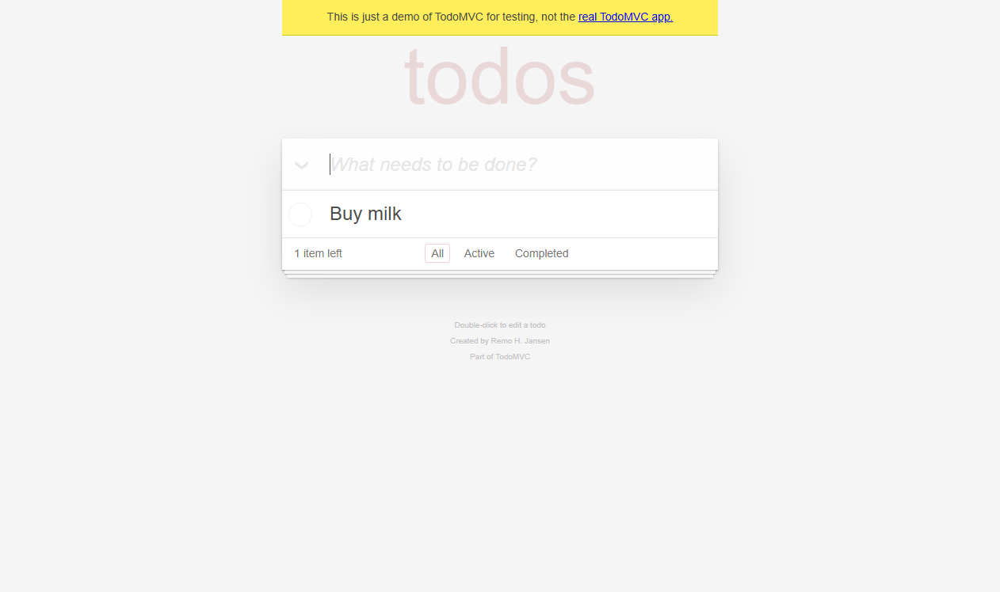
- [screenshot] 1262x748 `evidence/raw/RUN-TOOLCHECK-01/TC-TODO-001/TC-TODO-001__final__viewport__20261029T095512-047.png`  
  

### TC-TOOL-BROWSER-001 Playwright CLI 全链路工具自检

- 状态：**通过**
- 预期：打开 TodoMVC；快照、输入、勾选、悬停、求值、缩放、视口/整页/元素截图、控制台/网络、状态保存、标签页切换均成功。
- 实际：全部成功；items=1 checked=1 count='0 items left'；截图 1280x720/1024x768/550x59 均可读取。
- 执行日志：`evidence/logs/RUN-TOOLCHECK-01/TC-TOOL-BROWSER-001.log`

**步骤**
1. playwright-cli 打开 TodoMVC 并保存快照
2. 输入 Tool check item 并回车
3. 点击 input.toggle 完成待办
4. 悬停待办项并执行 eval 读取计数
5. 缩放到 1024x768，保存视口/整页/元素截图
6. 读取控制台、网络请求、localStorage，保存 storageState
7. 新建 example.com 标签页、切换、关闭
8. 关闭浏览器会话

**证据**

- [snapshot] `evidence/raw/RUN-TOOLCHECK-01/browser/snapshot-before.yml`  
- [snapshot] `evidence/raw/RUN-TOOLCHECK-01/browser/snapshot-after.yml`  
- [screenshot] 1280x720 `evidence/raw/RUN-TOOLCHECK-01/browser/before-viewport.png`  
  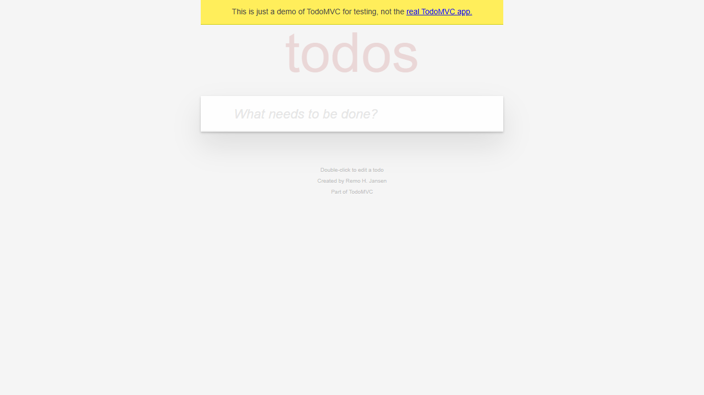
- [screenshot] 1024x768 `evidence/raw/RUN-TOOLCHECK-01/browser/after-viewport.png`  
  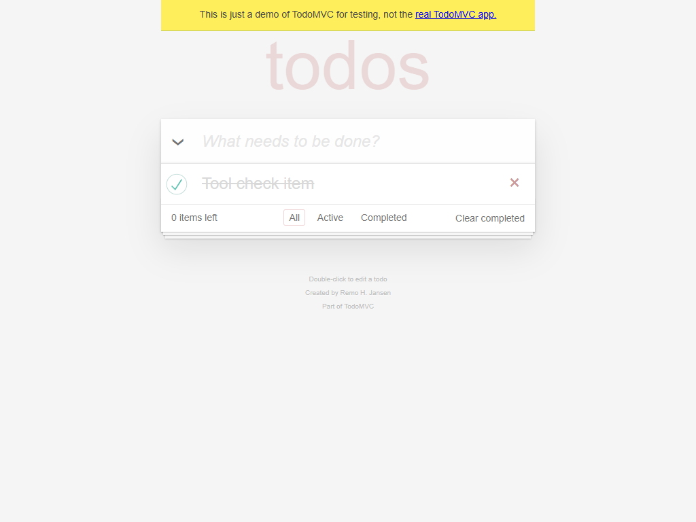
- [fullpage-screenshot] 1024x768 `evidence/raw/RUN-TOOLCHECK-01/browser/after-fullpage.png`  
  
- [element-screenshot] 550x59 `evidence/raw/RUN-TOOLCHECK-01/browser/after-element.png`  
  
- [log] `evidence/logs/RUN-TOOLCHECK-01/browser-console.log`  
- [log] `evidence/logs/RUN-TOOLCHECK-01/browser-requests.log`  
- [log] `evidence/logs/RUN-TOOLCHECK-01/localstorage.log`  
- [log] `evidence/logs/RUN-TOOLCHECK-01/state.json`  

### TC-TOOL-EVIDENCE-001 证据管理器 CLI 自检

- 状态：**通过**
- 预期：start-run/update-case/add-defect/summary/register/verify/index 均可执行；临时虚拟缺陷在验证后清理。
- 实际：add-defect 在临时运行中生成 1 条虚拟缺陷并统计为 defect_count=1；随后删除临时运行；正式运行未登记产品缺陷。
- 执行日志：`evidence/logs/RUN-TOOLCHECK-01/evidence-add-defect.log`

**步骤**
1. 创建临时运行 RUN-TOOLCHECK-DEFECT
2. 更新虚拟用例并调用 add-defect
3. summary 显示 defect_count=1
4. 删除临时运行，保留自检日志

**证据**

- [log] `evidence/logs/RUN-TOOLCHECK-01/evidence-add-defect.log`  

### TC-TOOL-IMAGE-001 图像 inspect/差异/裁剪/标注工具自检

- 状态：**通过**
- 预期：inspect 读取尺寸；相同图差异为 0；受控差异返回区域；裁剪和中文标注成功；原始图不变。
- 实际：相同图 0 像素/no-change；前后图 7981/921600（0.866%）、6 区域、PSNR 31.0085；裁剪 550x48、标注图生成。
- 执行日志：`evidence/logs/RUN-TOOLCHECK-01/TC-TOOL-IMAGE-001.log`

**步骤**
1. inspect diff-before.png / diff-after.png
2. compare 相同图 -> no-change
3. compare 前后图 -> visual-change-detected
4. crop 新增待办区域
5. annotate 中文标签

**证据**

- [screenshot] 1280x720 `evidence/raw/RUN-TOOLCHECK-01/browser/diff-before.png`  
  
- [screenshot] 1280x720 `evidence/raw/RUN-TOOLCHECK-01/browser/diff-after.png`  
  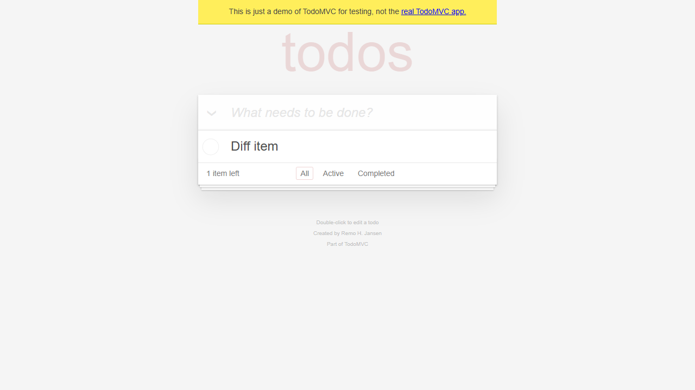
- [annotation] 1280x720 `evidence/diff/RUN-TOOLCHECK-01/identical/annotated.png`  
  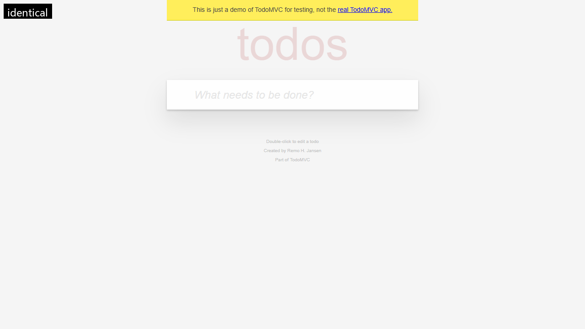
- [comparison] 2560x720 `evidence/diff/RUN-TOOLCHECK-01/identical/comparison.png`  
  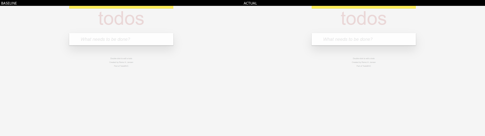
- [heatmap] 1280x720 `evidence/diff/RUN-TOOLCHECK-01/identical/heatmap.png`  
  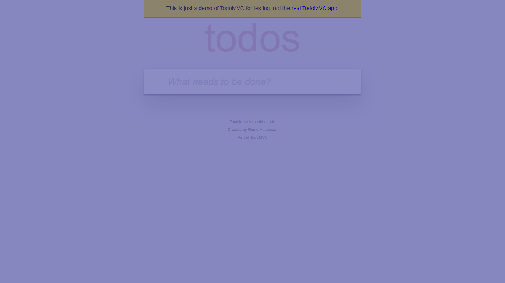
- [diff] 1280x720 `evidence/diff/RUN-TOOLCHECK-01/identical/diff.png`  
  
- [mask] 1280x720 `evidence/diff/RUN-TOOLCHECK-01/identical/mask.png`  
- [metrics] `evidence/diff/RUN-TOOLCHECK-01/identical/metrics.json`  
- [regions] `evidence/diff/RUN-TOOLCHECK-01/identical/regions.json`  
- [annotation] 1280x720 `evidence/diff/RUN-TOOLCHECK-01/changed/annotated.png`  
  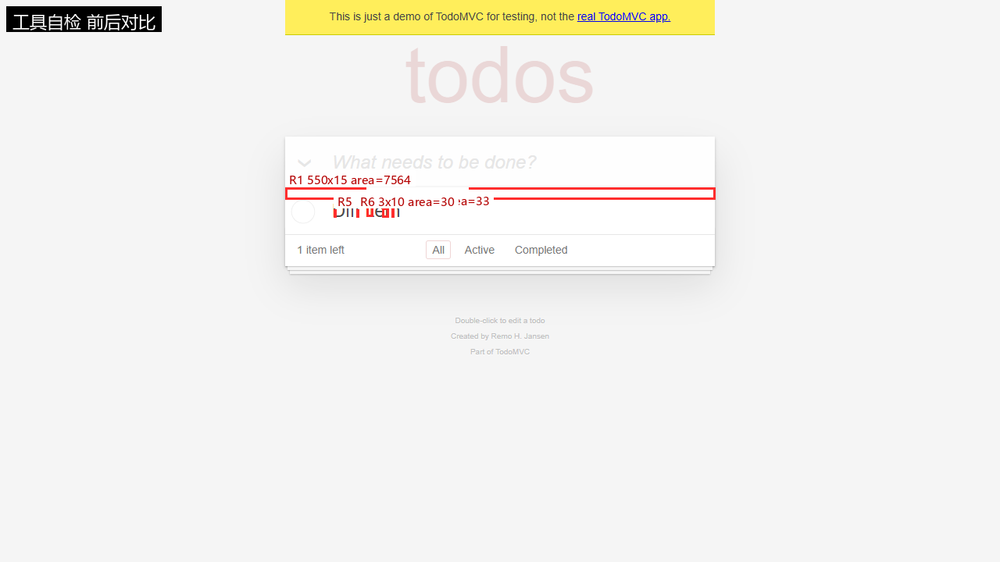
- [comparison] 2560x720 `evidence/diff/RUN-TOOLCHECK-01/changed/comparison.png`  
  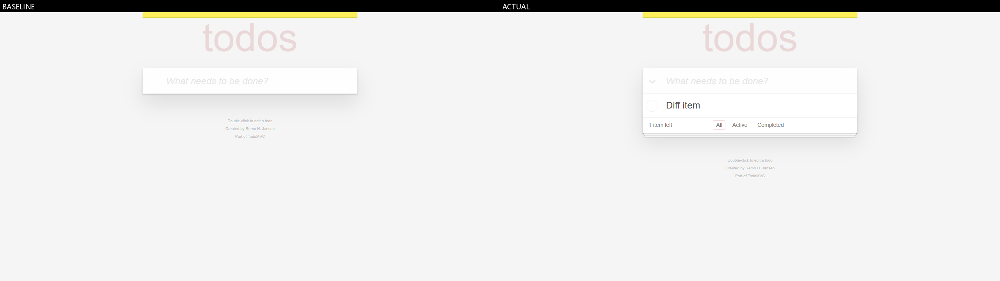
- [heatmap] 1280x720 `evidence/diff/RUN-TOOLCHECK-01/changed/heatmap.png`  
  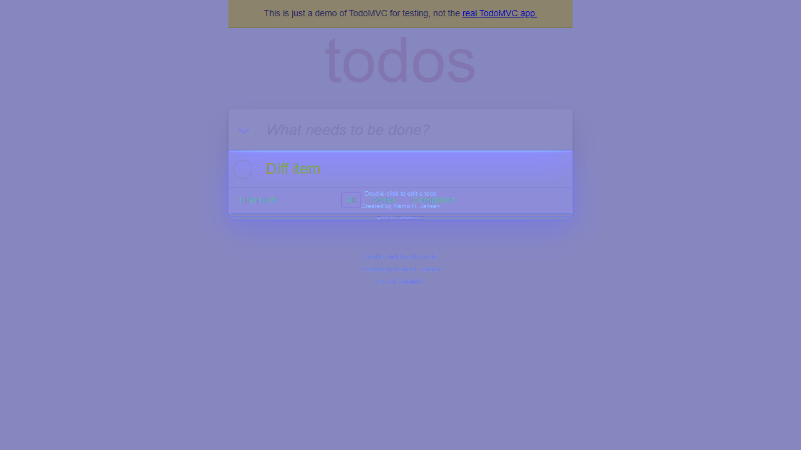
- [diff] 1280x720 `evidence/diff/RUN-TOOLCHECK-01/changed/diff.png`  
  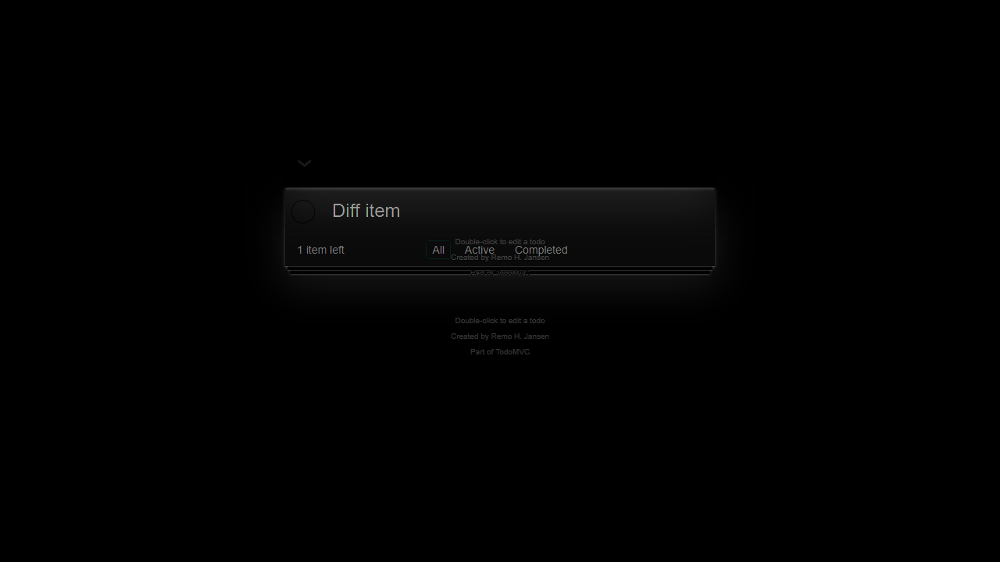
- [mask] 1280x720 `evidence/diff/RUN-TOOLCHECK-01/changed/mask.png`  
- [metrics] `evidence/diff/RUN-TOOLCHECK-01/changed/metrics.json`  
- [regions] `evidence/diff/RUN-TOOLCHECK-01/changed/regions.json`  
- [crop] 550x48 `evidence/annotated/RUN-TOOLCHECK-01/image/new-item-crop.png`  
  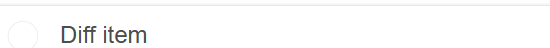
- [annotation] 1280x720 `evidence/annotated/RUN-TOOLCHECK-01/image/new-item-annotated.png`  
  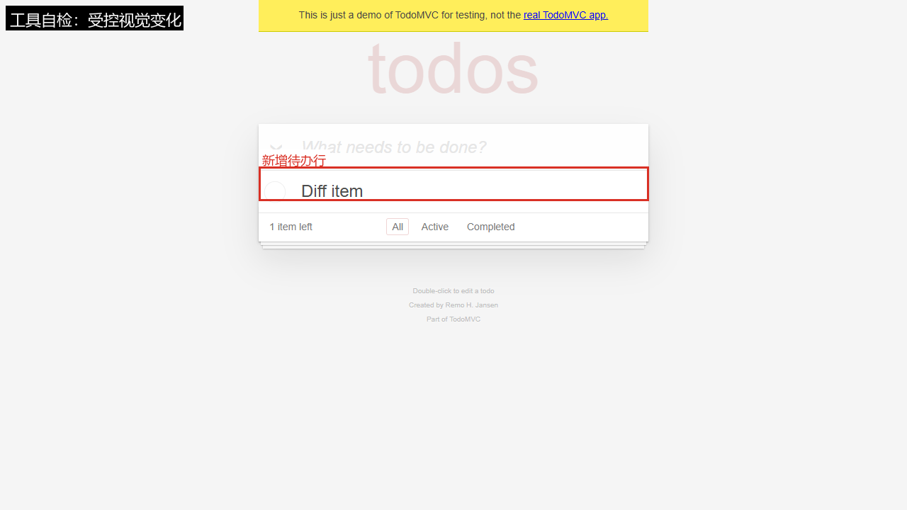

### TC-TOOL-MCP-001 Playwright MCP 扩展工具自检

- 状态：**通过**
- 预期：MCP 服务可初始化；navigate/type/wait/find/snapshot/click/evaluate/resize/console/network/tabs/screenshot/close 全部成功。
- 实际：25 个工具；14 个调用步骤全部成功；evaluate 返回 items=1 checked=1 count='0 items left'；截图 1024x768 有效。
- 执行日志：`evidence/logs/RUN-TOOLCHECK-01/TC-TOOL-MCP-001.log`

**步骤**
1. 启动 Playwright MCP（headless chrome, isolated）
2. initialize + tools/list
3. navigate TodoMVC
4. type + wait_for + find + snapshot
5. click toggle + evaluate 状态
6. resize + console + network + tabs
7. fullPage screenshot + close

**证据**

- [screenshot] 1024x768 `evidence/raw/RUN-TOOLCHECK-01/mcp/mcp-fullpage.png`  
  
- [snapshot] `evidence/raw/RUN-TOOLCHECK-01/mcp/mcp-snapshot.yml`  
- [log] `evidence/raw/RUN-TOOLCHECK-01/mcp/mcp-toolcheck.json`  

### TC-TOOL-OPENCODE-001 OpenCode 当前会话工具自检

- 状态：**通过**
- 预期：skill/task/glob/grep/webfetch/read image 可用；命令文件可枚举；图片可读取。
- 实际：skill visual-testing 加载成功；task explore 返回 6 skills/5 commands；glob 找到命令文件；grep 找到 READY 标记；webfetch 返回 Example Domain；read image 成功显示截图。
- 执行日志：`evidence/logs/RUN-TOOLCHECK-01/TC-TOOL-OPENCODE-001.log`

**步骤**
1. 加载 visual-testing Skill
2. glob 枚举 docs 与 .opencode/commands
3. grep 搜索 READY 标记
4. webfetch https://example.com
5. task explore 统计 skills/commands/evidence
6. read 读取 MCP 截图

**证据**

- [log] `evidence/logs/RUN-TOOLCHECK-01/TC-TOOL-OPENCODE-001.log`  

## 6. 缺陷与异常

未登记产品缺陷。若存在 `xfailed` 用例，它仅用于验证失败取证链路，不等同于产品缺陷。

## 7. 视觉差异证据

### 工具自检 前后对比

- 基准图：`evidence\raw\RUN-TOOLCHECK-01\browser\diff-before.png`
- 实际图：`evidence\raw\RUN-TOOLCHECK-01\browser\diff-after.png`
- 判定：`visual-change-detected（受控变化，待人工复核，不构成缺陷结论）`，差异像素 7981 / 921600（0.00866）
- 差异区域数：6；PSNR：31.0085
- 指标文件：`evidence/diff/RUN-TOOLCHECK-01/changed/metrics.json`
- 说明：Pixel changes are review signals. Confirm with DOM, expected behavior, and reproducible steps before filing a defect.

| 区域 | x | y | w | h | 面积 | 平均差 |
|---|---:|---:|---:|---:|---:|---:|
| R1 | 365 | 240 | 550 | 15 | 7564 | 32.803 |
| R2 | 469 | 262 | 8 | 15 | 60 | 101.35 |
| R3 | 489 | 266 | 8 | 12 | 56 | 103.429 |
| R4 | 501 | 267 | 3 | 11 | 33 | 113.606 |
| R5 | 427 | 268 | 3 | 10 | 30 | 119.567 |
| R6 | 456 | 268 | 3 | 10 | 30 | 98.167 |

### identical

- 基准图：`evidence\raw\RUN-TOOLCHECK-01\browser\diff-before.png`
- 实际图：`evidence\raw\RUN-TOOLCHECK-01\browser\diff-before.png`
- 判定：`no-change（受控变化，待人工复核，不构成缺陷结论）`，差异像素 0 / 921600（0.0）
- 差异区域数：0；PSNR：None
- 指标文件：`evidence/diff/RUN-TOOLCHECK-01/identical/metrics.json`
- 说明：Pixel changes are review signals. Confirm with DOM, expected behavior, and reproducible steps before filing a defect.

## 8. 证据完整性

- 已登记证据：36；校验通过：36
- 缺失文件：0；哈希不一致：0

## 9. 执行日志

- JUnit：`<PROJECT_ROOT>\reports\executions\RUN-TOOLCHECK-01\junit.xml`
- 控制台日志：`<PROJECT_ROOT>\evidence\logs\RUN-TOOLCHECK-01\pytest-console.log`
- 统计：tests=1 failures=0 errors=0 xfailed=0

## 10. 结论与限制

本轮执行的功能用例全部通过；本轮无受控预期失败用例。

- 未覆盖（设计完成但本轮未执行，不计入通过率）：TC-TODO-008 刷新后持久化；TC-TODO-009 全部完成/取消全部；TC-TODO-010 清除已完成；TC-TODO-012 键盘可访问性。
- 部分覆盖（仅覆盖部分判定条件）：TC-TODO-011 计数单复数。
- 本报告不把像素差异直接等同于产品缺陷。
- 未执行的场景不会在本报告中标记为通过。
- 比赛前需确认当届赛项对 AI 辅助工具的合规要求。

## 附录：测试用例设计

见 `reports/test-cases/todomvc-test-cases.md`。

